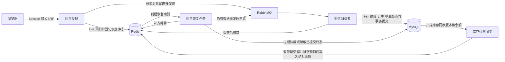

# 票务交易平台

前台展示品牌为「票遇」，品牌标语为「好演出，在票遇」。项目技术名、仓库名与 Java 根包继续使用 `ticketing` / `com.ticketing`。

`ticketing` 是一个单实例票务交易平台。Java 21 / Spring Boot 3 后端使用单个 Maven 模块，Vue 3 / TypeScript 前端独立构建。MySQL 8 保存订单、库存和购票终态，Redis 提供目录缓存和库存预扣，RabbitMQ 传递异步建单命令。支付与退款为模拟流程。

购票受理、消费者和后台任务都运行在同一个 Spring Boot 应用中。代码按技术层组织，库存、订单、候补和出票保留业务边界，通过 MySQL 本地事务协作。交易细节见[架构与模块协作](01-architecture.md)和[库存预扣与购票结果说明](33-stock-reservation-notes.md)。

## 业务功能

用户可以查询活动、场次和实时票档，注册登录、提交异步购票、按原幂等键恢复结果，模拟支付并查看电子票。订单支持主动取消和数据库截止后的自动过期。候补按同SKU内部FIFO分配，库存不足时不跳过有效队首。

登录页支持通过已验证邮箱找回密码。个人中心的「账号与安全」可修改密码、查看登录会话并退出其他会话。密码更新成功后，原有会话失效。

管理员可以管理活动、场次、票档和工作人员授权，查看订单与审计，办理整单模拟退款和取消场次善后。工作人员需使用有效账号，在授权场次和有效时间核销。每张票券最多成功核销一次。模拟退款保留原支付事实，异常关联进入人工待办。

同一场次可批量创建独立票档草稿。用户选定票档后，购票与候补共用一次场次额度查询。使用方式见[多票档管理与库存隔离](43-multi-sku-management.md)。

## 关键取舍

- 普通购票先做账号鉴权、CSRF 和用户安全限流，再由 `PurchaseAdmission` 用 Redis Lua 原子预扣。预扣成功后直接尝试发布持久购票消息，发送阶段跳过 Publisher Confirm 等待。HTTP 202 表示 Redis 已受理，购票申请的 MySQL 写入发生在消费或过期仲裁阶段。
- 消费和过期仲裁通过 `purchase_request` 的唯一键与行锁协调。同一事务写入库存、场次限购额度、订单与申请成功终态，提交后由 Redis Lua 结算。电子票在模拟支付成功的事务内签发。
- Redis 使用 AOF `appendfsync always` 和 `noeviction`。购票恢复按 Redis 索引重发原申请、仲裁过期或补齐结算。已初始化的 SKU 缺失库存账本或出现无法核对的凭据时，停止该票档的新受理并等待核对。
- 取消、订单过期、退款和库存配置变更与 `inventory_sync_version` 递增同事务。后台发现差异后暂停该 SKU 新受理，待预扣排空再发布 MySQL 的绝对可售余额。候补由后台扫描队首，复用同一套预扣和建单链路。
- 新建票档默认 `SINGLE`。普通购票支持已配置的 4、8、16、32 桶票档。新候补仅开放给 `SINGLE`，同一 SKU 按 FIFO 调度。
- 登录使用 Session、CSRF、BCrypt 和数据库最新账号状态。票券使用随机票号和版本化 HMAC 签名，仅保存完整凭证摘要。
- 单实例中断时受理和消费会暂停。重启后按 Redis 预扣记录、MySQL 已提交结果和候补记录恢复。

## 演示和复现

先按[本地开发](05-local-development.md)准备独立环境，或按[单实例运维](32-single-instance-operations.md)区分空库初始化与有数据升级。不要对既有库直接运行迁移或测试。

演示顺序为：管理员建活动/场次/票档并发布；普通用户登录购票、刷新找回订单、模拟支付和展示票券；管理员授权工作人员完成一次核销；另一未用票订单模拟退款；售罄场次候补，在持有订单取消后完成分配和支付。最后查看管理审计和库存/额度对账。

普通验证为`mvn -f backend/pom.xml clean verify`及前端`npm ci`、`npm run build`。真实集成只使用独立功能验收资源及随机guard，入口见[功能验证](40-functional-verification.md)。浏览器E2E使用真实Edge、生产dist及真实中间件，入口为`frontend/playwright.config.mjs`。
