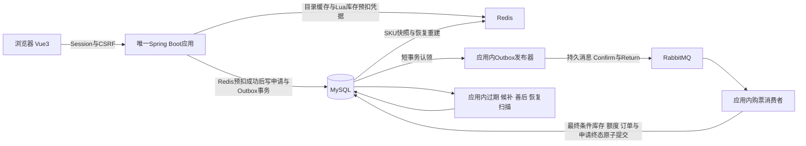

# 票务交易平台

前台展示品牌为「票遇」，品牌标语为「好演出，在票遇」。项目技术名、仓库名与 Java 根包继续使用 `ticketing` / `com.ticketing`。

`ticketing`是一个可本地演示、审计和恢复的单实例票务交易平台。Java21 / Spring Boot3后端仅一个Maven模块，Vue3 / TypeScript前端独立构建，MySQL8保存权威交易事实，Redis提供公开目录缓存和真实库存预扣，RabbitMQ传递可靠异步命令。它不接入真实资金、实名或选座。

图中的发布器、消费者和扫描器都是同一JVM的组件。按业务包保留模块边界，使库存、订单、候补与出票可以在本地事务中协作。当前规模使用模块化单体足以表达这些约束，微服务会增加跨进程一致性和运维成本，未引入。

## 可演示的业务

用户可以查询活动、场次和实时票档，注册登录、提交异步购票、按原幂等键恢复结果，模拟支付并查看电子票。订单支持主动取消和数据库截止后的自动过期。候补按同SKU内部FIFO分配，库存不足时不跳过有效队首。

管理员可以管理活动、场次、票档、工作人员场次授权，查看订单与审计，办理整单模拟退款和取消场次善后。工作人员只能在授权场次和有效时间核销；已核销、撤权或停用后拒绝重复使用。模拟退款保留原支付事实，异常关联进入人工待办。

## 关键取舍

- 普通POST购票返回202只证明Redis预扣及MySQL申请、Outbox已经受理，不代表订单成功。唯一token由可信用户、固定CREATE_ORDER操作域、原幂等键和请求摘要计算；库存Lua原子预扣并登记无TTL活动凭据及恢复索引；结算终态Hash保留7天，长期幂等由MySQL保证。Rabbit消费者在提交MySQL库存、限购、订单、电子票和申请终态后消费token；MySQL条件更新仍是最终防超卖约束。
- Redis库存、预扣凭据和有界待处理计数使用AOF `appendfsync always`，Compose设为`noeviction`。MySQL活动申请可重建token，计数丢失时从活动申请和有界Redis索引恢复；关系无法证明时SKU保持冻结，购票失败关闭。Redis、MySQL和Rabbit之间不宣称强一致事务。
- 取消、过期、退款、库存配置变更和申请失败通过同事务库存Outbox触发SKU冻结仲裁。协调先扣除仍有效的普通购票预扣，再按MySQL候补队首严格FIFO分配，最后从数据库快照重建Redis余额。达到单轮上限后由既有周期补偿任务继续。
- MySQL条件更新、固定锁序、唯一键与幂等事实约束超卖和重复副作用。Rabbit是至少一次投递，依靠数据库幂等；内存队列和扫描游标不是可靠状态。
- 新票档和新预占统一`SINGLE`，新分桶切换入口已停用；`BUCKETED`只保留历史订单履约、售后和余额读取。独立用户安全限流仍在购票业务前生效；旧的全局/票档Lua限速器不再接入购票路径，库存Lua承担真实预扣职责。
- Session、CSRF、BCrypt及数据库最新账号状态保持统一身份链。票券使用随机票号和版本化HMAC签名，只保存完整凭证摘要；密钥由环境提供，二维码不进入URL、日志或浏览器持久存储。
- 一个后端实例意味着进程或主机故障会暂停服务。Outbox租约和数据库扫描支持重启恢复，不构成服务高可用。

## 演示和复现

先按[本地开发](05-local-development.md)准备独立环境，或按[单实例运维](32-single-instance-operations.md)区分空库初始化与有数据升级。不要对既有库直接运行迁移或测试。

演示顺序为：管理员建活动/场次/票档并发布；普通用户登录购票、刷新找回订单、模拟支付和展示票券；管理员授权工作人员完成一次核销；另一未用票订单模拟退款；售罄场次候补，在持有订单取消后完成分配和支付。最后查看管理审计和库存/额度对账。

普通验证为`mvn -f backend/pom.xml clean verify`及前端`npm ci`、`npm run build`。真实集成只使用独立功能验收资源及随机guard，入口见[功能验证](40-functional-verification.md)。浏览器E2E使用真实Edge、生产dist及真实中间件，入口为`frontend/playwright.config.mjs`。

本机同JAR反序双轮，每场10秒业务预热、60秒稳态，按客户端终态观察完成时刻计算：
