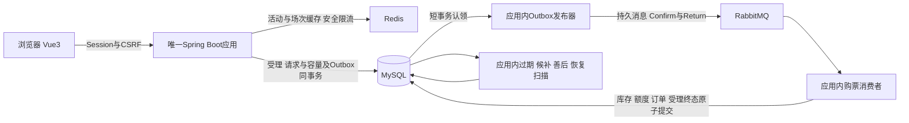

# 票务交易平台

`ticketing`是一个可本地演示、审计和恢复的单实例票务交易平台。Java21 / Spring Boot3后端仅一个Maven模块，Vue3 / TypeScript前端独立构建，MySQL8保存权威交易事实，Redis负责缓存与安全限流，RabbitMQ传递可靠异步命令。它不接入真实资金、实名或选座。

图中的发布器、消费者和扫描器都是同一JVM的组件。按业务包保留模块边界，使库存、订单、候补与出票可以在本地事务中协作。当前规模使用模块化单体足以表达这些约束，微服务会增加跨进程一致性和运维成本，未引入。

## 可演示的业务

用户可以查询活动、场次和实时票档，注册登录、提交异步购票、按原幂等键恢复结果，模拟支付并查看电子票。订单支持主动取消和数据库截止后的自动过期。候补按同SKU内部FIFO分配，库存不足时不跳过有效队首。

管理员可以管理活动、场次、票档、工作人员场次授权，查看订单与审计，办理整单模拟退款和取消场次善后。工作人员只能在授权场次和有效时间核销；已核销、撤权或停用后拒绝重复使用。模拟退款保留原支付事实，异常关联进入人工待办。

## 关键取舍

- 普通POST购票返回202只证明可靠受理；正式订单由消费者创建。请求、Outbox和持久容量同事务，最终库存、额度、订单与受理终态也在同一交易事务提交。
- MySQL条件更新、固定锁序、唯一键与幂等事实约束超卖和重复副作用。Rabbit是至少一次投递，依靠数据库幂等；内存队列和扫描游标不是可靠状态。
- 默认`SINGLE`库存。第17阶段的隔离实验显示桶化内核较快、端到端更慢，因此`BUCKETED`保留为显式离线切换能力。额外全局/票档Lua准入默认关闭，既有安全限流仍开启；没有稳定收益就不改变默认配置。
- Session、CSRF、BCrypt及数据库最新账号状态保持统一身份链。票券使用随机票号和版本化HMAC签名，只保存完整凭证摘要；密钥由环境提供，二维码不进入URL、日志或浏览器持久存储。
- 一个后端实例意味着进程或主机故障会暂停服务。Outbox租约和数据库扫描支持重启恢复，不构成服务高可用。

## 演示和复现

先按[本地开发](05-local-development.md)准备独立环境，或按[单实例运维](32-single-instance-operations.md)区分空库初始化与有数据升级。不要对既有库直接运行迁移或测试。

演示顺序为：管理员建活动/场次/票档并发布；普通用户登录购票、刷新找回订单、模拟支付和展示票券；管理员授权工作人员完成一次核销；另一未用票订单模拟退款；售罄场次候补，在持有订单取消后完成分配和支付。最后查看管理审计和库存/额度对账。

普通验证为`mvn -f backend/pom.xml clean verify`及前端`npm ci`、`npm run build`。真实集成与负载只使用固定`ticketing-perf`及随机guard，执行方式见[最终验收](31-final-acceptance-and-delivery.md)。浏览器E2E使用真实Edge、生产dist及真实中间件，入口为`frontend/playwright.config.mjs`。

本机同JAR反序双轮，每场10秒业务预热、60秒稳态，按客户端终态观察完成时刻计算：

| 场景 | 成功订单TPS | 成功端到端P95 | 成功端到端P99 |
| --- | ---: | ---: | ---: |
| 充足库存热点100VU/100独立账号 | 12.68～12.77 | 15.25～15.79秒 | 18.01～18.60秒 |
| 混合购票支付25VU/25独立账号 | 15.05～15.62 | 1.91～2.03秒 | 2.41～2.52秒 |

这些是i5-13400F单实例、固定perf环境的结果。安全限流开启但使用放宽阈值的regression模式，额外Lua准入关闭。200VU阶梯出现9次TCP连接拒绝，整轮未通过，P95升至29.09秒；不能把加并发当作提吞吐。250名买家暂停消费的突发得到200受理/50明确容量拒绝，重启后全部建单和容量恢复。

受理TPS、HTTP RPS、成功/失败分布、长时结果和完整限制见[阶段19验收](31-final-acceptance-and-delivery.md)，不作为生产SLA。历史阶段原始样本继续保留。原开发库已在本次明确授权窗口升级V10并对账，未进行生产上线。

25独立买家1800秒稳态平均成功建单13.74 TPS，P95/P99为2.405/2.675秒，审计零偏差。不过前后约5分钟服务端采样速率由14.34降至10.65次/秒，交易均时上升；未确认数据增长或宿主资源变化的唯一原因，不能把全程平均值当成恒定容量。
