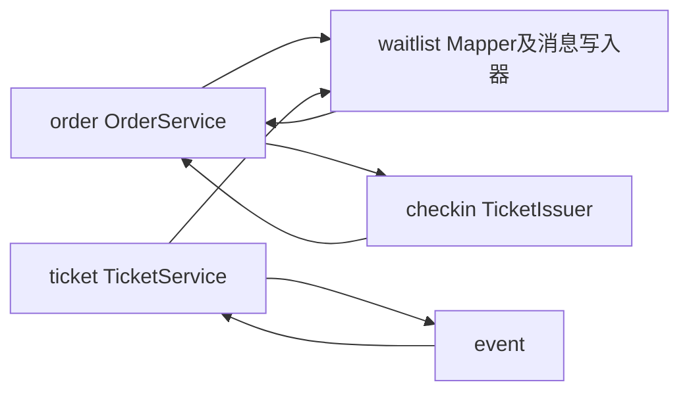
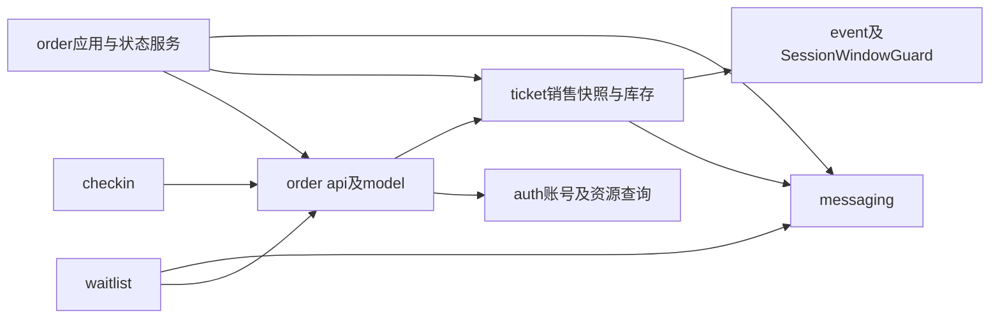

# 架构与模块协作

项目保持Java21、Spring Boot3、MyBatis-Plus、MySQL、RabbitMQ和Spring Security Session的前后端分离模块化单体，后端只有backend/pom.xml一个Maven模块，根包com.ticketing。Vue3、TypeScript、Pinia和Element Plus继续调用原/api/v1接口，不增加微服务或新的业务模块。

## 第九阶段之前的依赖

基准2c7b086中的箭头表示源码依赖。OrderService同时做资源锁定、预占、支付、关闭、候补联动与出票；候补和核销反向调用其内部锁上下文。SessionService直接查询票档Mapper，因此活动与票档也双向依赖。

## 当前依赖与协作边界

以下为重构后的主要编译依赖；常规common/api、DTO及配置依赖省略。源码守卫检查业务包无环，并禁止候补、核销访问订单service、mapper或entity。

OrderLifecycle是唯一的订单终态同步协作接口，定义小型不可变Transition，不是事件总线。WaitlistOrderLifecycle与TicketIssuer实现该接口，订单模块只注入有序参与者，不引用候补或电子票实现。运行时先完成候补联动，再出票；两者与订单、流水和库存共用同一个MySQL事务。任何异常直接传播并回滚，不使用提交后的异步事件替代这些原子变化。

SessionWindowGuard归活动模块定义，TicketService在场次UPDATE锁内校验已有票档窗口。SessionService不再访问TicketSkuMapper；该协作仅校验，不反向锁用户或活动。普通管理场次和票档仍保留其不同的父级锁模式，不把管理流程强行塞进订单服务。

## 主要职责

| 组件 | 当前职责 |
| --- | --- |
| OrderService | HTTP业务应用入口与READ_COMMITTED事务边界，订单本人查询和响应组装 |
| TradeResourceLocker | 用户、活动、场次、SKU及已有订单的固定锁协议，账号有效性及工作人员角色事实 |
| OrderReservation | 普通下单与候补共用预占、价格快照、用户场次限额、请求哈希和幂等查找；只向候补返回订单ID |
| OrderStateService | PENDING到PAID/CANCELLED/EXPIRED、数据库截止条件、流水和库存变化、同步参与者与释放事件编排 |
| TicketInventory | 票档权威库存条件更新，预占、释放和locked转sold；写入口要求已有事务 |
| TicketSale、TradeContext | 锁内不可变销售及账号事实，不跨请求缓存，不向候补暴露可写订单或库存实体 |
| WaitlistService | 候补申请、本人查询和取消、单个FIFO队首的独立分配事务 |
| WaitlistOrderLifecycle | 订单锁之后核对候补用户、SKU、数量、幂等域及键，原子联动COMPLETED/EXPIRED |
| TicketIssuer | 支付末端和历史补票共用的按明细序号幂等出票；两个事务入口调用同一个私有算法 |
| ElectronicTicketService | 本人凭证及展示、核销和受控补票编排；只通过订单公开锁API协作 |
| messaging | Outbox实体、Mapper、库存事件读写、认领、确认、重试及发布调度 |
| waitlist.messaging | 候补特有RabbitMQ拓扑、消费者和分配触发 |

库存SQL从OrderMapper归回TicketSkuMapper，由TicketInventory使用。候补不再查询OrderMapper，也不依赖OrderService的内部record；核销不再重复实现订单加锁或为角色额外查询一次用户。销售状态计算集中于TicketSale，TicketService与预占/候补使用同一规则。删除重复的SaleContext/PurchaseContext、候补对预留订单的重复回读和限额校验中的冗余场次存在性查询；保留分配和最终预占各自必须重新检查的销售条件。

## 事务与锁顺序

用户主动操作要求ACTIVE；超时释放和历史补票只要求取得用户行锁，禁用账号也必须回收历史锁定库存。核销最前面的用户行属于工作人员，随后沿持票订单的活动、场次、SKU、订单、票券顺序处理，在该工作人员行锁中取得最新ADMIN角色。持有子资源锁后不得再获取其他用户或父级锁。

OrderService写入口、WaitlistService分配/申请/取消和ElectronicTicketService核销/补票在代理入口开启READ_COMMITTED。TradeResourceLocker、OrderReservation写协作、TicketInventory和OrderLifecycle参与者使用MANDATORY加入现有事务；读限额允许独立只读事务。没有自调用开启独立事务或REQUIRES_NEW分割原子提交。支付、取消和超时共享OrderStateService的锁定流程，只有PENDING可进入三个终态，SQL继续做状态及截止时间条件更新。

同一用户的所有场次写操作仍被用户行串行化，用户锁内SUM统计PENDING/PAID明细保护默认每场4张限额。WAITING不占额，候补分配时重新检查。CREATE_ORDER及WAITLIST_CONFIRM域保持原值，同参重放原订单、异参409；数据库唯一键最终兜底。金额是服务端整数分精确乘算及不可变明细快照，不接收客户端金额或身份。

同SKU入队和分配继续共享SKU锁，锁内生成候补ID；分配先非锁定发现队首用户，再按上述顺序加锁并重新确认队首。队首数量不足就停止，每次释放全部锁后才处理下一用户。FIFO只承诺同SKU候补内部，普通新购票仍可竞争库存。

## Outbox兼容性

InventoryEvents与库存释放、管理员增加库存同事务写入。InventoryEvent集中旧类型WAITLIST_DISPATCH_REQUESTED、TICKET_SKU聚合与inventory.available路由，载荷仍为eventId/skuId/reason，SKU以字符串传输。交换机ticketing.waitlist、队列ticketing.waitlist.dispatch及其.dead不变。保留ticketing.waitlist.*配置键，避免组件移包导致部署参数失效。

OutboxService继续在短事务中FOR UPDATE SKIP LOCKED认领，租约和递增retry_count令牌防旧任务覆盖。发布器在事务外发送持久消息，Publisher Confirm且无mandatory退回后才标SENT；健康批量默认100、故障后停止本轮、指数退避及最大重试均保留。消费者只通过InventoryEvents核对已提交事件，每单分配提交后才确认。重复消息依靠数据库FIFO、状态条件及唯一订单键幂等，有界重试后进入死信；低频数据库补偿不依赖MQ在线。语义仍为至少一次加数据库幂等。

## 状态、配置与前端

订单、支付、候补、电子票、Outbox状态及订单操作域使用各业务枚举，库存事件类型/路由集中定义。数据库状态值和HTTP字符串契约不变，SQL中的状态条件仍明确表达既有数据库值，不引入枚举ordinal或新状态机框架。

OrderProperties、WaitlistProperties、OutboxProperties、CheckinProperties绑定相关非敏感配置并在启动校验边界。保留原环境变量、属性名、默认限额4/支付15分钟/发布批量100。签名密钥继续由TicketCredentialSigner严格解析私有环境变量，不放进可能打印toString的配置record，没有固定密钥或降级校验。

AdminActivitiesView只保留活动列表与活动维护，场次及票档入口归AdminSessionManager；关闭/切换场次时失效旧加载请求。ElectronicTicketsView负责列表，TicketCredential独立负责凭证请求与本地二维码，并在隐藏、刷新、切换或卸载时清理、丢弃过期异步结果。AdminCheckinView只展示结果，CheckinScanner负责摄像头、图片、手工输入和核销请求，卸载时停止媒体轨道并清空凭证。PurchasePanel与OrdersView已有明确购票/订单页面职责和OrderCard，不为增加层数额外拆分。

Session、CSRF、中文页面、北京时间、人民币分和BIGINT字符串规则保持。认证使用BCrypt与真实HttpSession，登录更换会话ID、退出失效；CurrentAccountFilter只在受保护端点复查最新账号状态和角色，公开查询不增加账号查询。完整票券凭证不进URL、Store、浏览器存储或日志，签名与摘要常量时间校验，最多一次核销不改变库存。

## 参考源码及取舍

本轮实际读取并固定以下源码版本，借鉴边界和事务职责，不复制业务代码或引入其基础设施：

- [Spring Modulith模块依赖建模](https://github.com/spring-projects/spring-modulith/blob/1fe549999aaa2401b675eba4a562ae374f4f96ba/spring-modulith-core/src/main/java/org/springframework/modulith/core/ApplicationModule.java)用于思考公开边界和依赖验证。[ApplicationModuleListener](https://github.com/spring-projects/spring-modulith/blob/1fe549999aaa2401b675eba4a562ae374f4f96ba/spring-modulith-events/spring-modulith-events-api/src/main/java/org/springframework/modulith/events/ApplicationModuleListener.java)实际包含异步、提交后及新事务语义，不能用于本项目必须原子完成的出票/候补联动，因此使用显式同步协作，不增加Modulith运行时。
- [12306订单状态枚举](https://github.com/nageoffer/12306/blob/daf3a2714c00ff263764d23ab10c2eaed2ae842d/services/order-service/src/main/java/org/opengoofy/index12306/biz/orderservice/common/enums/OrderStatusEnum.java)及[订单服务](https://github.com/nageoffer/12306/blob/daf3a2714c00ff263764d23ab10c2eaed2ae842d/services/order-service/src/main/java/org/opengoofy/index12306/biz/orderservice/service/impl/OrderServiceImpl.java)体现集中表达状态和交易入口；本项目继续使用原字符串状态和MySQL锁，不引入其微服务或Redisson方案。
- [mall订单服务](https://github.com/macrozheng/mall/blob/dcaa93b3150352e5044708d7211b5bed0af4509f/mall-portal/src/main/java/com/macro/mall/portal/service/impl/OmsPortalOrderServiceImpl.java)可对照确认下单、锁库存、取消释放等职责。本项目保持自己的条件SQL、事务和MySQL可靠关单，不移植延迟发送或其他商城规则。
- [RuoYi-Vue-Plus用户服务](https://github.com/dromara/RuoYi-Vue-Plus/blob/9227f626a3a37e1546d6c291ed398183e94df92b/ruoyi-modules/ruoyi-system/src/main/java/org/dromara/system/service/impl/SysUserServiceImpl.java)展示服务入口内显式维护关联及事务边界；本项目只采用必要的公开DTO/协作契约，不扩充权限框架、接口实现层或多模块结构。

第八阶段原始报告保留，热点SKU锁竞争及用户跨场次串行仍是当前协议代价。第九阶段的具体回归、迁移、性能对照与浏览器结果见[架构重构验收](16-architecture-verification.md)。本轮不开发真实支付、退款或其他新业务。
