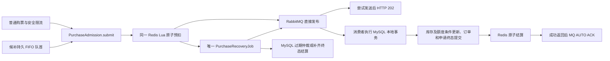

# 架构与模块协作

本文描述当前源码。V16 移除库存 Outbox/MQ 通知和普通购票发布确认等待；阶段验收文档保留为历史记录。已有库切换前须执行 [V16 切换检查](41-inventory-sync-migration.md)。

## 项目结构

Java 21、Spring Boot 3、MyBatis-Plus、MySQL、Redis、RabbitMQ、Spring Security Session，保持前后端分离的模块化单体。后端只有 `backend/pom.xml` 一个 Maven 模块和唯一 `TicketingApplication`，根包 `com.ticketing`。

技术包为 `controller`、`service`、`mapper`、`entity`、`dto`、`vo`、`config`、`enums`、`security`、`task`、`messaging`、`cache`、`exception`、`common`。请求/查询参数归 DTO，响应归 VO，定时任务归 task；不为目录形式新增空接口。`architecture-modules.properties` 登记逻辑业务归属，架构测试继续检查技术分层、归属完整、业务依赖无环与交易公开协作边界。

## 普通购票链路

HTTP `POST /api/v1/orders` 由 `PurchaseAdmission` 编排，只调用 Redis 和 RabbitMQ，没有购票申请 SQL、MySQL 受理事务或购票 Outbox。既有安全过滤器仍按数据库最新账号状态鉴权，并执行 CSRF 与独立请求限流。requestId 由服务端生成；Lua 首先检查用户、固定 CREATE_ORDER 域和幂等键，同参重放复用原 ID，异参冲突，不重复预扣。

Lua 一次完成销售资格、Redis 时间窗口、单笔数量、场次内用户未完成预扣数量、库存和排队容量检查，之后扣减库存，写 RESERVED 凭据与恢复 ZSET。入口预检只限制并发未完成申请；已建订单的精确场次限额仍由消费者在 MySQL 中校验，不宣称 Redis 是额度权威。

`PurchasePublisher` 使用持久消息和 durable 队列，不等待发布确认。Redis 预扣及凭据登记成功后，尝试发送；发送异常记录日志和计数，保留 RESERVED 并返回202，由恢复任务处理。202 表示申请已受理，不表示 Broker 已接收或订单已创建。RabbitMQ 连接超时为5秒；网络拥塞或 Broker 流控下同步发送仍可能阻塞，不能将202视为无条件即时返回。

## MySQL 消费与三道幂等

普通分桶购票支持4、8或16桶。首次路由使用`StockBucketRouter.route(requestId,bucketCount)`，以MurmurHash3的64位finalizer混合原申请ID，再掩码映射桶号。跨桶路径仍在整笔回滚后按桶号升序获取X锁；已提交订单只按不可变allocation履约。分桶新候补仍禁用。

2026-10-28 新增四桶普通购票，完整实现与隔离验收见[四桶库存实现](jmeter/four-bucket-implementation.md)。V10 表结构直接复用，未新增迁移或自动切换业务 SKU。BUCKETED=4 按原 requestId 选择初始桶；SKU 配置用 SHARE，目标桶条件 UPDATE 获得独立 X 锁，不更新主 SKU 交易计数。单桶不足先整笔回滚，再按桶号升序跨桶，订单、明细、不可变 allocation 和申请终态原子提交。SINGLE 仍使用原 SKU UPDATE 锁。分桶新候补暂不开放，历史订单与 SINGLE 候补继续按原生命周期处理。

库存同步以 SKU X 与普通分桶 SKU S 互斥，在 pause/pending 排空之后校验并汇总四桶，再发布绝对 Redis 可售余额。Redis 命令默认超时为 1s，连接超时为 500ms，允许环境变量覆盖；AOF always 不变。锁冲突的三次有界重试发生在完整事务之间，重试耗尽保留原申请与预扣，不转换为无票失败。

`PurchaseOrderWorker` 从 Redis 凭据读取可信业务参数，以 requestId 唯一键插入/锁定 `purchase_request`，与过期仲裁共享同一个数据库互斥协议。随后按原资源锁序调用 `TradeResourceLocker` 和 `OrderReservation`；MySQL 库存条件更新、场次额度、订单和价格明细快照、SUCCEEDED/orderId 在一个 READ_COMMITTED 本地事务提交。请求行 QUEUED 只是事务内协调占位，不独立提交为排队事实，没有 processing token、租约或第二条普通建单路径。

确定业务错误先使整个建单事务回滚，再重新锁同一 requestId 登记 FAILED/EXPIRED；若重复消费者或仲裁已经先提交，采用其原终态。数据库连接、死锁等技术故障不记为确定业务失败，交给有限延迟重试及统一补偿。消费返回后的 AUTO ACK 发生在 SQL 提交之后；Redis 结算暂时失败可先 ACK，由恢复索引补齐。重复消息不会再次占库存或创建订单。

1. Redis 入口：用户 + 服务端操作域 CREATE_ORDER / WAITLIST_CONFIRM + 幂等键，验证请求摘要并复用 requestId。
2. MySQL 消费：requestId 主键、用户/操作域/幂等键唯一约束、订单关联唯一约束和本地事务。
3. Redis 结算：RESERVED 只能一次转为 CONSUMED 或 RELEASED。成功不再次扣减，失败只返还一次；取消成功订单不重置购票凭据。

Redis key 使用 `ticketing:seckill:v2:<数据库命名空间>:`。未完成申请不设置 TTL；终态详情保留七天，较小的幂等摘要长期保留以继续复用 ID 和终态，详情到期后仍可从 MySQL 查询。历史 MySQL 终态在票档首次受控初始化时预装到 Redis，不通过 HTTP 同步查询历史申请。幂等摘要需要纳入 Redis 容量管理，不能未经协调随意删除。

## 唯一购票恢复入口

`PurchaseRecoveryJob` 小批量读取待恢复 ZSET，成员为 skuId:requestId，分数为下次检查时间。原子延期避免并发扫描重复领取，并按申请年龄增加检查间隔，最迟在截止时间再次仲裁；不增加恢复租约、分布式锁或线程池。

- 有 MySQL SUCCEEDED：补齐 CONSUMED；有 FAILED/EXPIRED：补齐 RELEASED。
- 无 MySQL 终态且仍有效：按原 requestId 直接重新发布 RabbitMQ。
- 已过期：先在 MySQL 以相同唯一键/行锁仲裁，再结算 Redis。迟到消费者必须读取原终态，不能同时成功建单和过期返票。
- Redis 凭据、库存账本或容量计数丢失：暂停对应 SKU，保留明确异常并等待核对；不从 MySQL 剩余库存猜测重建未完成预扣。

Redis 继续使用 AOF、`appendfsync always` 和 `noeviction`。Redis、RabbitMQ、MySQL 之间没有强分布式事务，不承诺绝对零丢失；Redis 持久化数据永久丢失、外部误删、长时间基础设施故障可能需要人工核对。死信仅保存失败投递，不作为自动返票依据。

## 库存同步与候补

`StockSnapshotService` 收敛为父资源→SKU 行锁内的小型维护，不再保存 owner/fence/mutation、多层冻结租约、孤儿恢复或自动重建框架。`ticket_sku.redis_inventory_initialized` 区分从未初始化和已初始化后 Redis 账本丢失；后者停止受理，不能静默重置。

库存释放、退款、销售资格或候补状态变化与 `inventory_sync_version` 递增同事务；普通建单成功不递增版本。版本单独按 SKU 存行，避免把分桶交易持有的 SKU 共享锁升级为排他锁。恢复任务按游标分批比较数据库版本和 Redis `inventoryVersion`，并在无在途预扣时检查余额；发现差异先暂停 SKU 新受理，待预扣归零后在 SKU 锁内发布权威绝对余额。旧版本不能覆盖新版本，重复扫描不会累加库存。

候补现在只负责持久 FIFO 与优先级调度，不创建订单、不另扣 MySQL 库存。旧 `allocateHead()`、`reserveWaitlist()`、`pauseForWaitlist()` 路径已删除。`PurchaseAdmission.submit(PurchaseIntent)` 由普通 HTTP 与可信候补调度共同调用，来源贯通 Redis、申请终态与正式订单；HTTP DTO 不能指定 WAITLIST_CONFIRM。

同 SKU 入队、挑选队首、取消/过期与清空门禁都使用原账号→父资源→SKU 锁序。入队持 SKU 锁，在 Lua 中原子检查真实 Redis 可预扣余额并先开启 `waitlistPriority`，之后提交 WAITING；回滚只可能留下保守门禁，由同一 SKU 恢复扫描确认空队列后关闭。普通 Lua 先处理幂等重放，再检查门禁，开启前已预扣请求继续有效。关门禁也必须在 SKU 锁内重查没有 WAITING/PROCESSING，且 Redis waitlistPending 为零。队首重查禁用 MyBatis 本地查询缓存，不能把加锁前的空结果用于加锁后的判断。

`WaitlistDispatcher` 在短事务中以最小 ID 选择 WAITING/PROCESSING；合格 WAITING 变 PROCESSING，绑定持久 attemptNo、requestId 和 `waitlist-{id}-{attemptNo}` 键。事务外调用统一入口并尝试发送购票消息，不等待发布确认。库存不足不跳队，PROCESSING 未决时不能分配下一位。

同一消费者取得请求协调锁和原交易资源锁，`WaitlistPurchaseLifecycle` 在 SKU 锁后再次确认队首；统一 `OrderReservation.reservePurchase()` 完成建单后，在同一事务写 SUCCEEDED/orderId 及 PROCESSING→ALLOCATED。临时 SQL 故障全部回滚并重试；确定失效在最终结果仲裁内变 EXPIRED。库存不足/排队超时等可重试失败保持 PROCESSING，只有 SQL 终态与 Redis 结算完成后才恢复 WAITING、递增 attemptNo。没有预扣的明确无票拒绝也先在同一 Lua 中使旧尝试失效，防止迟到并发提交与尝试推进交叉；回滚由原 PROCESSING 事实重新发布所选队首。

ALLOCATED 支付后 COMPLETED，取消/订单超时后 EXPIRED，退款保留已完成历史。历史分配无 purchase_request_id 时继续验证原 `waitlist-{id}` 键；新尝试一律使用代数键。Redis waitlistPending 在购票结算完成前阻止下一队首预扣或清空门禁，避免 SQL 已终结而 Redis 尚未结算时越队。

`WaitlistCompensation` 默认每5秒进行有界 SKU 游标扫描，覆盖 WAITING、PROCESSING 及空队列残留门禁。消息丢失及 SQL/Redis 结算恢复由 PurchaseRecoveryJob 处理；不存在独立候补通知队列。

## 原业务边界

交易锁序继续为账号 SHARE→活动 SHARE→场次 SHARE→需要写额度时的用户场次额度 UPDATE→SKU UPDATE→已有订单→候补→电子票。消费的请求唯一键协调先于这条资源锁链；候补失效仲裁在请求锁后按相同资源顺序锁账号、父资源和 SKU，再更新候补。管理员/多账号操作及退款保持原升序账号协议，核销不占买家额度。

MySQL 是订单和最终库存权威。默认每用户每场四张，PENDING/PAID 占额，取消/到期/退款条件释放，支付不重复占额。金额由服务端人民币分整数乘算并保存快照。订单截止、状态条件更新、整单模拟退款、场次取消善后、原 paid_at 和核销历史保持。

`OrderLifecycle` 在同一 MySQL 事务先候补再出票，不改为提交后异步联动。电子票签名、摘要存储、密钥轮换、工作人员角色和场次授权、最多一次核销、CSRF、Session/BCrypt 均保持。候补与核销只访问交易公开契约；架构检查继续生效。

公开目录仍用 Caffeine/Redis，交易与授权查询绕过展示缓存，实时票档库存/销售状态/serverTime 仍由 MySQL 返回。客户端查询 Redis QUEUED 或 MySQL 最终结果，显示“已受理”后轮询真实订单。lookup、详情和本人活动申请列表保留原路径和所有权校验；数据库暂时没有申请行时不会误报不存在。普通购票只有 QUEUED/终态；候补新增 PROCESSING“分配中”展示，保留原键恢复、支付、取消、候补、票券和核销流程。

## 配置和迁移

普通启动方式、路径、API 及单模块结构保持。业务容量默认200、消费者默认2；命名空间默认取 MYSQL_DATABASE。购票发布确认窗口和库存 Outbox 配置已删除。

V16 将旧库存事件最大序号加一写入 `inventory_sync_version`，触发历史 SKU 安全重同步，再删除库存 Outbox 表。历史库须先停止旧实例、排空旧消息与预扣并执行只读检查，单次启用 `INVENTORY_SYNC_MIGRATION_APPROVED=true`；细节见 [V16 切换检查](41-inventory-sync-migration.md)。

V1–V13 不变；V14 在任何破坏性 DDL 前拒绝仍有 QUEUED/PROCESSING 的旧库，要求先停写、停止旧发布/消费者并排空旧链路。迁移保留所有订单、支付、候补和历史申请终态，删除废弃 purchase_capacity、购票 Outbox 记录及申请处理租约/token 等字段，增加首次库存初始化标记。已有业务库升级仍须具体授权，不自动 repair、清库或降级。

V15 扩展 purchase_request 的 WAITLIST_CONFIRM 来源与 waitlist_entry_id，候补增加 attempt_no、purchase_request_id 和 PROCESSING 活跃唯一约束。没有新增请求表；不在请求插入时增加候补外键行锁，候补关联由 SKU 协调、事务参与者和审计验证，避免倒置订单→候补锁序。V1–V14 保持不变。

用户于 2026-10-27 明确授权更新本机开发库。已停止旧后端，复核无 QUEUED/PROCESSING 申请、无未完成购票消息，退款/候补/额度预检通过后，将 127.0.0.1:3307/ticketing 从 V13 升级至 V15，两项迁移登记成功，未新增备份。新版后端8080与前端5173返回正常；升级后库存、订单、支付、候补、电子票、额度及申请审计全部零偏差，7个Redis账本与MySQL一致。原账号/活动/订单/候补行数保留3/8/6/1，没有在业务库注入测试。仅本机开发库授权，不包含生产部署或以后迁移。

## 验证范围

V16 的真实故障注入、完整业务集成回归和重构后性能测试仍需执行；历史阶段测试结果不能视为本次验证结果。仓库已有的隔离验证和压测脚本尚未适配 V16，不应直接用于本版本。
