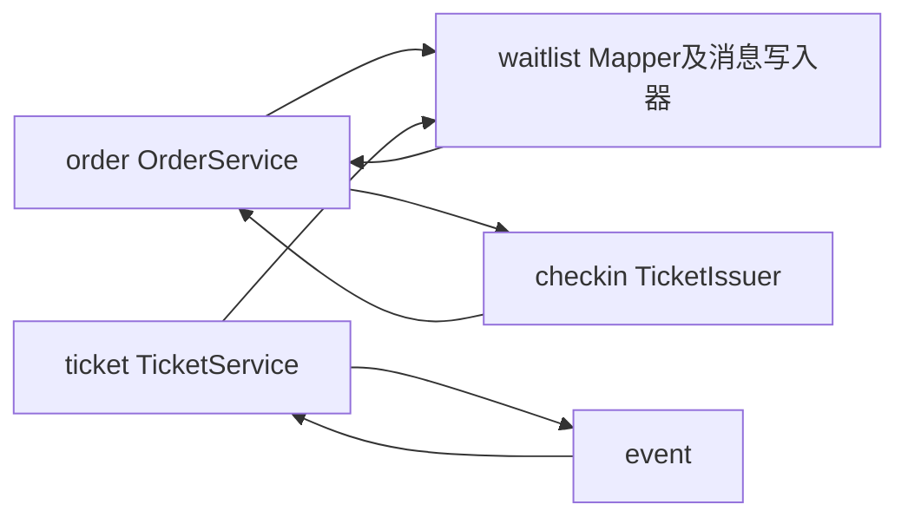
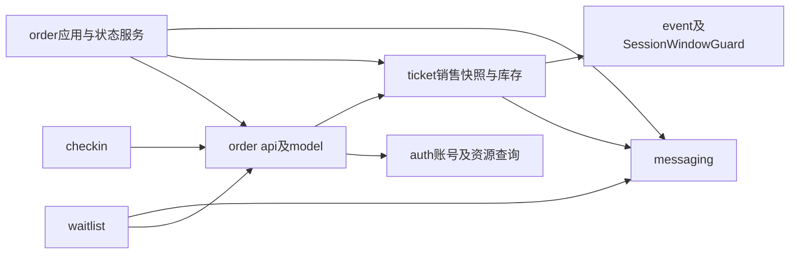

# 架构与模块协作

项目保持Java21、Spring Boot3、MyBatis-Plus、MySQL、RabbitMQ和Spring Security Session的前后端分离模块化单体，后端只有backend/pom.xml一个Maven模块，根包com.ticketing。Vue3、TypeScript、Pinia和Element Plus继续调用原/api/v1接口，不增加微服务或新的业务模块。

## 当前源码目录

按用户确认统一使用技术分层目录。`controller`、`service`、`mapper`各只有一个目录，所有类直接放入，不按活动、订单或候补再嵌套子目录；类名与业务职责保持不变。业务边界是依赖规则，不再对应独立Java业务包。

```text
backend/src/main/java/com/ticketing/
├── TicketingApplication.java
├── controller/  所有HTTP控制器与异常处理
├── service/     应用服务及已有事务协作
├── mapper/      MyBatis数据访问
├── dto/         请求与响应
├── entity/      数据库实体
├── model/       状态、操作域及不可变业务上下文
├── api/         OrderLifecycle、SessionWindowGuard协作契约
├── common/      ApiResponse、PageResponse、BusinessException
├── config/      Spring配置、启动初始化及配置属性
├── security/    身份、会话过滤、请求限流及票券签名
├── job/         有界后台任务
└── messaging/   事件、发布器及消费者
```

Spring Boot、配置属性和Mapper仍从`com.ticketing`扫描。技术目录合并没有合并业务类，也没有改变接口、SQL、锁序、事务传播或数据库迁移。`architecture-modules.properties`仅用于测试，逐类登记原逻辑业务归属；守卫覆盖新类登记、同包省略import的依赖、订单公开协作边界及业务依赖无环。完整迁移与回归结果见[目录整理验收](20-flat-package-refactor-verification.md)。

## 第九阶段之前的依赖

基准2c7b086中的箭头表示源码依赖。OrderService同时做资源锁定、预占、支付、关闭、候补联动与出票；候补和核销反向调用其内部锁上下文。SessionService直接查询票档Mapper，因此活动与票档也双向依赖。



## 当前依赖与协作边界

以下为当前逻辑业务依赖，节点表示业务归属而非Java目录；共用响应、DTO及配置依赖省略。源码守卫检查逻辑模块无环，候补、核销只能调用订单公开契约、模型、DTO及原有资源锁定/预占协作，不能直接访问订单内部服务、Mapper或实体。



OrderLifecycle是唯一的订单终态同步协作接口，定义小型不可变Transition，不是事件总线。WaitlistOrderLifecycle与TicketIssuer实现该接口，订单模块只注入有序参与者，不引用候补或电子票实现。运行时先完成候补联动，再出票；两者与订单、流水和库存共用同一个MySQL事务。任何异常直接传播并回滚，不使用提交后的异步事件替代这些原子变化。

SessionWindowGuard归活动模块定义，TicketService在场次UPDATE锁内校验已有票档窗口。SessionService不再访问TicketSkuMapper；该协作仅校验，不反向锁用户或活动。普通管理场次和票档仍保留其不同的父级锁模式，不把管理流程强行塞进订单服务。

## 主要职责

| 组件 | 当前职责 |
| --- | --- |
| OrderService | HTTP业务应用入口与READ_COMMITTED事务边界，订单本人查询和响应组装 |
| TradeResourceLocker | 用户、活动、场次、SKU及已有订单的固定锁协议，账号有效性及工作人员角色事实 |
| OrderReservation | 普通下单与候补共用预占、价格快照、用户场次限额、请求哈希和幂等查找；只向候补返回订单ID |
| OrderStateService | PENDING到PAID/CANCELLED/EXPIRED、数据库截止条件、流水和库存变化、同步参与者与释放事件编排 |
| TicketInventory | 票档权威库存条件更新，预占、释放和locked转sold；写入口要求已有事务 |
| TicketSale、TradeContext | 锁内不可变销售及账号事实，不跨请求缓存，不向候补暴露可写订单或库存实体 |
| WaitlistService | 候补申请、本人查询和取消、单个FIFO队首的独立分配事务 |
| WaitlistOrderLifecycle | 订单锁之后核对候补用户、SKU、数量、幂等域及键，原子联动COMPLETED/EXPIRED |
| TicketIssuer | 支付末端和历史补票共用的按明细序号幂等出票；两个事务入口调用同一个私有算法 |
| ElectronicTicketService | 本人凭证及展示、核销和受控补票编排；只通过订单公开锁API协作 |
| OutboxService、OutboxPublisher、OutboxMapper、OutboxPublishJob | Outbox库存事件读写、认领、确认、重试及发布调度，按技术职责分别位于service、messaging、mapper、job |
| WaitlistRabbitConfig、InventoryConsumer | 候补特有RabbitMQ拓扑、消费者和分配触发，分别位于config、messaging |

库存SQL从OrderMapper归回TicketSkuMapper，由TicketInventory使用。候补不再查询OrderMapper，也不依赖OrderService的内部record；核销不再重复实现订单加锁或为角色额外查询一次用户。销售状态计算集中于TicketSale，TicketService与预占/候补使用同一规则。删除重复的SaleContext/PurchaseContext、候补对预留订单的重复回读和限额校验中的冗余场次存在性查询；保留分配和最终预占各自必须重新检查的销售条件。

## 事务与锁顺序


用户主动操作要求ACTIVE；超时释放和历史补票只要求取得用户行锁，禁用账号也必须回收历史锁定库存。核销最前面的用户行属于工作人员，随后沿持票订单的活动、场次、SKU、订单、票券顺序处理，在该工作人员行锁中取得最新ADMIN或CHECKIN_STAFF角色。CHECKIN_STAFF还要在同一事务内复查目标场次授权；管理授权变更先锁该工作人员用户行，因此撤权与核销按同一用户行串行。持有子资源锁后不得再获取其他用户或父级锁。

OrderService写入口、WaitlistService分配/申请/取消和ElectronicTicketService核销/补票在代理入口开启READ_COMMITTED。TradeResourceLocker、OrderReservation写协作、TicketInventory和OrderLifecycle参与者使用MANDATORY加入现有事务；读限额允许独立只读事务。没有自调用开启独立事务或REQUIRES_NEW分割原子提交。支付、取消和超时共享OrderStateService的锁定流程，只有PENDING可进入三个终态，SQL继续做状态及截止时间条件更新。

同一用户的所有场次写操作仍被用户行串行化，用户锁内SUM统计PENDING/PAID明细保护默认每场4张限额。WAITING不占额，候补分配时重新检查。CREATE_ORDER及WAITLIST_CONFIRM域保持原值，同参重放原订单、异参409；数据库唯一键最终兜底。金额是服务端整数分精确乘算及不可变明细快照，不接收客户端金额或身份。

同SKU入队和分配继续共享SKU锁，锁内生成候补ID；分配先非锁定发现队首用户，再按上述顺序加锁并重新确认队首。队首数量不足就停止，每次释放全部锁后才处理下一用户。FIFO只承诺同SKU候补内部，普通新购票仍可竞争库存。

## Outbox兼容性

InventoryEvents与库存释放、管理员增加库存同事务写入。InventoryEvent集中旧类型WAITLIST_DISPATCH_REQUESTED、TICKET_SKU聚合与inventory.available路由，载荷仍为eventId/skuId/reason，SKU以字符串传输。交换机ticketing.waitlist、队列ticketing.waitlist.dispatch及其.dead不变。保留ticketing.waitlist.*配置键，避免组件移包导致部署参数失效。

OutboxService继续在短事务中FOR UPDATE SKIP LOCKED认领，租约和递增retry_count令牌防旧任务覆盖。发布器在事务外发送持久消息，Publisher Confirm且无mandatory退回后才标SENT；健康批量默认100、故障后停止本轮、指数退避及最大重试均保留。消费者只通过InventoryEvents核对已提交事件，每单分配提交后才确认。重复消息依靠数据库FIFO、状态条件及唯一订单键幂等，有界重试后进入死信；低频数据库补偿不依赖MQ在线。语义仍为至少一次加数据库幂等。

## 状态、配置与前端

订单、支付、候补、电子票、Outbox状态及订单操作域使用各业务枚举，库存事件类型/路由集中定义。数据库状态值和HTTP字符串契约不变，SQL中的状态条件仍明确表达既有数据库值，不引入枚举ordinal或新状态机框架。

OrderProperties、WaitlistProperties、OutboxProperties、CheckinProperties绑定相关非敏感配置并在启动校验边界。保留原环境变量、属性名、默认限额4/支付15分钟/发布批量100。签名密钥继续由TicketCredentialSigner严格解析私有环境变量，不放进可能打印toString的配置record，没有固定密钥或降级校验。

AdminActivitiesView只保留活动列表与活动维护，场次及票档入口归AdminSessionManager；关闭/切换场次时失效旧加载请求。ElectronicTicketsView负责列表，TicketCredential独立负责凭证请求与本地二维码，并在隐藏、刷新、切换或卸载时清理、丢弃过期异步结果。AdminCheckinView只展示结果，CheckinScanner负责摄像头、图片、手工输入和核销请求，卸载时停止媒体轨道并清空凭证。PurchasePanel与OrdersView已有明确购票/订单页面职责和OrderCard，不为增加层数额外拆分。

Session、CSRF、中文页面、北京时间、人民币分和BIGINT字符串规则保持。认证使用BCrypt与真实HttpSession，登录更换会话ID、退出失效；CurrentAccountFilter只在受保护端点复查最新账号状态和角色，公开查询不增加账号查询。完整票券凭证不进URL、Store、浏览器存储或日志，签名与摘要常量时间校验，最多一次核销不改变库存。

## 参考源码及取舍

本轮实际读取并固定以下源码版本，借鉴边界和事务职责，不复制业务代码或引入其基础设施：

- [Spring Modulith模块依赖建模](https://github.com/spring-projects/spring-modulith/blob/1fe549999aaa2401b675eba4a562ae374f4f96ba/spring-modulith-core/src/main/java/org/springframework/modulith/core/ApplicationModule.java)用于思考公开边界和依赖验证。[ApplicationModuleListener](https://github.com/spring-projects/spring-modulith/blob/1fe549999aaa2401b675eba4a562ae374f4f96ba/spring-modulith-events/spring-modulith-events-api/src/main/java/org/springframework/modulith/events/ApplicationModuleListener.java)实际包含异步、提交后及新事务语义，不能用于本项目必须原子完成的出票/候补联动，因此使用显式同步协作，不增加Modulith运行时。
- [12306订单状态枚举](https://github.com/nageoffer/12306/blob/daf3a2714c00ff263764d23ab10c2eaed2ae842d/services/order-service/src/main/java/org/opengoofy/index12306/biz/orderservice/common/enums/OrderStatusEnum.java)及[订单服务](https://github.com/nageoffer/12306/blob/daf3a2714c00ff263764d23ab10c2eaed2ae842d/services/order-service/src/main/java/org/opengoofy/index12306/biz/orderservice/service/impl/OrderServiceImpl.java)体现集中表达状态和交易入口；本项目继续使用原字符串状态和MySQL锁，不引入其微服务或Redisson方案。
- [mall订单服务](https://github.com/macrozheng/mall/blob/dcaa93b3150352e5044708d7211b5bed0af4509f/mall-portal/src/main/java/com/macro/mall/portal/service/impl/OmsPortalOrderServiceImpl.java)可对照确认下单、锁库存、取消释放等职责。本项目保持自己的条件SQL、事务和MySQL可靠关单，不移植延迟发送或其他商城规则。
- [RuoYi-Vue-Plus用户服务](https://github.com/dromara/RuoYi-Vue-Plus/blob/9227f626a3a37e1546d6c291ed398183e94df92b/ruoyi-modules/ruoyi-system/src/main/java/org/dromara/system/service/impl/SysUserServiceImpl.java)展示服务入口内显式维护关联及事务边界；本项目只采用必要的公开DTO/协作契约，不扩充权限框架、接口实现层或多模块结构。

第八阶段原始报告保留，热点SKU锁竞争及用户跨场次串行仍是当前协议代价。第九阶段的具体回归、迁移、性能对照与浏览器结果见[架构重构验收](16-architecture-verification.md)。第十阶段增加下述售后能力，仍不接入真实支付或真实资金退款。

## 第十阶段订单运营与售后

AdminOrderService提供校验分页、精确筛选和只读明细投影，包含支付、候补、票券状态数量与售后结果，不导出凭证。所有端点在原/admin/**匹配器内复查最新账号，写操作沿用Session和CSRF。

OrderRefundService是整单模拟退款及场次善后的READ_COMMITTED应用入口，不把职责塞回OrderService。依赖方向保持order→ticket/messaging，waitlist/checkin→order公开协作接口；订单不引用候补或票券实现。OrderLifecycle增加锁内退款检查，先候补关联后票券，检查成功后同事务PAID→REFUNDED、sold减量、票券UNUSED→VOID、唯一refund_record、Outbox及售后结果。原SUCCEEDED支付和paid_at保持不变；REFUNDED不再占场次限额。候补完成事实仍为COMPLETED，不重新排队。

用户行阶段同时涉及管理员和买家时按ID递增获取，并复查操作人ACTIVE/ADMIN，随后严格活动SHARE→场次SHARE→SKU UPDATE→订单UPDATE→候补→电子票。系统善后仅锁买家，不检查其ACTIVE。退款与核销共用父级、SKU和订单锁，最多产生一次退款或核销效果。缺失明细时没有可锁SKU，仍按用户→父级→订单锁定，只记录人工待办，不猜测数量释放库存。

SessionService.cancel仍仅提交不可恢复的CANCELLED，不遍历订单。SessionAftercareJob每轮至多100单（1至500可配），调用代理服务逐单提交：PENDING转CANCELLED并释放locked，PAID走统一退款。已用票、缺票及关联异常持久化MANUAL_REQUIRED；临时失败在已回滚之后另开正常应用事务记录RETRY，默认30秒指数退避、最多5次、上限1小时，超限转人工，不阻塞后单。候选状态、截止和重试均在数据库，内存游标仅用于公平扫描；启动即扫描、失败前进并回绕，重启可补偿。活动OFFLINE不会进入此任务。

AdminOrdersView负责筛选与稳定分页，AdminOrderDetail负责明细、受控原因和确认退款。复用OrderCard与中文视觉风格，用户订单展示原支付及模拟退款流水，VOID电子票不再生成入场凭证。未实现人工售后审批/补偿操作、部分退款或第三方资金结算。

## 第十一阶段工作人员核销与管理审计

`CHECKIN_STAFF`是最小平台角色，不是组织或通用RBAC。账号由现有用户显式升级；注册仍固定创建USER，工作人员管理接口不能创建管理员、修改管理员或改变自己的更高权限。`staff_session_permission`以工作人员与场次唯一约束保存授权，撤销只写`revoked_at`，保留授权人和历史。禁用工作人员、降回USER时一并撤销其有效场次授权。

所有管理端点在`CurrentAccountFilter`中按受保护路径重新读取数据库最新账号状态和角色；停用账号的会话失效，角色变更刷新会话身份。`/api/v1/admin/**`始终要求ADMIN，工作人员不能查看管理订单、退款、活动或库存。`/api/v1/checkins/**`允许ADMIN与CHECKIN_STAFF，STAFF只能核销其有效授权的场次；ADMIN延续原有全场次核销能力。当前凭证和场次来自签名及数据库票券关系，不接受客户端声明的场次或核销人。

撤权、角色变化与核销都以工作人员`user_account`行UPDATE锁协调。管理授权入口先按用户ID递增锁定管理员和目标工作人员，再按活动SHARE、场次SHARE读取并变更授权；核销先锁工作人员行，再按活动SHARE→场次SHARE→SKU UPDATE→订单UPDATE→票券条件更新，并在该事务中查询场次授权。若核销先取得账号锁，它提交后撤权才继续；若撤权先提交，旧Session发起的核销在事务内看到撤销记录并被拒绝。角色降级与账号禁用另由CurrentAccountFilter刷新身份或使会话失效。两人同时核销同一票仍由UNUSED条件更新保证最多一次成功，`checked_by`始终来自Session principal。

`AuditWriter`只接受服务显式提供的审计动作、资源类型和脱敏前后快照，不读取原始请求体。活动、场次、票档/总库存、工作人员角色/场次授权和管理员整单模拟退款的业务成功记录在同一事务中追加到`admin_audit_log`；回滚时审计也回滚。高频核销继续以`electronic_ticket.checked_by/used_at`作为事实来源，不额外复制为通用操作日志。V7触发器拒绝应用及普通SQL会话对审计行UPDATE/DELETE；表不提供修改或删除API。审计快照不得含密码、Cookie、Session/CSRF、原始凭证、签名密钥或原始请求体。

工作人员页面只展示当前账号有效授权的场次并复用原`ElectronicTicketService`验证和核销；运营后台新增工作人员管理及审计查询。业务归属和依赖继续由`architecture-modules.properties`与`ArchitectureRulesTest`约束，audit与staff登记为逻辑业务归属，没有新增业务子包、Maven模块或独立权限服务。

## 第十二阶段Redis请求限流

`RateLimitProperties`集中绑定并校验五类策略。`RedisRateLimiter`归auth业务，在Redis Lua内原子检查所有维度、递增和设置TTL，通过独立密钥摘要隐藏标识，只返回放行、429或503决定，不读取订单、候补或库存数据。

`RequestRateLimitFilter`的认证实例在CSRF后、formLogin前保护登录/注册，业务实例在最新数据库身份复核及AuthorizationFilter后保护下单/候补。两个实例使用不同的重复执行标记，且不作为Servlet Filter Bean自动注册。过滤器不启动MySQL事务，不改动交易锁序或同步生命周期协作。数据库库存、场次限购、订单幂等、候补唯一约束及ADMIN/STAFF权限仍由原有服务执行。

故障默认拒绝四类提交并返回有界503，公开活动读取及其他交易和补偿链路维持原有依赖。生产默认开启；普通测试显式关闭，真实Redis验收显式开启，专用性能环境分别记录关闭对照、开启放宽阈值及默认阈值三种配置。实现、窗口边界、部署与验收记录见[阶段十二说明](22-redis-security-rate-limits-verification.md)。
