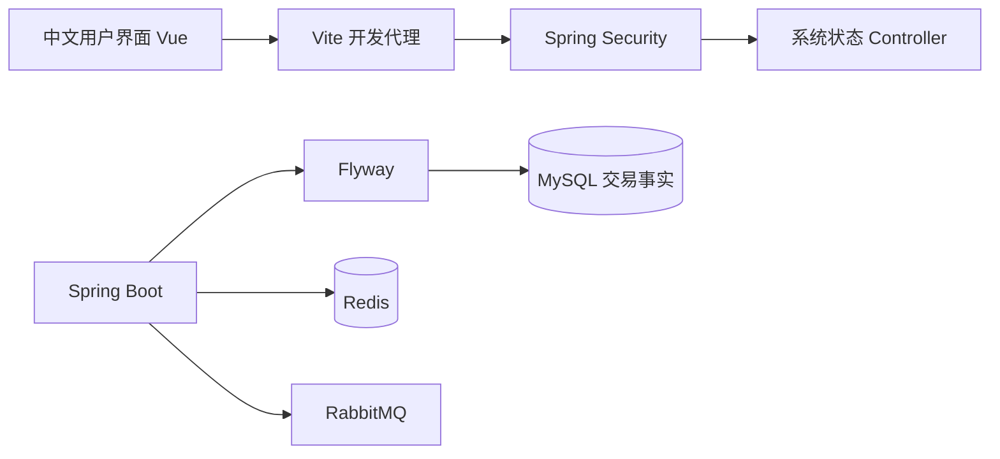

# 架构与边界

这是前后端分离的模块化单体，一个 Maven 后端、一个 Vue 前端，未建立微服务。

当前自定义 HTTP API 只有系统状态；Actuator 综合检查 MySQL、Redis、RabbitMQ。MyBatis-Plus 已接入依赖和配置，当前没有业务 Mapper，因此不会创建占位 Mapper 或空 Service。

采用 Java 21、Spring Boot 3.5.16（[官方兼容要求](https://docs.spring.io/spring-boot/3.5/system-requirements.html)）及 MyBatis-Plus 3.5.17 的 [Boot 3 专用 Starter](https://baomidou.com/getting-started/install/)。Spring Boot BOM 管理 MySQL 驱动、Flyway、Security、Redis、AMQP 和测试依赖。

后续领域包为 `auth/event/ticket/order/waitlist/checkin`，逐个添加 Controller、Service、Mapper、DTO、Entity。通用响应与状态 DTO 维持 `common/api`；状态接口维持 `common/controller`；Security 维持 `config`。

用户端与管理端继续共用一个 Vue 工程，通过后续路由和权限划分。Pinia 已注册，当前没有共享业务状态，不建立空 Store。Element Plus 按组件引入，中文区域设置全局配置。

库存、订单、支付以 MySQL 为准。后续先通过本地事务完成订单与库存变化，再通过同事务 Outbox 触发异步处理；Redis 缓存不能作为成功购票的判据。RabbitMQ 采用确认与幂等消费，定时扫描补偿超时与遗漏事件。当前没有声明队列、监听器或调度器。

安全基线只允许匿名 GET 系统状态、健康和 info；合理错误分派允许处理，其他路径一律拒绝，包括已认证请求。CSRF 保留默认保护；未启用登录表单、Basic 或默认用户。后续实现认证时再确定 Cookie/Token 与 CSRF 协议，不能直接全局放行。
