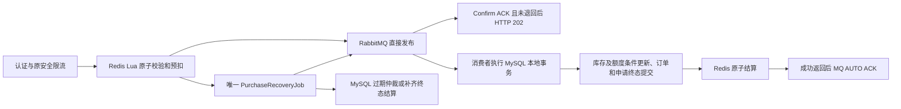

# 架构与模块协作

本文描述当前源码。2026-10-26 的普通购票重构替代旧 MySQL 受理、购票 Outbox、处理租约和 Redis 冻结重建协议；阶段验收文档（如 25、27、33、34）保留为历史记录。

## 项目结构

Java 21、Spring Boot 3、MyBatis-Plus、MySQL、Redis、RabbitMQ、Spring Security Session，保持前后端分离的模块化单体。后端只有 `backend/pom.xml` 一个 Maven 模块和唯一 `TicketingApplication`，根包 `com.ticketing`。

技术包为 `controller`、`service`、`mapper`、`entity`、`dto`、`vo`、`config`、`enums`、`security`、`task`、`messaging`、`cache`、`exception`、`common`。请求/查询参数归 DTO，响应归 VO，定时任务归 task；不为目录形式新增空接口。`architecture-modules.properties` 登记逻辑业务归属，架构测试继续检查技术分层、归属完整、业务依赖无环与交易公开协作边界。

## 普通购票链路

HTTP `POST /api/v1/orders` 由 `PurchaseAdmission` 编排，只调用 Redis 和 RabbitMQ，没有购票申请 SQL、MySQL 受理事务或购票 Outbox。既有安全过滤器仍按数据库最新账号状态鉴权，并执行 CSRF 与独立请求限流。requestId 由服务端生成；Lua 首先检查用户、固定 CREATE_ORDER 域和幂等键，同参重放复用原 ID，异参冲突，不重复预扣。

Lua 一次完成销售资格、Redis 时间窗口、单笔数量、场次内用户未完成预扣数量、库存和排队容量检查，之后扣减库存，写 RESERVED 凭据与恢复 ZSET。入口预检只限制并发未完成申请；已建订单的精确场次限额仍由消费者在 MySQL 中校验，不宣称 Redis 是额度权威。

`PurchasePublisher` 使用持久消息、durable 队列、mandatory 和 CorrelationData Confirm。默认最多 16 个在途发布，多个请求可并行确认，回调不访问数据库或 Redis。HTTP 仅在 ACK 且未退回时返回 202；窗口满、发送失败或确认超时返回受控 503，保留原 RESERVED，由原幂等键查询/重试以及恢复任务解决。确认未知不等于消息未投递，绝不据此返票。RabbitMQ 不可用时没有同步 MySQL 下单降级。

## MySQL 消费与三道幂等

`PurchaseOrderWorker` 从 Redis 凭据读取可信业务参数，以 requestId 唯一键插入/锁定 `purchase_request`，与过期仲裁共享同一个数据库互斥协议。随后按原资源锁序调用 `TradeResourceLocker` 和 `OrderReservation`；MySQL 库存条件更新、场次额度、订单和价格明细快照、SUCCEEDED/orderId 在一个 READ_COMMITTED 本地事务提交。请求行 QUEUED 只是事务内协调占位，不独立提交为排队事实，没有 processing token、租约或第二条普通建单路径。

确定业务错误先使整个建单事务回滚，再重新锁同一 requestId 登记 FAILED/EXPIRED；若重复消费者或仲裁已经先提交，采用其原终态。数据库连接、死锁等技术故障不记为确定业务失败，交给有限延迟重试及统一补偿。消费返回后的 AUTO ACK 发生在 SQL 提交之后；Redis 结算暂时失败可先 ACK，由恢复索引补齐。重复消息不会再次占库存或创建订单。

1. Redis 入口：用户 + CREATE_ORDER + 幂等键，验证请求摘要并复用 requestId。
2. MySQL 消费：requestId 主键、用户/操作域/幂等键唯一约束、订单关联唯一约束和本地事务。
3. Redis 结算：RESERVED 只能一次转为 CONSUMED 或 RELEASED。成功不再次扣减，失败只返还一次；取消成功订单不重置购票凭据。

Redis key 使用 `ticketing:seckill:v2:<数据库命名空间>:`。未完成申请不设置 TTL；终态详情保留七天，较小的幂等摘要长期保留以继续复用 ID 和终态，详情到期后仍可从 MySQL 查询。历史 MySQL 终态在票档首次受控初始化时预装到 Redis，不通过 HTTP 同步查询历史申请。幂等摘要需要纳入 Redis 容量管理，不能未经协调随意删除。

## 唯一购票恢复入口

`PurchaseRecoveryJob` 小批量读取待恢复 ZSET，成员为 skuId:requestId，分数为下次检查时间。重复扫描允许重复投递，不增加恢复认领租约、分布式锁或线程池。

- 有 MySQL SUCCEEDED：补齐 CONSUMED；有 FAILED/EXPIRED：补齐 RELEASED。
- 无 MySQL 终态且仍有效：按原 requestId 直接重新发布 RabbitMQ。
- 已过期：先在 MySQL 以相同唯一键/行锁仲裁，再结算 Redis。迟到消费者必须读取原终态，不能同时成功建单和过期返票。
- Redis 凭据、库存账本或容量计数丢失：暂停对应 SKU，保留明确异常并等待核对；不从 MySQL 剩余库存猜测重建未完成预扣。

Redis 继续使用 AOF、`appendfsync always` 和 `noeviction`。Redis、RabbitMQ、MySQL 之间没有强分布式事务，不承诺绝对零丢失；Redis 持久化数据永久丢失、外部误删、长时间基础设施故障可能需要人工核对。死信仅保存失败投递，不作为自动返票依据。

## 库存同步与候补

`StockSnapshotService` 收敛为父资源→SKU 行锁内的小型维护，不再保存 owner/fence/mutation、多层冻结租约、孤儿恢复或自动重建框架。`ticket_sku.redis_inventory_initialized` 区分从未初始化和已初始化后 Redis 账本丢失；后者停止受理，不能静默重置。

首次初始化或库存事件到来时，先暂停 SKU 新受理。有未完成普通预扣就等待结算；归零后，在 SKU 行锁内读取 MySQL 已提交的总量、locked、sold、销售资格，发布绝对可售余额与最新库存事件序号。消费者可以继续处理已经受理的凭据，避免暂停阻塞自身恢复。Redis 余额同步不使用数量累加，重复释放事件只会再次读取同一数据库事实，不会重复加票。

候补逐笔取得用户→活动→场次→额度→SKU 锁并重新确认 FIFO 队首。SKU 锁内暂停普通入口，尚有普通预扣就返回 BLOCKED；归零后才使用 MySQL 可售量。候补通过原 `OrderReservation` 创建订单、更新 ALLOCATED，再发布减少后的 Redis 余额；事务回滚最多临时低估余额，既有 WAITING 补偿/重同步继续恢复，不会多分票额。每单释放全部锁后再处理下一用户，库存不足不跳过队首。FIFO 只承诺同 SKU 候补内部，不保证优先于普通购票。

## 通用库存 Outbox

Outbox 只服务仍在使用它的库存释放、库存/销售配置变更和候补事件；普通购票不写、不读购票 Outbox。删除 PurchaseCommands、购票发布分支、recover/close/failed SQL 及废弃命令类型；保留库存事件载荷 eventId/skuId/reason、现有交换机/队列和独立事件 ID。

`InventoryEvents` 与取消、超时、退款或管理更新在同一个事务写事件。`OutboxService` 在短事务中 SKIP LOCKED 认领，递增投递令牌和持久租约防迟到回调覆盖；发布器事务外使用有界窗口、Confirm、mandatory，失败退避与死信保持。`InventoryConsumer` 验证数据库已提交事件后调用候补/库存同步。既有 `WaitlistCompensation` 根据 WAITING 和库存事件序号有界补偿，不能将 SENT 视为库存同步完成。

## 原业务边界

交易锁序继续为账号 SHARE→活动 SHARE→场次 SHARE→需要写额度时的用户场次额度 UPDATE→SKU UPDATE→已有订单→候补→电子票。消费的请求唯一键协调先于这条资源锁链；仲裁只锁请求事实，不反向获取订单或 SKU 锁。管理员/多账号操作及退款保持原升序账号协议，核销不占买家额度。

MySQL 是订单和最终库存权威。默认每用户每场四张，PENDING/PAID 占额，取消/到期/退款条件释放，支付不重复占额。金额由服务端人民币分整数乘算并保存快照。订单截止、状态条件更新、整单模拟退款、场次取消善后、原 paid_at 和核销历史保持。

`OrderLifecycle` 在同一 MySQL 事务先候补再出票，不改为提交后异步联动。电子票签名、摘要存储、密钥轮换、工作人员角色和场次授权、最多一次核销、CSRF、Session/BCrypt 均保持。候补与核销只访问交易公开契约；架构检查继续生效。

公开目录仍用 Caffeine/Redis，交易与授权查询绕过展示缓存，实时票档库存/销售状态/serverTime 仍由 MySQL 返回。客户端查询 Redis QUEUED 或 MySQL 最终结果，显示“已受理”后轮询真实订单。lookup、详情和本人活动申请列表保留原路径和所有权校验；数据库暂时没有申请行时不会误报不存在。前端移除废弃 PROCESSING 展示，保留原键恢复、支付、取消、候补、票券和核销流程。

## 配置和迁移

普通启动方式、绝对路径、API 路径及单模块结构保持。新增 `PURCHASE_IN_FLIGHT_WINDOW`（默认 16，1–64）和 `PURCHASE_CONFIRM_TIMEOUT_MS`（默认 3000ms）；命名空间默认取 MYSQL_DATABASE。保留容量、排队截止、消费者并发/预取、安全限流、库存 Outbox 配置，删除旧购票处理租约和无调用的购票双桶限速器配置。

V1–V13 不变；V14 在任何破坏性 DDL 前拒绝仍有 QUEUED/PROCESSING 的旧库，要求先停写、停止旧发布/消费者并排空旧链路。迁移保留所有订单、支付、候补和历史申请终态，删除废弃 purchase_capacity、购票 Outbox 记录及申请处理租约/token 等字段，增加首次库存初始化标记。已有业务库升级仍须具体授权，不自动 repair、清库或降级。

本次仅在随机 guard 保护的独立功能验证资源应用 V14；本机业务库仍是 V13，未升级或重启部署。正式发布前还需按目标环境完成停写/排空和明确授权的迁移。

## 验证范围

使用现有 `scripts/verification/verify_backend.py`，只连接独立 13307 MySQL、16379 Redis、15673 RabbitMQ 和随机 schema，不加载业务 .env。`--tests` 支持 Failsafe 类与方法筛选（#、+），避免无关全量运行。

新 `AsyncPurchaseIT` 八个真实中间件场景全部通过：正常 HTTP→MQ→建单，最后一张票并发竞争，同键重放/异参冲突，重复消息及丢失凭据停卖，发布失败/确认未知后的恢复，数据库回滚/提交后结算失败，过期仲裁与迟到消费，取消释放与 FIFO 候补协调。另有八个相关既有回归通过，覆盖跨票档场次额度、订单快照、支付重试、过期支付限制、整单退款、核销和候补分配/超时。

架构、配置和通用库存 Outbox 的十个普通测试通过。前端严格类型检查和生产构建通过。未做性能测试、全仓库压力回归或生产部署；不从本次功能验证推导吞吐量。
