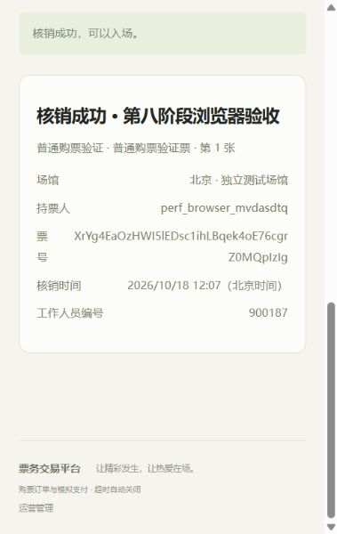

# 第八阶段系统验收

验收日期为2026年10月18日（北京时间）。本阶段完成可复现压测、瓶颈分析、最小发布调度优化及完整交易一致性/恢复验证，不扩展真实支付、退款或整体架构。

## 修改范围

- `scripts/performance/`：k6真实Session/CSRF场景、固定独立Compose、随机凭据和数据库标记、自动等价准备/清理、JVM/MySQL/MQ监测、快照审计、SQL/锁诊断、故障恢复、报告生成及本地Vue预览。
- `OutboxPublisher.java`、`application.yml`、`.env.example`：健康发布批量默认20调整为100，可配置1至100；一次消息故障后结束本轮，继续沿用确认、退避、租约和递增认领令牌。
- `OutboxPublisherTest.java`：故障停止继续认领、健康连续发送、中断保留三个测试。
- `AGENTS.md`、数据库/API/计划/本地验证文档及`docs/performance/`报告更新。前端业务源码和依赖未改动，连接池默认10、库存及权限协议保持原状，无新业务迁移或索引。

## 构建与回归的实际结果

| 检查 | 结果 |
| --- | --- |
| `mvn -f backend/pom.xml clean verify` | 45项，失败0、错误0、跳过0 |
| `powershell -NoProfile -ExecutionPolicy Bypass -File scripts/start-backend.ps1 -VerifyDatabase` | 原脚本启用mysql-it；45项基础加108项真实集成，失败0、错误0、跳过0 |
| `npm ci`、`npm run build` | 均成功，包含严格TypeScript检查 |
| Python隔离/路径/凭据/远程Docker边界测试 | 5项通过 |
| 数据库业务审计反例 | 4项全部检出并还原，再次审计通过 |

现有回归脚本通过进程变量指向独立13307/ticketing_perf及15673 RabbitMQ，原脚本保持不变，根`.env`不改动，开发库`ticketing`没有参与压测或故障注入。Flyway实际校验V1至V4，仍有既有“上游已测试MySQL最高8.1”的兼容性提示；本机MySQL8.4的迁移、外键、CHECK及真实业务测试通过，未为消除提示而升级依赖。结构化计数见 [regression.json](performance/results/regression.json)。

## 压测与库存一致性

正式基线24组、最终代码24组、单参数对照2组、连接持有/Rabbit监听计时补充对照2组，共52组。每组均通过k6验证、监测检查及MySQL一致性审计，稳定窗口5xx/连接错误均为0，全HTTP阶段失败率也为0。预期库存不足、限购及重复核销409单独计数。

每组10秒预热、20秒稳定，VU为10/25/50/100，覆盖活动/票档查询、充足/稀缺热点、混合下单支付取消、FIFO候补和同票核销。每轮11项快照核对覆盖库存边界与订单汇总、金额/支付快照、场次限额、候补归属/FIFO、票数/序号/归属和核销元数据。四档候补均完成与人数相同的真实支付；四档同票核销均恰有一次成功。

压力结束前的MySQL全局lock_deadlocks、lock_timeouts计数均为0，指标启用状态也被保存。事务仍为READ_COMMITTED，锁序与用户锁限额协议未改，价格快照及幂等效果不变。独立连接故意持有用户行锁验证了同用户跨场次串行范围；这属于协议诊断，不冒充正常请求延迟。

完整数值见 [48组同场景前后表](performance/03-full-results.md)、[原始比较数据](performance/results/comparison.json)、[52组交付检查](performance/results/validation.json)。瓶颈证据、单参数控制结果及限制见 [性能分析](performance/02-analysis.md)。原始SQL计划中的抽样与最终状态选择性不能外推到生产规模；另保存 [实际夹具参数的完整列表计划](performance/results/execution-plans.json)。

## 故障恢复

[真实恢复记录](performance/results/fault-recovery.json)的10类检查均通过，每类都重新执行数据库审计：

1. 匿名/USER/ADMIN读取压测指标分别401/403/200。
2. 专用RabbitMQ停止，取消订单仍提交库存释放及Outbox；恢复后退避重试、分配、支付成功。
3. 10个真实管理员并发核销同票，1次200、9次409，数据库USED及库存不变。
4. 真实库存事件重复投递10次，没有新增预留订单。
5. 强制断开消费者连接后重新消费，队列消费者恢复。
6. 真正停止应用进程，持久队列保留已提交事件；恢复时关闭数据库补偿，单独验证RabbitMQ消费并支付。
7. 关闭消息和后台后留下真实库存事实，重启仅启用数据库补偿，恢复候补。
8. 停止/恢复专用MySQL，已提交订单保留、相同幂等键重试同一订单；已用票再次409，原核销人员和时间保持。
9. 停止应用跨越真实数据库支付截止时间，重启将两单EXPIRED，其中一位用户已禁用，库存仍正常释放。
10. 10笔订单在截止附近并发支付/取消并与扫描竞争，实际最终9笔CANCELLED、1笔EXPIRED，库存只释放一次。本轮没有PAID结果，不将其伪报为三种赢家都出现；可支付窗口内支付/取消竞争同时由原真实MySQL订单回归覆盖。

四项反例分别注入库存汇总差异、支付快照差异、候补数量关联差异、电子票序号差异，均检出且恢复。没有通过修改订单截止时间制造本轮等待结果，见 [反例记录](performance/results/audit-negative-probes.json)。MQ语义保持至少一次加数据库幂等，没有Exactly Once承诺。

## 浏览器真实联调

构建后的Vue通过127.0.0.1:15173静态预览代理至独立18080后端。普通用户在页面注册、登录，刷新恢复Session，访问运营管理被拦截；创建两张票订单后取消，页面库存恢复20张；新订单模拟支付256元，真实签发两张独立电子票。

另一用户真实下单占满1张票，页面用户申请候补。持单用户通过真实API取消后，数据库写入两条相关SENT事件，页面刷新出现实际候补订单900077；通过页面模拟支付128元，候补变为已完成。管理员通过真实登录在页面输入本人接口取得的真实凭证，核销成功，重复提交被拒绝；用户重新登录可见一张已核销、一张未使用。

浏览器专用订单窗口配置为5分钟，故障用例1分钟，正常产品默认15分钟未改。最终数据库已售分别2张和1张，锁定均0，电子票3张、USED1张、UNUSED2张，11项审计全通过。临时凭证输入文件使用后删除，不写URL、Store、浏览器存储、压测日志或报告。此次使用手工凭证核销，没有申请摄像头权限。见 [浏览器记录及最终审计](performance/results/browser-verification.json)。

## 本阶段边界

证据支持的优化只涉及可靠事件发布节奏及故障时的资源边界。单轮扩大连接池没有足够稳定收益证据，未改默认10；没有新索引或Redis库存权威。热点SKU串行化和高峰消息等待仍存在。测试是本机短时闭环，不代表生产极限、长时间稳定性或开放流量容量。真实支付、退款、整体模块解耦均未开发，阶段验收后停止。
