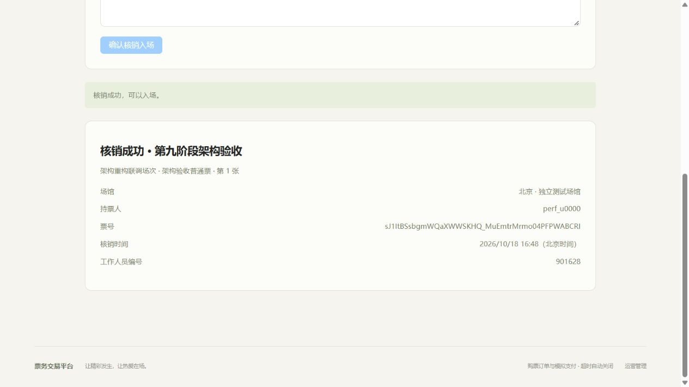

# 第九阶段架构解耦与工程质量验收

验收日期为2026年10月18日（北京时间），基准main为2c7b086。实际完成代码重构、V5关联修复、真实回归与性能/浏览器联调，不增加业务模块、微服务、真实支付或退款。

## 依赖和职责

[架构说明](01-architecture.md)给出重构前后Mermaid依赖图、主要Service职责和实际参考源码的固定版本。[源码依赖结果](architecture/results/module-dependencies.json)由基准git archive与当前源码生成；ArchitectureRulesTest检查源码包引用无环及候补/核销不得访问订单内部实现，真实Spring Boot上下文启动同时验证没有Bean循环依赖。

- OrderService只保留应用入口、事务边界和本人查询；TradeResourceLocker集中固定锁序，OrderReservation共用普通/候补预占，OrderStateService编排支付、取消和超时。
- 订单不再引用WaitlistMapper或TicketIssuer。OrderLifecycle同步参与者先候补、再出票，错误必须传播并回滚同一交易；不使用提交后异步事件。候补和核销不再依赖OrderService内部record、Mapper或实体。
- TicketInventory及TicketSkuMapper拥有库存条件SQL，TicketSale统一销售状态事实；SessionWindowGuard消除活动对票档实现的反向引用。
- 删除重复的订单锁实现、内部SaleContext/PurchaseContext、候补限额检查中的重复场次读取、分配后的重复订单回读及核销额外账号读取。保留不同阶段必须重查的资格与数据库截止条件。
- 通用Outbox移至messaging，候补拓扑、消费者和补偿留在waitlist。交换机、队列、路由、消息字段、Publisher Confirm、SKIP LOCKED、租约和令牌、重试/死信均兼容，保留健康批量100和故障停止认领。
- 订单/支付/候补/票券/Outbox状态及订单操作域集中表达；四组非敏感配置用ConfigurationProperties绑定并校验。旧部署属性、环境变量和状态字符串契约保持。

主要代码为order/api/OrderReservation、TradeResourceLocker、OrderLifecycle，order/service/OrderService、OrderStateService，waitlist/service/WaitlistOrderLifecycle，checkin/service/TicketIssuer、ElectronicTicketService及messaging下的可靠消息实现。没有另建接口实现双层、事件总线或通用工作流。

## 事务协议

写入口开启READ_COMMITTED，内部写协作使用MANDATORY加入同一事务。锁序继续为用户UPDATE→活动SHARE→场次SHARE→SKU UPDATE→已有订单UPDATE→候补→电子票。用户清理/补票不要求ACTIVE；工作人员核销在其用户行锁内核对ADMIN，之后遵循订单父级锁序。

同一用户跨场次仍串行，SUM有效订单限购仍在用户锁内。普通和候补订单共用金额快照、原子条件库存和幂等，候补使用WAITLIST_CONFIRM。支付、取消和超时只能从PENDING进入一个终态，流水、库存、候补和出票同步提交；任何注入故障全部回滚。核销不改变库存。

## V5迁移结果

V1至V4逐文件与基准比较保持不变，V5只增加uk_item_order_sku(order_id,sku_id)、idx_waitlist_order_sku(reserved_order_id,sku_id)及相应复合外键。原用户外键、唯一键、库存CHECK和索引保留。数量和幂等关联继续由事务检查，未增加业务表。

迁移前对原专用V4库执行只读关联审计，已有1条预留关联，没有SKU、用户、场次或数量差异，见[预检](architecture/results/pre-migration-audit.json)。[最终迁移探针](architecture/results/migration-final.json)实际通过三项：

1. 全新独立schema由原Flyway创建V1至V5，10张业务表及新外键存在。
2. 基准V4应用建立历史订单/明细/候补后，当前应用升级V5，业务事实保持不变。
3. 独立异常夹具被审计检出，停在V4，不执行迁移、不自动改写异常记录。

另外复用已存在的ticketing-mysql-1容器，对原ticketing开发库执行只读预检：当前仍为V4，已有1条预留关联，差异0。没有向原库应用V5或写入/清理压测数据；原库后续受控启动前仍需按部署流程预检并升级，见[开发库只读结果](architecture/results/development-readonly-audit.json)。

探针只在固定13307专用MySQL中创建本次随机临时schema，结束仅清理这些schema，不重建现有数据库。DatabaseMigrationIT另验证错误SKU插入、关联后改SKU及反向改订单明细均被数据库拒绝，原用户外键仍生效。部署前只读运行scripts/audit-waitlist-relations.sql，非空即停止；不提供自动删除、覆盖或Flyway repair。

## 构建与真实回归

| 命令或检查 | 实际结果 |
| --- | --- |
| mvn -f backend/pom.xml clean verify | 50项，失败0、错误0、跳过0 |
| 原scripts/start-backend.ps1 -VerifyDatabase | 原脚本执行mysql-it，50项基础加111项真实集成，失败0、错误0、跳过0 |
| frontend npm ci与npm run build | 均成功，包含严格TypeScript检查 |
| Python隔离边界测试 | 5项通过 |
| V5探针 | 空库、历史升级、异常只读预检3项通过 |

计数由实际Surefire/Failsafe XML读取，见[结构化回归结果](architecture/results/regression.json)。普通Maven与mysql-it中重复执行的基础测试不重复合并统计。集成验证通过进程环境变量指向ticketing_perf、独立RabbitMQ/Redis，不修改根.env或原启动脚本。

原回归继续覆盖真实Session/Cookie/CSRF、权限与禁用身份、并发幂等/限购、库存争抢、支付取消超时竞争、重启补偿、FIFO、重复消费、确认丢失、租约令牌及数据库补偿、支付原子出票、幂等补票和并发核销。故障注入用于触发失败，检查实际事务回滚及最终数据库事实。新增检查包括源码依赖、状态转换、配置绑定、同步参与者次序及写协作不能在无事务时执行。

首轮测试编译发现旧测试调用已移动的内部API，随后销售状态单测发现其原夹具缺少新不可变快照需要的ID/价格等事实；已修正测试入口及夹具并重新全量验证。以上失败未计为通过。既有Flyway对MySQL8.4的上游已测试版本提示仍存在，实际迁移及约束测试通过，没有为消除提示调整依赖或关闭校验。

## 五个指定场景的对照

复用第八阶段相同k6工程、10秒预热/20秒稳定、1000活动、相同用户数和64场次混合模型。Hikari10、JVM512m/1024m与G1、MySQL持久化设置、MQ配置及Outbox批量100不变；V5必需索引和外键的实际成本包含在新数据中。本轮[机器配置快照](architecture/results/hardware.json)单独保存，没有覆盖第八阶段环境文件。

对照是第八阶段optimized原始数据，其生产源码对应2c7b086交付；旧environment.baseCommit的c0cd5d5是当时未提交工作区起点，实际运行jar SHA均另行记录。新结果位于docs/performance/results/stage9，补测位于stage9-repeat1、stage9-repeat2，历史原始目录与报告未改动。

| 场景 | RPS前/后 | 下单TPS前/后 | P95毫秒前/后 | P99毫秒前/后 | 累计锁等待毫秒前/后 | 审计 |
| --- | ---: | ---: | ---: | ---: | ---: | --- |
| query-100 | 1169.3/1181.7 | 0.0/0.0 | 211.28/205.15 | 440.91/358.45 | 0/0 | 通过 |
| hot-ample-100 | 57.6/56.5 | 26.1/26.1 | 3058.98/2947.54 | 3680.71/3759.38 | 246865/250297 | 通过 |
| mixed-50 | 117.65/119.9 | 53.4/54.3 | 797.62/747.97 | 1061.93/1009.52 | 161075/145820 | 通过 |
| waitlist-100 | 676.15/667.6 | 0.0/0.0 | 224.33/245.84 | 393.88/445.15 | 23673/25774 | 通过 |
| checkin-100 | 161.85/194.2 | 0.0/0.0 | 1249.63/1194.94 | 1697.88/1888.97 | 119664/99809 | 通过 |

全部5组的稳定及全HTTP阶段非预期错误率为0，MySQL快照审计均通过。100人候补均真实分配并支付100笔，同票100管理员竞争仅1次成功，其余为预期409。表中下单TPS只计普通下单，不把候补轮询RPS或重复扫码拒绝RPS当作分配/成功入场吞吐。累计锁等待覆盖预热及收尾，是多连接累计值，不是单请求延迟。

首轮候补P95从224.33升至245.84毫秒，累计行锁等待从23673升至25774毫秒。保留该结果并以同代码、配置和数据规模补测两轮：

| 候补100人 | RPS | P95毫秒 | P99毫秒 | 累计行锁等待毫秒 | 实际支付数 |
| --- | ---: | ---: | ---: | ---: | ---: |
| stage9-repeat1 | 652.6 | 248.69 | 433.59 | 23399 | 100 |
| stage9-repeat2 | 668.55 | 216.49 | 404.12 | 22838 | 100 |

三轮新候补P95范围216.49至248.69毫秒，均无系统错误、重复订单或审计差异；各轮200条相关事件全部SENT，平均已投递等待分别约2.00/2.12/1.88秒。不能仅凭首轮尾延迟认定持续退化，也不把较快一轮替换原结果。核销首轮P99从1697.88升至1888.97毫秒，仍如实保留；其累计锁等待下降且吞吐上升，重复拒绝负载下的单轮尾部分位数不代表不同票券的入场容量。

本轮没有出现明显整体吞吐下降，未据此承诺尾延迟均改善、统计显著收益、长稳表现或生产SLA。热点SKU仍受行锁串行化限制。详细值、构建SHA和两轮补测见[机器可读对照](architecture/results/performance-stage9.json)。7组均执行实际数据库审计；压力结束后的全局锁监测无死锁或超时，状态为enabled，数据见本轮环境快照。

复现指定场景，在完成独立环境初始化及当前jar构建后执行，使用全新label保护历史：

```powershell
python scripts/performance/perf.py start --jar backend/target/ticketing-backend-0.1.0-SNAPSHOT.jar --pool-size 10 --outbox-batch-size 100
python scripts/performance/suite.py --label new-stage9 --levels 100 --scenarios query,hot-ample,waitlist,checkin --warmup 10 --duration 20
python scripts/performance/suite.py --label new-stage9 --levels 50 --scenarios mixed --warmup 10 --duration 20
python scripts/performance/compare_refactor.py --label new-stage9
```

基线原始结果、SUM限购与锁协议不变；没有新增Redis库存、分布式锁、异步下单、连接池调参或未经测量的优化。

## Vue与浏览器真实联调

实际拆出AdminSessionManager、TicketCredential及CheckinScanner，保持原样式、路由、API和Pinia/CSRF；PurchasePanel与OrdersView已有明确职责，不强行增加转发层。

浏览器通过构建后的15173预览和18080独立后端完成18项人工联调检查，见[浏览器及数据库结果](architecture/results/browser-verification.json)。管理员在拆出的组件中创建场次900226、票档900236并启用销售，关闭/重开能加载真实记录。普通用户创建订单902815后取消，库存与限额从预占2张恢复4张；新订单902816支付256元，真实签发两张票。二维码展示后隐藏，以及展示请求后刷新，都恢复为无二维码状态，未保存有效二维码图像。

另一用户通过真实API下单902817占满候补票900237；页面用户申请候补963。持单用户通过API取消，Outbox和RabbitMQ分配真实订单902818，用户在页面支付128元后候补COMPLETED并签发1张票。刷新仍恢复真实身份与状态；普通用户访问运营路由被拦截。

管理员在CheckinScanner手工输入本人API取得的真实凭证，核销6081成功，重复提交明确拒绝；数据库首次操作人及UTC时间保持。输入提交后已清空，临时凭证文件使用后删除，用户页面可见第一张已核销、第二张未使用。未启用摄像头或上传图片，不将该部分宣称为已测试。浏览器窗口支付配置5分钟，压力环境1分钟，正常产品默认15分钟未改。

本轮浏览器场次最终4笔订单，其中2笔PAID、2笔CANCELLED；主票sold2、候补票sold1、locked均0；新增电子票3张，USED1、UNUSED2，候补COMPLETED。全部独立测试数据的11项快照审计通过，不把该场次3张与此前压力夹具100张混淆。



## 交付范围

代码、数据库设计、架构、API、计划及验收文档同步更新。main上完成本轮整体验证后分功能提交并推送，不提交本地环境、日志、jar、密码、签名密钥或有效凭证，README仍本地忽略。实际提交SHA及远程核对结果在交付消息中列出。

本轮到架构解耦和必要约束修复为止。真实支付、退款、微服务、新业务模块和进一步热点库存模型改造均未开发。
