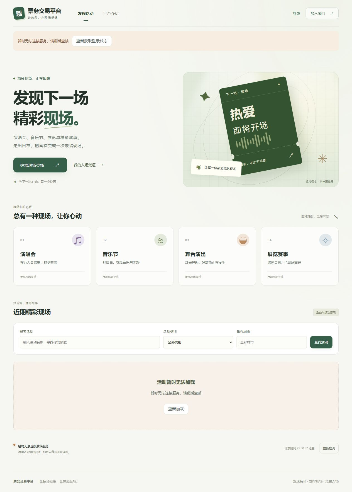
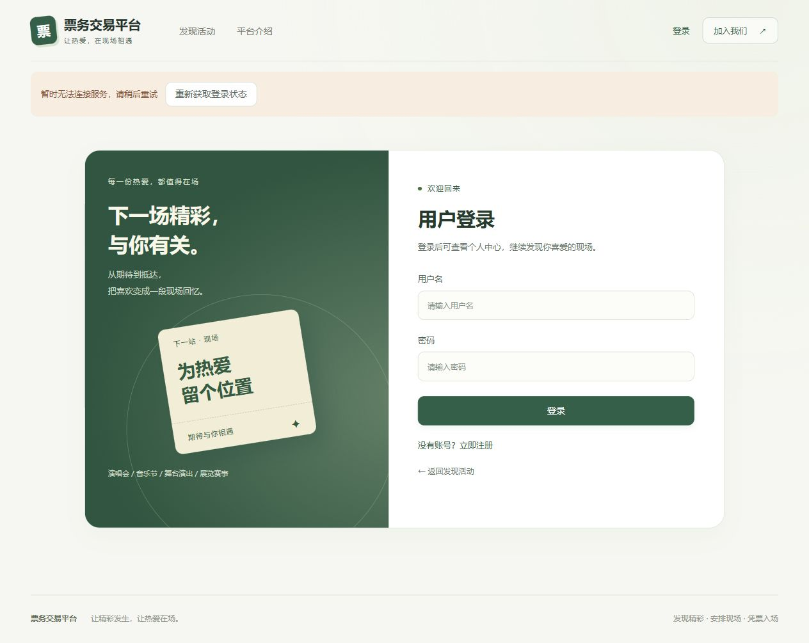
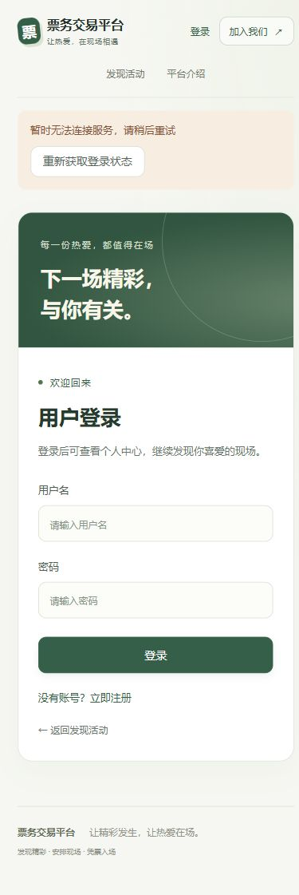

# 前端视觉优化验收

验收日期为2026年10月18日，代码基于main的41f48c1。本轮只调整展示层，沿用暖白、橄榄绿与票券视觉元素。

## 修改范围

- App.vue整理品牌、主导航与个人导航，登录后业务入口仍按原账号角色展示，窄屏导航可以横向滚动。
- style.css统一背景、主题色、按钮、留白和首页卡片；Element Plus悬停配色与页面主题一致。
- AuthLayout.vue为登录和注册提供共用的纯展示布局；两个页面只增加组件引用、布局及输入占位文案。
- event.css、ticket.css、order.css、checkin.css与auth.css统一活动、表单、表格、弹窗、订单和电子票卡片。状态配色读取原有后端状态，不改变状态判断。
- OrderCard.vue、WaitlistView.vue和ElectronicTicketsView.vue只增加用于样式的data-status或class，保留原按钮条件、事件和凭证清理逻辑。
- 第二轮继续整理ProfileView.vue，以真实账号信息和订单、候补、电子票三张入口卡片组织个人中心；补齐三个列表的空状态与原路由入口。
- HomeView.vue增加通往原电子票路由的次要入口；PurchasePanel.vue突出原有预计金额，WaitlistPanel.vue与CheckinScanner.vue只增加展示样式类。ActivityDetailView.vue调整展示文案，不改变场次或销售校验。

13个修改过的现有Vue组件逐一比对script，除AuthLayout的展示组件导入外保持一致。后端、数据库迁移、API、Store、路由、工具函数及依赖清单和锁文件均未修改。

## 实际验证

| 检查 | 结果 |
| --- | --- |
| npm ci | 通过 |
| npm run build | 通过，包含vue-tsc严格类型检查 |
| git diff --check | 通过 |
| 桌面首页、登录页 | 浏览器实际检查通过，导航、票券插画与登录卡片正常显示 |
| 390像素宽度的首页、登录和注册页 | 实际检查，无页面横向溢出；修复了导航第二行受旧固定高度挤压的问题 |
| 登录空表单校验 | 仍显示中文必填提示，未发送登录请求 |
| 首页探索入口 | 点击后正常定位到#discover |
| 新增的首页电子票入口 | 未登录时仍由原路由守卫转到/login?redirect=/tickets，没有绕过认证 |

本轮浏览器使用本地Vite的15173端口。Docker原先未运行，尝试启动后其日志报告dockerInference监听初始化失败，引擎未就绪。因此页面保留了真实的服务不可用提示，没有伪造接口、登录状态或订单数据。本轮未验证登录后的真实活动列表、运营管理、订单、候补及电子票数据页面，未将第九阶段的回归结果冒充本轮测试。没有后端源码变更，本轮没有重跑Maven或数据库集成测试。

## 页面截图

截图均不包含账号密码、有效票券凭证或二维码。

