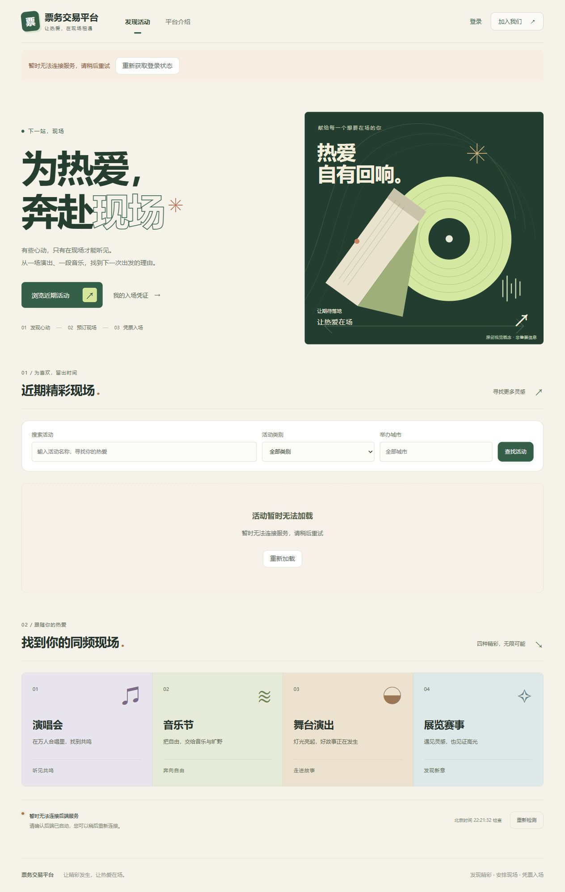
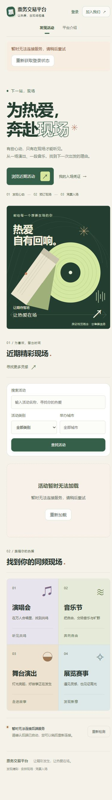
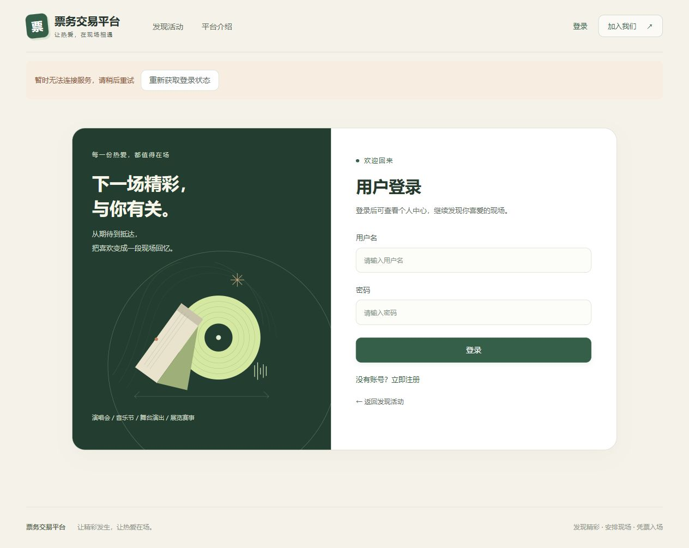
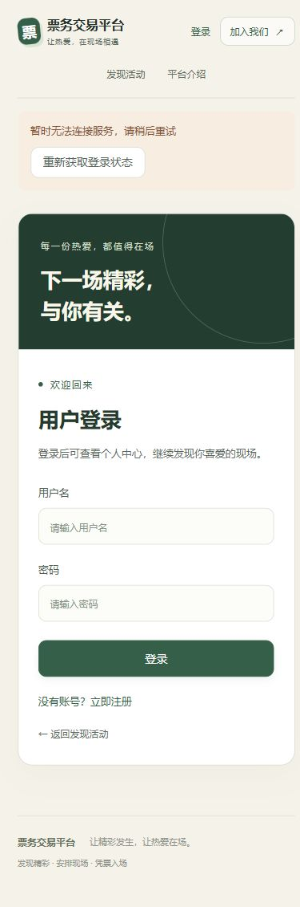

# 获奖案例借鉴与前端展示验收

2026年10月18日，基于main的4db4a19进行本轮展示优化。核心交易、认证和库存逻辑保持不变。

## 参考资料与落地方式

| 实际参考项目 | 核实来源 | 在本项目中的应用 |
| --- | --- | --- |
| KIKK Festival 2017 | [Dogstudio官方案例](https://dogstudio.co/cases/kikk-festival-2017/)记录Awwwards及FWA的Site of the Day；[Awwwards图库](https://www.awwwards.com/inspiration/kikk-festival)可查看主视觉 | 借鉴统一主题画面与清晰的信息层次，使用本项目原创的唱片、纸带、线条作为跨页图形 |
| American Museum of Western Art | [Web Excellence Awards获奖记录](https://we-awards.com/winner/american-museum-of-western-art/)包含视觉设计、用户体验与电商设计；[Webby官方记录](https://winners.webbyawards.com/2026/websites-and-mobile-sites/features-design/best-user-experience/372149/american-museum-of-western-art-integrated-ticketing-and-ecommerce-website)为2026用户体验Honoree | 借鉴内容展示与购票路径衔接，真实活动列表前移，主按钮直接到达原有筛选与列表组件 |

设计判断依据官方获奖记录、设计方案例说明及图库资料。原站浏览器加载超时，没有将原站动效运行或性能视为本轮验证结果。

页面使用原创SVG和系统字体，没有引入参考项目的图片、视频、字体文件或源代码。项目页面没有添加获奖标识，参考站点的荣誉不代表本项目获奖。

## 实际修改

- HomeView.vue采用大标题、描边文字、深绿与浅黄对比和海报式构图；近期活动位于灵感分类之前，保留原ActivityList的数据获取、筛选、分页、错误及空状态。
- StageArtwork.vue是纯展示的原创SVG，首页和AuthLayout.vue共用。图形标记为视觉概念，不包含虚构演出、票价、销量或票券凭证。
- style.css整理首页版式、分类、间距和响应式样式，删除被替代的浮动票券、轨道等旧样式。event.css细化现有活动卡片和默认封面，不改变真实封面图片的加载或失败处理。
- auth.css同步登录注册的图形风格，并收紧320像素宽度下的导航。保留键盘焦点、中文语义标签及减少动态效果偏好。
- router/index.ts只调整scrollBehavior，让片段链接滚动到对应元素；路由表、权限元数据与beforeEach守卫保持不变。

HomeView的script除新增展示组件导入外与基准一致。后端、数据库迁移、API、Pinia Store、工具函数、认证页面业务脚本及依赖清单和锁文件没有修改。

## 验证结果

| 检查 | 实际结果 |
| --- | --- |
| npm ci | 通过；首次因预览进程占用Windows原生依赖文件而失败，停止本次预览后重试通过 |
| npm run build | 通过，包含严格TypeScript检查；最终构建2000个模块 |
| git diff --check | 通过 |
| 桌面浏览器 | 检查构建后的首页、登录页与平台介绍页，版式正常 |
| 手机浏览器 | 首页320与390像素、登录注册390像素检查通过，页面无横向溢出 |
| 活动锚点 | 点击后scrollY约1113，活动区域距视口顶部24像素，确认实际滚动而非仅地址变化 |
| 电子票入口 | 未登录访问仍跳转/login?redirect=/tickets |

检查使用构建后的Vite Preview，地址为127.0.0.1:15173。当前后端未运行，因此保留实际服务不可用提示，没有用静态活动或模拟订单替代接口。登录后的活动、订单、候补、电子票及管理端真实数据展示未在本轮完成联调；未重跑后端Maven和数据库集成测试，也未将之前阶段的结果计入本轮。

第17份验收文档原先只确认了URL片段变更，未核对实际滚动，本轮已更正该记录并修复对应问题。历史截图保留，新增截图另存于frontend/award-inspired。

## 页面效果

