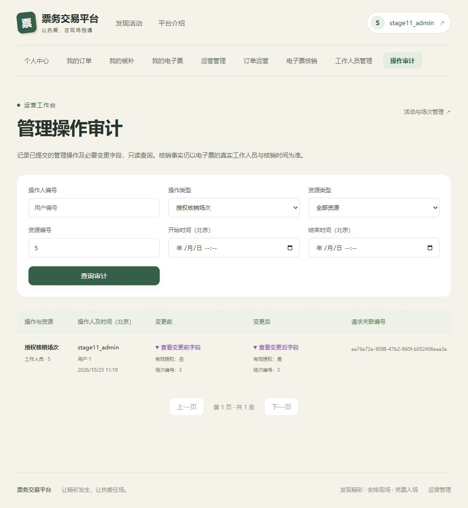

# 第十一阶段工作人员核销与审计验收

## 范围

本阶段在既有Session/CSRF、电子票核销、订单退款和MySQL锁序上增加`CHECKIN_STAFF`角色、按场次授权、管理员审计和对应页面。没有引入通用RBAC、组织/租户模型、真实支付退款或新的服务基础设施。V1～V6迁移保持不变，数据库结构只由V7扩展。

## 实现与数据约束

- `user_account.role`允许USER、ADMIN、CHECKIN_STAFF；公开注册仍只能创建USER。
- `staff_session_permission`保存工作人员、场次、授权管理员、授予/撤销时间，`(staff_id,session_id)`唯一；外键和索引保留人员及场次关系。
- `admin_audit_log`追加业务操作类型、资源、UTC时间、请求ID及显式前后快照；UPDATE/DELETE触发器阻止常规改写，接口仅对ADMIN开放分页查询。
- `/api/v1/admin/checkins`保留原ADMIN核销行为；`/api/v1/checkins`复用原核销服务，ADMIN可核销所有正常场次，CHECKIN_STAFF只可核销自己当前获准的场次。STAFF无法访问其他`/admin/**`端点。
- 授权、撤销、降级和停用以工作人员账号行锁协调；核销保持工作人员→活动→场次→SKU→订单→票券顺序，在同一事务检查授权并通过UNUSED条件更新保证同票最多成功一次。
- 活动、场次、票档/库存、工作人员权限和管理员退款的成功审计与业务写操作同事务提交。核销高频事实继续由电子票`checked_by`和`used_at`记录，审计不复制凭证明文或认证秘密。

## 权限矩阵

| 能力 | USER | CHECKIN_STAFF | ADMIN |
| --- | --- | --- | --- |
| 查看本人订单、候补及票券 | 允许 | 允许 | 允许 |
| `/checkins/sessions` | 403 | 当前有效授权的正常且未结束场次 | 全部正常且未结束场次 |
| `/checkins` | 403 | 仅票券所属授权场次 | 保留管理员全场次核销策略 |
| `/admin/checkins` | 403 | 403 | 允许，原路径保持兼容 |
| 活动、票档、库存、退款管理 | 403 | 403 | 允许 |
| 工作人员角色及场次管理 | 403 | 403 | 允许，不可借此修改ADMIN |
| 全站管理审计查询 | 403 | 403 | 分页及受控条件查询 |

## 本轮实际检查

验证日期：2026-10-23。

| 检查 | 结果 |
| --- | --- |
| `mvn -f backend/pom.xml clean verify` | 通过；55项基础测试，失败0、错误0、跳过0，编译及打包成功 |
| `scripts/start-backend.ps1 -VerifyDatabase` | 通过；独立随机`_it`库执行55项基础测试及150项真实MySQL/RabbitMQ集成测试，共205项，失败0、错误0、跳过0 |
| 普通数据库账号迁移探针 | 通过；无SUPER权限的应用账号在独立空库完成V1～V7，两个审计触发器均存在 |
| V7部署只读检查 | 通过；分别识别失败Flyway历史、部分DDL遗留对象和成功应用V7的状态 |
| `python -m unittest discover -s scripts/performance -p test_safety.py` | 通过；5项压测环境隔离安全测试 |
| `cd frontend; npm ci` | 通过；安装143个包，npm报告0个漏洞 |
| `cd frontend; npm run build` | 通过；`vue-tsc --noEmit`和Vite生产构建成功 |
| `git diff --check` | 通过；仅有仓库现存CRLF行尾转换提示，没有空白错误 |

基础测试和集成测试的数量分别统计，205项不再重复叠加55项。Java生产代码完成上述全量测试后未再改动；后续补充的部署只读SQL在失败库及成功探针库中分别执行核对。前端构建包含严格TypeScript检查，安装依赖不作为构建通过的替代。

## 迁移、并发与审计结果

空库由Flyway依次运行V1～V7，并由`DatabaseMigrationIT`验证约束、索引、UTC及交易关联。`StaffMigrationIT`新建独立schema从V6升级到V7，只执行一个新增迁移，核对原USER/ADMIN角色、停用账号、成功支付流水以及USED票的核销人/时间逐项保持一致；工作人员角色CHECK、授权唯一键/外键和审计UPDATE/DELETE拒绝均通过。V1～V6文件未修改。

`StaffAuditIT`的17项真实MySQL测试覆盖注册不可提权、ADMIN/STAFF/USER隔离、所有新增写入口CSRF、重复授权幂等、旧Cookie撤权/降级/停用、授权与核销竞争、审计原子性及查询脱敏。实际竞争结果包括：

- 两名已授权工作人员竞争同票，响应恰为200和409，数据库仅一条USED事实，库存及支付保持原状态。
- 撤权事务持有工作人员行锁时，核销请求等待；撤权提交后返回403，票仍UNUSED且无核销人。
- 同时发起核销和撤权，只允许先核销成功后撤权，或撤权先提交而核销403；撤权完成后的旧Cookie均不能再成功核销。
- 两名管理员持同一库存版本并发修改，恰好一笔成功、一笔409；只有成功修改产生审计，后续修改的旧值接续前次已提交新值。
- 注入审计插入失败时，库存修改与Outbox一同回滚；业务冲突也不产生成功审计。活动/场次/票档全生命周期、整单模拟退款和人工待核对结果保存真实前后值。
- 禁用历史操作人不丢失审计，敏感字段检查及审计筛选/时区/分页校验通过。

本轮首次对原开发库`ticketing`运行时，MySQL开启binlog而`log_bin_trust_function_creators=0`，V7在创建第一个审计触发器时报1419。用户角色CHECK和两张新表已由MySQL提交，Flyway保留V7失败记录，触发器未创建。此库的失败历史和部分DDL均保留，未执行repair、清库、删除部分DDL或改写迁移。后续全量验收使用新建的独立`_it`库；开发及专用压测Compose补充触发器创建策略后，另以非SUPER普通账号完成空库启动验证。

**原开发库部署仍处于停止状态，须由数据库管理员在备份后人工恢复该迁移现场；本阶段的隔离验收通过不代表这个失败库已经修复。** `scripts/audit-staff-audit-readiness.sql`对此库返回`STOP_FAILED_MIGRATION`及`STOP_EXISTING_V7_OBJECT`，对成功探针库返回`V7_ALREADY_APPLIED`。后续升级先执行该只读检查，出现STOP就停止。

## 三角色浏览器联调

本轮使用真实Vue页面、Session Cookie、CSRF和独立`ticketing_stage11_browser`数据，通过手工凭证输入完成：

1. ADMIN在工作人员管理页提升真实注册的普通账号，分配一个正常场次；审计页按操作类型和工作人员编号筛选，展开快照确认授权由“否”变为“是”。
2. STAFF登录后只出现工作人员核销入口，场次列表只显示被授权场次。授权票核销成功并展示真实工作人员编号；同票重试显示已核销，未授权场次显示无授权。
3. 保持STAFF原浏览器会话，另一个ADMIN会话撤权；原会话核销另一张未用票被拒绝，刷新场次后为空。数据库复核该票仍UNUSED且核销人/时间为空。
4. STAFF直接进入订单运营页面被跳转至无权提示；USER登录后没有运营或核销导航，直接进入工作人员核销、管理审计页面均被拒绝。另核对10项真实HTTP访问限制均为403。
5. ADMIN从原`/admin/checkins`页面成功核销工作人员未获授权的对照场次，真实核销人仍为管理员。数据库最终为工作人员USED一张、管理员USED一张、撤权后UNUSED一张。



本轮没有使用实体摄像头硬件；摄像头扫码不计为本轮已验证项。

## 核销性能对照

保留原`performance/results/stage11/before/checkin-100/`记录。本轮另从当前基准`96ec69f868e837e6692405b3b56e3095b94920b8`导出源码独立构建基准JAR，在相同机器、镜像、V7专用schema、1000活动/1场次/100用户、连接池10、Outbox批量100下依次比较基准ADMIN、阶段11 ADMIN、阶段11 STAFF。基准产物仍为阶段10代码，运行于同一个V7结构以控制数据库结构差异；没有回滚schema。每轮100 VU，预热10秒，按请求完成时间截取其后固定20秒。

| 路径 | 稳定窗口请求数 | 请求/秒（数量÷20） | p50毫秒 | p95毫秒 | 预期409 |
| --- | ---: | ---: | ---: | ---: | ---: |
| 基准ADMIN | 3038 | 151.9 | 534.20 | 1436.92 | 3037 |
| 阶段11 ADMIN | 3890 | 194.5 | 362.63 | 1310.91 | 3889 |
| 阶段11 STAFF | 3182 | 159.1 | 530.41 | 1176.36 | 3181 |

三轮各一次真实核销成功；所有409均匹配预期业务码。5xx、传输错误、非预期错误及监测失败均为0，数据库一致性快照全部通过。每轮初末Outbox均无事件与积压，投递延迟没有样本，不能解释为零毫秒。稳定吞吐按固定20秒计算，未使用k6按整个运行时间计算的Counter rate冒充稳定吞吐。

本轮未观察到核销路径退化，未调整连接池、锁序、签名或鉴权以追求指标。这是三次本机短窗口同票争抢对照，不能据此宣称稳定性能提升或生产容量。硬件、JAR SHA-256、聚合统计、监测、SQL诊断及审计结果见[本轮原始结果](performance/results/stage11/verification-20261023/)；原始JSON未包含setup_data、Cookie、密码、票券凭证或签名密钥。

## 复现步骤

先在已有Flyway库只读执行`scripts/audit-staff-audit-readiness.sql`，检查迁移状态、触发器策略及当前账号权限。为全量集成测试创建独立的`_it`验收库，通过进程环境变量指定MYSQL连接；历史迁移探针须在隔离实例内拥有建schema权限。不修改开发.env，不使用开发业务库进行测试清理。再执行：

```powershell
powershell -NoProfile -ExecutionPolicy Bypass -File scripts/start-backend.ps1 -VerifyDatabase
cd frontend
npm ci
npm run build
```

授权/审计页面复现按[本地开发第十一阶段](05-local-development.md#第十一阶段工作人员及管理审计)操作：先注册普通账号，再由显式初始化的ADMIN提升与授权；准备同窗口内两个场次的已付票，只授权其中之一，保持工作人员Cookie完成成功、未授权、撤权后拒绝及审计快照检查。

性能环境仅使用固定`ticketing-perf`、`ticketing_perf`和随机标记。按[压测复现](performance/01-reproduce.md)准备或恢复专用环境后，对基准JAR和当前JAR分别执行以下命令，基准及当前ADMIN两轮不加`--staff-checkin`，STAFF轮才加；每轮使用新的label以保留原始结果：

```powershell
python scripts/performance/perf.py start --jar backend/target/ticketing-backend-0.1.0-SNAPSHOT.jar --pool-size 10 --outbox-batch-size 100
python scripts/performance/perf.py prepare --scenario checkin --users 100 --staff-checkin
python scripts/performance/perf.py run --scenario checkin --vus 100 --warmup 10 --duration 20 --label stage11-reproduce-staff
python scripts/performance/perf.py audit
python scripts/performance/perf.py stop
```

结果写到`docs/performance/results/<label>/checkin-100/`。基准源码可用`git archive --format=zip --output=<私有ZIP路径> 96ec69f`导出到新私有目录后以Maven打包，不覆盖当前工作区。基准仅用于对照，不将该版本未重新执行的测试算作本轮通过。

## Docker数据保留与收尾

验收临时恢复归档的专用MySQL/RabbitMQ卷，恢复后随机标记验证和真实压测通过；结束后先关闭专用进程和容器，再以只读挂载重新归档，571个文件SHA-256及路径元数据全部一致后才移除两个闲置卷。原归档和新归档均在忽略的`.local/docker-volume-backups/`内保留，备份目录限制访问并提供恢复脚本，不提交私有配置或数据。RabbitMQ恢复须保持所恢复mnesia目录对应的节点名，不能删除旧节点目录。

最终仅保留3个健康开发容器及其`ticketing_mysql_data`、`ticketing_rabbitmq_data`、`ticketing_redis_data`卷。专用Redis改用`/data` tmpfs，避免生成匿名卷；开发Redis的AOF命名卷保持持久化。原开发MySQL的失败迁移现场仍完整保留。
