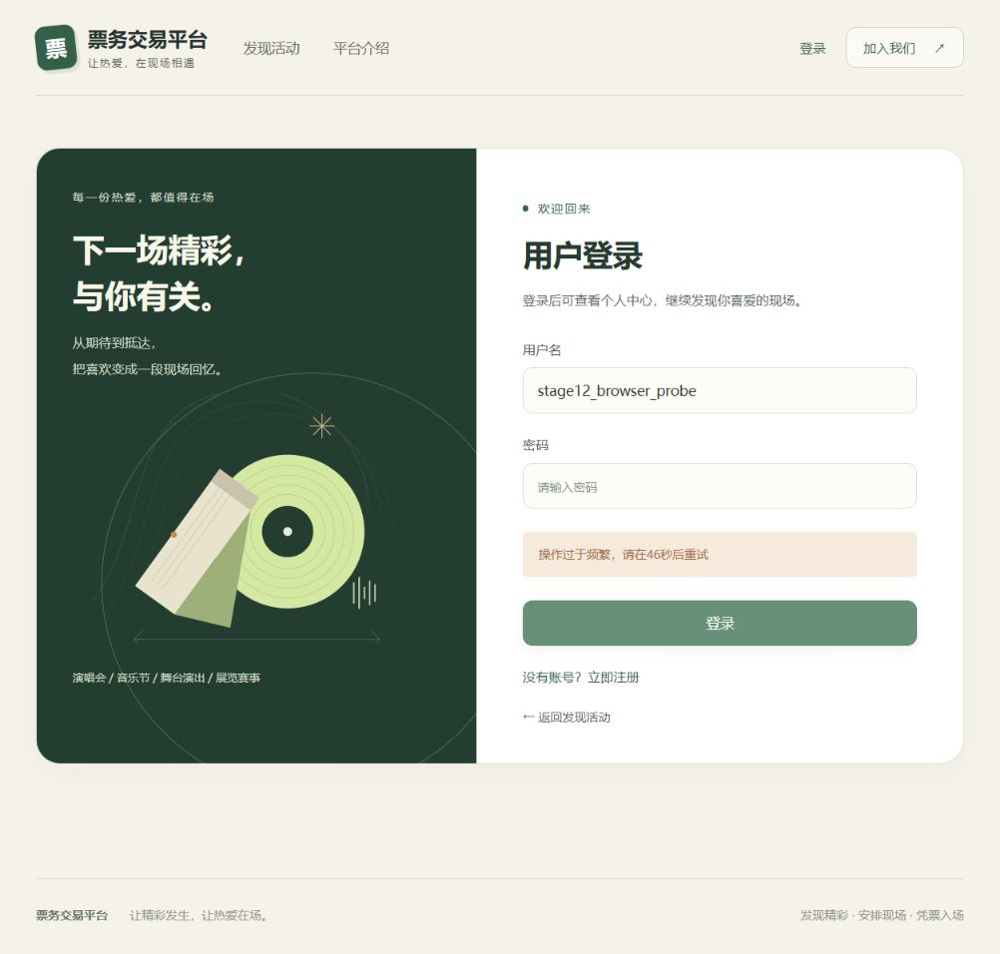
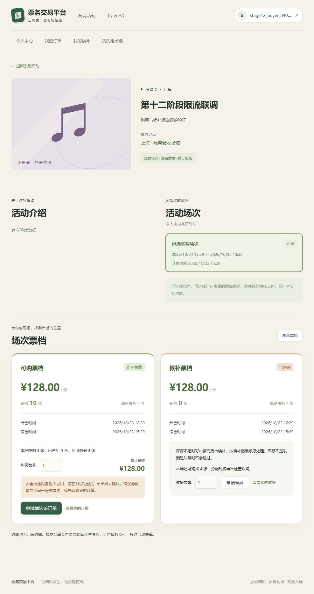

# 第十二阶段Redis请求频率保护验收

本文保留第十二阶段的历史验收口径。第十三阶段已增加新会话预算和显式受信代理，并完成原开发库受控V7恢复；当前部署与验证说明见[阶段十三验收](23-session-proxy-migration-verification.md)。

## 范围与接入

重新检查backend、frontend、deploy、scripts/performance、docs及测试布局后，在既有单模块及扁平分层上实现限流。生产新增`RateLimitProperties`、`RedisRateLimiter`、`RequestRateLimitFilter`及一个Lua资源，全部登记auth逻辑归属。不新增依赖、数据库表或迁移；V1～V7原文件保持不变。

Spring Security执行顺序为：`CsrfFilter` → 认证入口限流 → 现有Logout/formLogin → `CurrentAccountFilter` → `AuthorizationFilter` → 业务提交限流 → Controller。登录由真实`UsernamePasswordAuthenticationFilter`处理，限流读取同一表单参数，注册分支不读JSON Body。两个过滤器实例使用不同的already-filtered属性，只由Security链注册，无Servlet重复注册。限流不打开数据库事务，拒绝后不进入交易服务。

登录采用全部**放行尝试**计数：密码正确、错误、账号不存在或停用的认证尝试都消耗相同预算；成功不清零。达到任一维度的阈值即拒绝，拒绝不递增任何维度、不延期现有窗口。只有有效CSRF请求进入计数，业务提交还必须先通过最新数据库身份与授权。Controller参数校验错误仍消耗已放行预算；这防止无效提交无限制进入应用层。

## Redis键和窗口

键为`ticketing:rate-limit:v1:<namespace>:<category>:<HMAC-SHA256十六进制摘要>`，分类为login-ip、login-account-ip、register-ip、order-user、waitlist-user。输入按分类以NUL分隔，账号trim后按Locale.ROOT小写；用户名原规范只允许ASCII。登录账号维度与连接IP绑定，无独立账号全局封禁键。HMAC使用独立环境密钥，防止对低熵用户名/IP直接进行无密钥字典匹配；多实例共享密钥、命名空间与Redis实例才能共享预算。变更这些配置重置短期预算，数据库业务事实不变。

Lua在Redis单次原子执行中先检查所有维度，再一起INCR，并仅在首次计数时设置PEXPIRE。窗口从该维度首笔放行开始，使用Redis自身PTTL；不依赖应用主机时钟。不同登录维度各有窗口起点，拒绝返回所有当前受限维度的最大剩余TTL，毫秒向上取整为秒。拒绝不延长窗口，误写的永久计数键会恢复配置TTL，避免永久封禁。当前部署为单机Redis，未宣称支持Redis Cluster多槽Lua。

这是固定窗口，窗口边界附近可出现接近两倍阈值的短时突发，不宣称严格任意滑动时间段内限额。默认IP登录60/60秒、账号+IP登录10/60秒、注册IP 10/600秒、下单用户30/10秒、候补用户10/60秒。下单同键重试照常消耗预算；限流不缓存成功结果、不绕过MySQL幂等。30/10秒允许常规重试，恶意反复使用同键也受保护；耗尽后保留原订单及请求键，待窗口恢复后仍返回原订单。

连接地址仅取`request.getRemoteAddr()`，明确关闭Spring转发头处理。不信任客户端X-Forwarded-For、X-Real-IP和Forwarded；当前没有受信代理列表功能。反向代理部署会按代理连接IP共享预算，应评估并配置阈值，不能直接信任互联网请求头。

## 故障、隐私与前端

Redis连接/命令超时默认500ms，受限入口故障关闭，统一503 `RATE_LIMIT_UNAVAILABLE`、中文信息、Retry-After默认1秒及no-store，不无限制放行。首次故障只记录分类和异常类型，恢复只记录一次；不打印异常正文、请求体、键、Session或凭证。指标`ticketing.security.rate.limit.requests`只有四个route和三个outcome标签，不使用用户、订单、IP或Redis键作为标签。

故障仅影响四类提交；公开活动/场次/票档读取、已登录查询、支付、取消、退款、核销及后台补偿不新增Redis依赖。保持已有BCrypt、30分钟Cookie Session、HttpOnly/SameSite/Secure策略、Session fixation防护和CSRF刷新。前端统一处理429及该503的Retry-After，登录/注册/下单/候补展示中文等待提示，不自动重试。首次提交明确的限流503不再提示订单结果未知；真正网络中断/其他5xx保留同键确认行为。若先前提交已超时待确认，后续429/限流503仍保留原幂等键与待确认状态，不能因为本次拒绝而丢失上一笔提交的事实。

## 测试与复现

普通测试资源显式关闭限流，避免基础/历史业务回归隐式依赖Redis；生产配置默认开启且缺密钥启动失败。`RateLimitConfigurationTest`验证默认开启、必要密钥、边界、部分策略绑定及受控关闭。`RateLimitIT`显式启用真实Redis，使用随机it_命名空间和密钥，只SCAN/DELETE自身键；不FLUSHDB、不清理开发Redis。

真实集成须先启动专用Compose，在独立`_it`数据库配置MYSQL_*与RABBITMQ_*，执行`scripts/start-backend.ps1 -VerifyDatabase`。Redis默认16379，可用RATE_LIMIT_TEST_REDIS_PORT覆盖。测试覆盖真实formLogin正确/错误计数、Session换号及退出、CSRF先于限流、未知/停用账号统一错误、IP组合公平性、大小写、伪造代理头、TTL恢复、两实例160并发精确放行50、业务无写拒绝及窗口后幂等、STAFF撤权/停用先于业务保护、503响应与真实断连超时。HTTP 503细分入口的单测使用Redis客户端异常注入；另外的专用环境探针实际停止Redis，不能将注入测试当作真实停机证据。

性能工具只操作固定ticketing-perf Compose、ticketing_perf库及随机隔离标记，启动时清除继承的RATE_LIMIT_/PERF_参数；模式写入结果，随机测试密钥仅传子进程。历史结果不覆盖。

```powershell
python scripts/performance/perf.py init
python scripts/performance/perf.py start --jar backend/target/ticketing-backend-0.1.0-SNAPSHOT.jar --rate-limit-mode regression
python scripts/performance/suite.py --label stage12-regression --levels 50 --scenarios query,hot-ample,hot-scarce,mixed,waitlist,checkin --warmup 10 --duration 20
python scripts/performance/perf.py stop
# 相同JAR、场景、数据量和配置，以baseline模式显式关闭保护重跑，换label保留对照。
python scripts/performance/perf.py start --jar backend/target/ticketing-backend-0.1.0-SNAPSHOT.jar --rate-limit-mode baseline
python scripts/performance/suite.py --label stage12-baseline --levels 50 --scenarios query,hot-ample,hot-scarce,mixed,waitlist,checkin --warmup 10 --duration 20
python scripts/performance/perf.py stop
# 先在regression模式prepare query夹具，再stop，以production模式重新启动。
python scripts/performance/perf.py start --jar backend/target/ticketing-backend-0.1.0-SNAPSHOT.jar --rate-limit-mode production
python scripts/performance/verify_rate_limits.py --label stage12-production
python scripts/performance/perf.py stop
```

生产阈值探针必须在新启动的独立进程中执行，避免旧请求消耗预算；包含真实160个HTTP注册请求（有效CSRF、无效Body不写入账号），精确10次到Controller返回400、150次429，下单/候补预算、真实专用Redis停机四入口503、公开/Session查询保持200、事实不变及重启恢复。禁止对开发或真实业务Redis执行停机探针。

## 部署边界

第十一阶段原开发库的V7失败历史和部分DDL仍保留，未repair、清库或改写迁移。部署前只读执行audit-refund-readiness.sql、audit-waitlist-relations.sql、audit-staff-audit-readiness.sql，出现异常/STOP必须停止部署；隔离测试通过不表示原失败库已恢复。本阶段不要求更改库结构。

## 本轮结果

验收日期为2026-10-23。先完成代码和整轮验证，再统一提交main。后端生产代码完成全量测试后未再修改；前端补充待确认请求的同键保留后重新构建并完成真实超时联调。

| 检查 | 实际结果 |
| --- | --- |
| `mvn -f backend/pom.xml clean verify` | 58项基础测试，失败0、错误0、跳过0，编译与打包成功 |
| `scripts/start-backend.ps1 -VerifyDatabase` | 专用MySQL/RabbitMQ/Redis及新建ticketing_stage12_final_it中58项基础加161项真实集成，共219项全部通过，失败/错误/跳过均为0 |
| `RateLimitIT` | 11项全部通过；两实例160并发精确放行50、拒绝110；真实HTTP注册TTL恢复、登录链路、代理头、角色/CSRF顺序、订单/候补无写拒绝及幂等恢复通过 |
| 生产阈值真实HTTP并发 | 160次注册，10次通过限流到Controller校验返回400，150次429；下单30次、候补10次预算后429，数据库事实不变 |
| 真实Redis停机/恢复 | 四类入口均503，实测500/515/532/515毫秒；公开和Session订单读取200，事实不变，重启恢复 |
| 历史交易及权限回归 | 全量包含退款/取消善后、核销/工作人员授权、迁移、Outbox确认/重试及数据库补偿测试，未跳过原测试 |
| `npm ci` | 安装143个包，npm报告0个漏洞 |
| 最终`npm run build` | vue-tsc严格检查与Vite生产构建通过 |
| 性能工程安全测试 | 7项全部通过，含环境标记、固定Compose、本机Docker、报告目录、参数和秘密隔离 |
| k6性能及数据库快照 | 12轮全部通过，每轮50VU、预热10秒、按完成时间截取其后固定20秒 |
| 共享结果/迁移检查 | setup_data、Cookie、密码、有效票券、签名及限流密钥扫描通过，V1～V7无修改 |

基础58项已包含在mysql-it的219项内，不重复叠加。Redis异常注入、真实断连和实际停机探针分别记录，不混为同一种证据。原始故障记录见[生产阈值探针](performance/results/stage12-production/rate-limits.json)，运行与安全检查汇总见[本轮验证](performance/results/stage12/validation.json)。

### 浏览器联调

真实Vue页面使用独立ticketing_stage12_browser库和独立Redis命名空间，测试时将登录账号+IP阈值设3、注册IP设2、下单用户设2、候补用户设1，注册、下单与候补窗口均设60秒，便于观察；这些是显式测试参数。登录/注册达到阈值均显示中文等待秒数；购票和候补先各成功创建一笔，再次高频提交显示429。实际停止专用Redis后购票显示503，前后订单仍1笔、候补仍1笔、locked仍1、sold仍0。

随后恢复生产阈值，在真实MySQL事务持有测试买家行锁45秒，使一次实际下单超过前端5秒超时；页面保留“重试确认该订单”。此时停止专用Redis，再次手工重试显示503及原待确认说明，按钮和原幂等键仍保留。释放用户锁后，超时原请求提交成功；恢复Redis并再次手工重试，页面进入该原订单，数据库历史订单总数在重试前后均为2（含前一笔已过期订单），未产生第三笔订单。期间未写浏览器存储、未导出Cookie、CSRF或请求幂等键。[聚合事实](performance/results/stage12/browser-verification.json)记录前后数量。





### 性能对照与实际限制

关闭组为baseline，开启组为regression；后者在隔离配置中将五类阈值显式提高至10000，保留Redis Lua、摘要和指标开销，不改变生产默认值。两组使用同一第十二阶段JAR（SHA-256 `575ca7283eb125833b2416a313a84f63af9044d29d8577095091e14ae328e0df`），连接池10、Outbox批量100、1000活动、50用户，混合场景64场次，其余1场次。metadata中的baseCommit为运行时HEAD d75c7d1，实测JAR包含当时尚未提交的本阶段后端代码，以JAR摘要核对产物。

| 场景 | 关闭 请求/秒 | 开启 请求/秒 | 关闭 p95毫秒 | 开启 p95毫秒 |
| --- | ---: | ---: | ---: | ---: |
| query | 860.50 | 940.95 | 156.49 | 135.61 |
| hot-ample | 43.80 | 46.20 | 1785.25 | 1830.66 |
| hot-scarce | 139.10 | 125.35 | 606.58 | 712.67 |
| mixed | 108.50 | 118.45 | 942.82 | 744.63 |
| waitlist | 373.25 | 385.25 | 150.88 | 117.26 |
| checkin | 153.10 | 173.50 | 796.40 | 659.89 |

稳定吞吐均为实际请求数÷20秒；409只按既有预期业务码计入，所有轮次5xx、传输错误、未知错误、监测失败均为0。每个核销轮恰好一次成功，候补轮50人全部分配并支付，库存、支付、限购、关联及票券审计全部通过。上述为每场景一组短时本机对照，存在JIT、调度和锁竞争波动；稀缺库存本轮吞吐下降约9.9%、p95增加约17.5%，不能宣称稳定性能提升或完全无退化。本轮保留结果并未降低鉴权/签名/持久化，也未调整默认阈值或连接池以追逐指标。

Outbox不能只看最终SENT样本：下表列出采样观察到的PENDING+PROCESSING峰值及最终全部已投递样本延迟。每轮结束等待有界排空后的PENDING/PROCESSING/FAILED均为0。baseline候补开始时仍有3条PENDING、47条SENT，开启组开始时50条SENT；这些起点差异保留在原始快照中。查询/核销轮没有Outbox事件及延迟样本，不解释为零毫秒。

| 场景 | 关闭/开启观测积压峰值 | 关闭最终SENT数量及平均/最大毫秒 | 开启最终SENT数量及平均/最大毫秒 |
| --- | ---: | --- | --- |
| hot-ample | 411 / 514 | 540；21106.90 / 25510.26 | 567；21509.33 / 25595.72 |
| hot-scarce | 185 / 189 | 302；11311.24 / 16695.12 | 276；12037.77 / 17065.43 |
| mixed | 711 / 780 | 787；23315.35 / 27946.13 | 860；23584.56 / 29384.94 |
| waitlist | 14 / 20 | 100；956.85 / 2338.51 | 100；1152.35 / 2782.74 |

负载期间实际出现秒级消息延迟，最终排空不能掩盖这一现象；保留既有退避、批量100和数据库补偿语义，未在本阶段扩展消息性能优化。全部环境、JVM/MySQL/队列监测、SQL诊断及原始统计位于[关闭组](performance/results/stage12-baseline/)、[开启组](performance/results/stage12-regression/)和[本轮硬件记录](performance/results/stage12/hardware.json)。未对真实生产容量、分布式多机吞吐或实体摄像头作本轮已验证声明。

本轮只读检查开发库的退款及候补关联无异常，工作人员审计迁移检查仍返回STOP_FAILED_MIGRATION与STOP_EXISTING_V7_OBJECT，因此开发库部署继续停止；未修改其DDL或Flyway历史。验收及浏览器数据保留在隔离环境中，专用进程和容器在收尾时停止，不删除业务库、Redis数据或Docker持久卷。本阶段到此结束，不增加真实支付、缓存库存、分布式锁或新基础设施。
