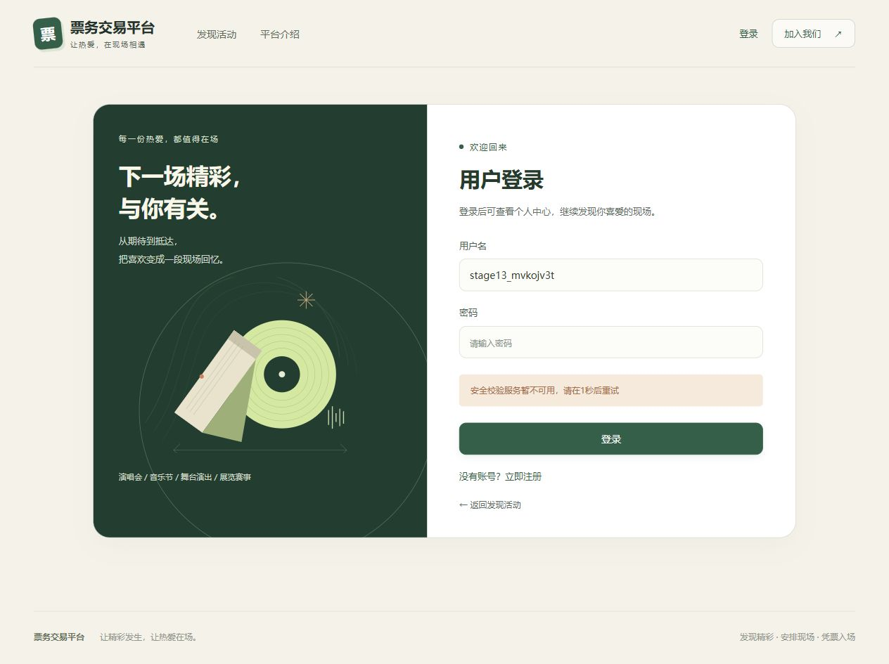
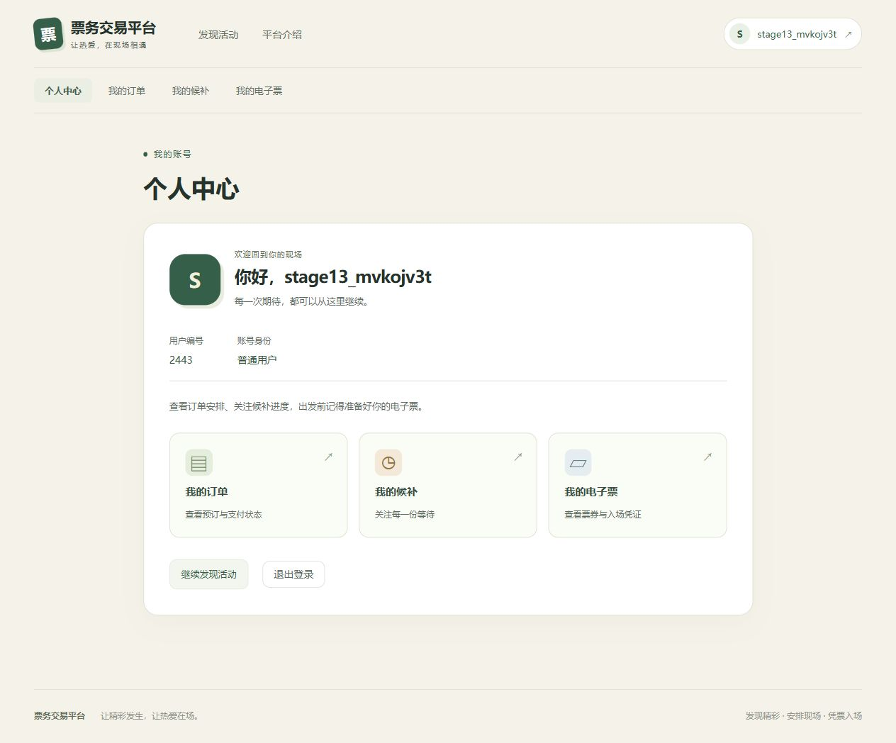

# 第十三阶段会话、代理与迁移安全验收

## 范围与恢复起点

本阶段接续`1e0dc86`的第十二阶段成果，补充匿名CSRF新会话预算、显式受信代理解析、迁移前只读预检及V7受控恢复。原有交易、限购、候补、电子票、核销、退款与Outbox事务协议保持不变，无新增基础设施、依赖或数据库迁移，V1～V7原文件保留。

此前中断时已有核心实现、V7克隆恢复证据、原开发库单次授权恢复记录及第一轮测试。本轮保留这些成果，修正验收未闭环部分：HEAD csrf应保持403且不生成令牌；善后重启测试须等待两笔独立事务都完成；恢复工具的最终数据核验改为显式失败检查，避免Python优化模式跳过assert。首次失败日志和私有备份保留，未重做原开发库恢复。

## 会话创建保护

Security链依次为：新会话限流 → CsrfFilter → 登录/注册限流 → 既有认证及最新账号检查 → AuthorizationFilter → 下单/候补限流 → Controller。三个限流实例使用不同的already-filtered标记，仅由Security链注册。

没有有效HttpSession时，GET csrf与所有需要CSRF的写请求消耗`csrf-session-ip`预算；默认120次/60秒，按客户端来源的HMAC摘要建键。伪造、过期Cookie不能替代服务端Session检查。仅GET csrf允许公开读取令牌；HEAD仍403且不物化令牌、不创建Session。安全的公开查询不参与新会话预算。已有有效Session读取令牌不消耗该预算，已有标签页、登录换号后的Session继续复用。退出使Session失效后，重新获取令牌属于新会话路径。

429/503沿用中文ApiResponse、Retry-After和no-store。前置拒绝不创建Session、不返回Set-Cookie、不进入Controller。无Session的写请求可能先被新会话预算拒绝，然后才轮到CSRF或授权；已有Session的校验顺序保持原语义。Redis故障时新会话创建故障关闭，已有Session的csrf和公开/订单读取保持可用，登录/注册/下单/候补仍各自受既有保护。

这是每来源的固定窗口，不能替代全站容量保护，也不保证跨节点本地Session共享。不新增Spring Session。实际Session创建与销毁由CsrfSessionIT中的Tomcat监听器计数，拒绝数不代替资源增长证据。第十二阶段原始80并发无Cookie全部创建Session的[基线](security/results/stage13-csrf-baseline.json)继续保留。

## 受信代理

DIRECT为默认模式，只认Servlet连接IP并忽略所有转发头。TRUSTED_PROXY必须显式配置代理数值IP/CIDR；禁止域名和/0，列表最多32项。仅连接地址受信时读取唯一X-Forwarded-For，从右向左剥离受信节点，在最近不可信节点停止，不直接相信最左地址。IPv4/IPv6规范化后进入同一限流摘要协议，不做DNS解析。X-Real-IP和Forwarded从不作为来源。

在需要解析来源的新会话、登录及注册入口，受信源缺头、重复头、控制字符、非法IP、端口/方括号/区域标识、超长头或超多跳均400 INVALID_CLIENT_ADDRESS，且不创建新Session。默认8跳/1024字符，上限32跳/4096字符。DIRECT带代理列表或TRUSTED_PROXY无列表拒绝启动；Spring的forward-headers-strategy必须none，防止容器先改写连接来源。

`deploy/nginx.conf.example`适用于单一边缘代理，须合并到既有TLS站点。代理覆盖外部X-Forwarded-For、清空其他来源头，同机部署后端通过SERVER_ADDRESS=127.0.0.1绑定并限制网络访问。多层代理须逐层清洗并准确配置范围。TrustedProxyIT以真实TCP连接和转发链验证边界，不宣称已在生产Nginx或公网网络中部署。

## 迁移预检与受控恢复

应用通过FlywayMigrationStrategy，在任何迁移DDL前读取历史、V7对象、触发器策略及目标schema的TRIGGER权限。有失败历史、未登记对象、成功历史与触发器缺失不一致、权限或策略不足时停止；不自动repair、清库、改全局变量或申请SUPER。成功V7启动不再要求重新具备创建触发器的策略。完整结构仍须通过只读审计详细输出与原迁移参考结构人工核对，启动检查不替代完整结构审查。

部署顺序为：停止业务写入、确认备份 → 只读执行`audit-refund-readiness.sql`、`audit-waitlist-relations.sql`、`audit-staff-audit-readiness.sql` → 无异常后启动。STOP必须停止，不可通过禁用Flyway绕过。审计脚本兼容空库、V6、成功V7和失败现场，SET/PREPARE只影响当前连接。

`scripts/recover-v7.py`仅用于人工明确授权的已核验失败分支：V1～V6成功且checksum匹配、唯一失败为V7、两表完整建立而两个审计触发器均缺失。默认audit以及不带--apply的recover只读。备份含所有表、逐行摘要及完整dump，须先在当时的独立验收环境（现已退役）实例验证恢复和原V7参考结构。执行恢复还必须同时提供数据库名、server UUID、维护窗口确认和已验证备份；数据相对备份变化立即停止。

恢复命令中的显式确认是人工操作条件，不能加入启动脚本或无人值守任务：

```powershell
# MYSQL_PASSWORD只从进程环境注入；输出、备份、journal全部保存在私有目录。
python scripts/recover-v7.py --action audit --database ticketing
python scripts/recover-v7.py --action backup --database ticketing --directory .local/v7-reviewed-backup
# RECOVERY_VERIFY_PASSWORD和RECOVERY_VERIFY_GUARD为既有专用环境的私有参数。
python scripts/recover-v7.py --action verify-backup --database ticketing --directory .local/v7-reviewed-backup
# 仅在已获授权且所有预检通过的维护窗口执行，UUID来自本次只读诊断。
python scripts/recover-v7.py --action recover --apply --database ticketing --confirm-database ticketing --confirm-server-uuid $targetServerUuid --maintenance-confirmed --directory .local/v7-reviewed-backup
```

工具只移除核对过的失败V7表，保留其数据，自行调用Flyway移除已核验失败历史后真正重放原V7，再回灌两表数据及自增位置，逐表核对全部业务行并validate。每步写私有journal，任何失败保留现场；不提供自动重试、自动回滚或通用数据库恢复功能。Python需pymysql及可用的本机Docker/Maven。不可将备份、授权记录、凭据或明细日志提交版本库。

MigrationSafetyIT只在固定13307端口、_it数据库和匹配随机guard下运行，创建独立schema，用schema授权普通账号验证空库、V6升级、缺TRIGGER、真实1419部分失败及失败后停止；全局触发器策略只在该专用实例临时修改并在finally恢复，故意失败schema保留供诊断。普通验证环境未提供guard时这些破坏性策略探针会跳过，不能将跳过算通过。

原开发库在前会话的单次明确授权下完成恢复，[恢复聚合证据](security/results/stage13-migration-recovery.json)记录备份、克隆及历史事实保留。本轮再次只读执行三个预检：V1～V7全成功、0失败、2个审计触发器，所有业务行摘要与已恢复备份一致；见[最终只读核对](security/results/stage13-readiness-final.json)。本轮没有再次执行原库repair或DDL。

## 验证方式

先局部复测，再完整验证。真实集成使用独立`ticketing_stage13_final_it`，MySQL/RabbitMQ/Redis均来自当时的独立验收环境（现已退役），沿用随机隔离标记；不清理开发库，不导出秘密。

性能继续按请求完成时间截取预热后固定窗口，保留409错误码分类、每轮MySQL快照审计、Outbox积压与投递延迟。baseline关闭限流，regression开启六类预算并显式放宽至10000；生产默认值不改。工具清除继承的CLIENT_ADDRESS_等参数，固定DIRECT模式。生产探针额外验证160次新会话请求、拒绝无Cookie、已有Session复用，以及真实Redis停止时匿名csrf为503而已有csrf为200。

## 本轮实际结果

| 检查 | 实际结果 |
| --- | --- |
| 局部配置、地址解析及架构检查 | 28项通过 |
| 局部CSRF、代理、迁移及善后重启集成 | 13项通过，两个旧失败点均已修复并复测 |
| 最终VerifyDatabase的clean verify | 81基础＋173真实集成，共254项，失败/错误/跳过均0；编译、打包通过 |
| CsrfSessionIT | 5项通过；120个无Cookie真实HTTP并发精确5放行/115拒绝，实际创建及活动Session均5；HEAD不创建会话，匿名写请求也有界；已有标签页复用、伪造头/无效Cookie、TTL恢复及Redis异常拒绝通过 |
| TrustedProxyIT | 3项真实TCP集成通过；IPv4/IPv6来源独立预算、最左伪造不越过最近不可信节点、异常头拒绝、登录/注册使用相同边界 |
| MigrationSafetyIT | 4项全部执行通过，无跳过；普通schema账号、空库、V6升级、缺权限、真实1419部分失败及失败后停止均验证 |
| 恢复工具安全检查 | 6项，普通及Python -O优化模式均通过；不连接真实库的边界测试覆盖缺确认/损坏备份/数据漂移及恢复后摘要不一致，后者不得标记verified |
| 性能隔离检查 | 7项通过，新增代理环境隔离及新会话预算的模式检查 |
| 前端 | npm ci成功，安装143包，报告0漏洞；vue-tsc严格检查与Vite生产构建通过 |
| 原开发库只读检查 | 三份脚本通过；V1～V7成功，0失败，2个触发器，全部业务行摘要与已恢复备份一致 |
| 生产阈值探针 | 注册160次精确10次进入Controller校验、150次429；订单30/10秒、候补10/60秒预算后拒绝，业务事实不变 |
| 新会话生产阈值 | 160次并发中115次200、45次429；此前启动与探针已消耗5次预算。所有429均无Set-Cookie，已有Session取令牌200 |
| 真实Redis停机及恢复 | 四类原写入口503，实测515/547/516/515毫秒；匿名csrf503且无Cookie，已有csrf、公开活动和本人订单均200，数据库事实不变；重启恢复到Controller校验400 |
| 共享报告检查 | 不含setup_data、密码属性、有效电子票凭证或令牌属性；V1～V7与原提交一致，备份/凭据/私有日志未纳入交付 |

### 浏览器联调

真实Vue生产构建经本机5174代理到当时的独立验收环境（现已退役）的18080 API。另一次无Cookie160请求精确120次200、40次429且拒绝无Cookie后，首次登录显示中文等待秒数；实际停止专用Redis后显示中文503等待提示。恢复Redis后，通过页面创建随机测试账号、登录、刷新恢复身份、退出、再次登录，全部成功。未将密码、Cookie或CSRF写入浏览器存储或共享报告，聚合事实见[浏览器记录](security/results/stage13-browser.json)。





