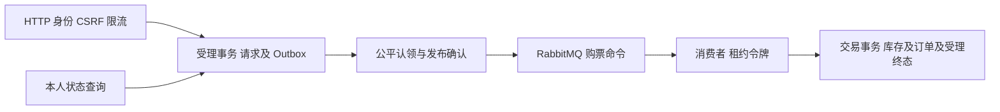
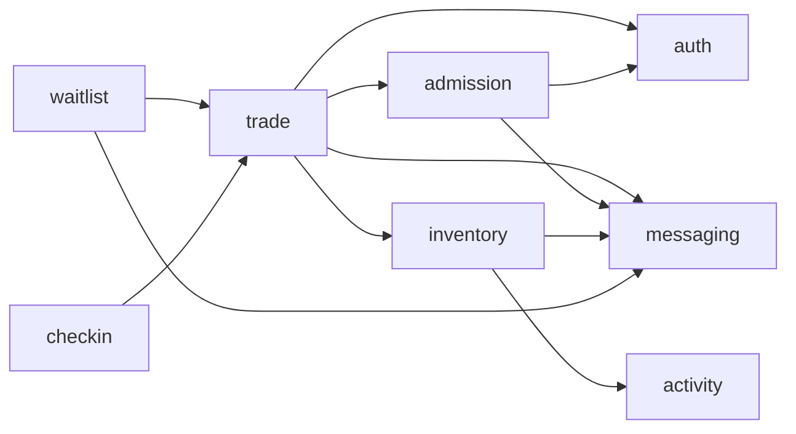
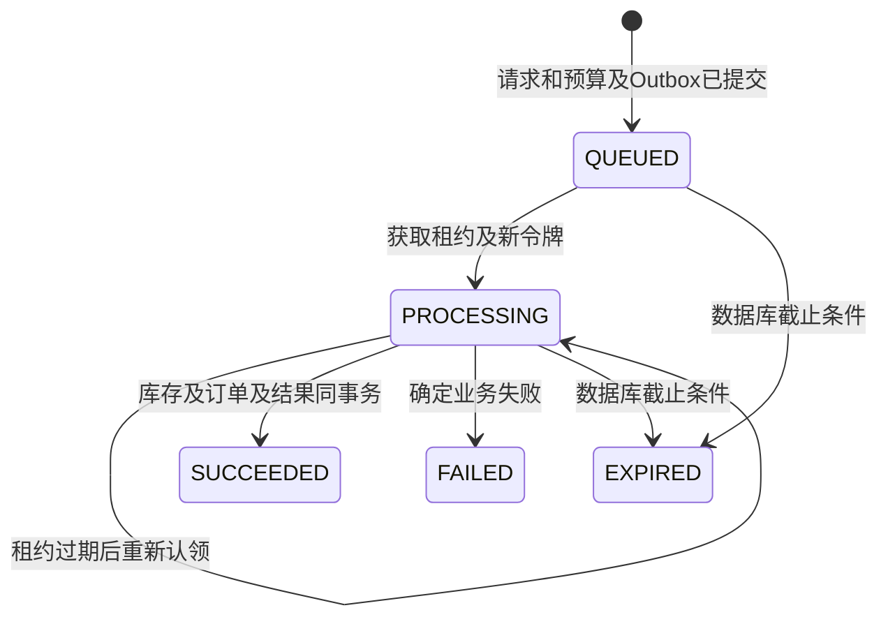

# 第十四阶段异步购票重构

状态：已完成开发及隔离环境验收（2026年10月24日）。原开发库尚未部署V8，部署仍须执行下述只读预检。基线起点为 `7ea1197`，开始时工作区干净。实施计划依据用户提供的第十四阶段执行说明，不重写 V1～V7。

## 设计冻结

保留单 Maven 模块和唯一 `TicketingApplication`，将旧技术目录按已有逻辑业务归属整理为业务包。已有交易、库存、候补、出票和售后算法保留；依赖守卫改为验证真实业务包、完整归属、无环及公开协作边界。基础设施不反向依赖业务实现。

受理事务不锁库存，不创建订单。以用户行串行化同用户幂等键，新请求插入、申请持久容量及 Outbox 同事务提交。重复键不消耗容量、不延长期限。默认预算保守，满额明确拒绝。

处理资格由独立短事务认领请求行。交易锁序为用户 → 活动 → 场次 → SKU → 订单 → 购票请求 → 容量预算 → Outbox；候补内部原锁序保持。超时及恢复仅按用户 → 请求 → 预算/Outbox，不在持有请求行后再获取交易父资源。请求最终状态与订单、库存同事务提交；令牌及数据库截止时间在最终条件更新再次核验，条件失效则整笔回滚。确定业务失败先回滚交易尝试，再在独立短事务中复核令牌并持久化失败；临时故障保留可恢复状态。

每请求对应唯一购票 Outbox 事件，低频恢复复用该记录并受下一次恢复时间约束，不无限追加副本。待处理和租约到期扫描有界，失败前进及回绕；截止后请求可靠终结并释放预算。终态重复消费只确认，不再预占。

排队过期同时关闭仍待发/发送中的购票 Outbox，递增认领令牌使迟到确认失效，避免 MQ 长期不可用时已过期请求继续堆积为待投递事件。既有 SENT 事实保留，已在代理中的消息作为幂等空操作确认。

购票消息还携带等于已校验排队时长的消息TTL，消费者长期停用时，副本会从工作队列进入既有死信通道；TTL只限制传输副本寿命，不替代数据库截止校验。死信和终态数据库历史需要日常保留策略，不作为仍可建单的无限工作积压。

历史普通订单在 V8 增量登记成功受理结果，保留旧幂等键语义。部署前只读核对历史订单明细完整性，异常停止，禁止自动修复。

V8 的用户外键及成功订单复合归属外键保留身份约束；SKU编号在受理时只是持久请求参数，不建立可能在容量锁内隐式获取SKU锁的外键。消费者从数据库重新加载并锁定真实SKU及父资源，缺失或停售明确失败。已有订单/明细/SKU外键不变。

部署顺序为停止业务写入、确认备份，执行既有退款/候补/审计只读预检及 `scripts/audit-async-purchase-readiness.sql`，结果无异常后才允许V8迁移。启动会阻止有失败历史及历史普通订单缺明细的情况；完整只读审计还核对请求摘要和单明细约束，不自动repair或删改历史数据。

参考仅用于业务边界及异步幂等原则：[12306](https://github.com/nageoffer/12306)、[黑马点评](https://github.com/zhuxuchen/hm-dianping)。不采用其微服务、Redis 库存预扣或教学简化协议。

## 实际模块与核心实现

业务包为activity、inventory、auth、admission、trade、waitlist、checkin、staff、audit，通用设施为common/messaging，装配为appconfig。一个Maven模块、一个可执行JAR、一个应用进程；构建、Docker与启动脚本的路径保持兼容，不引入多节点协调。

图中只画核心依赖；测试资源逐类登记全部生产类，ArchitectureRulesTest检查业务包与归属匹配、完整登记、依赖无环及候补/核销的公开交易协作边界。

| 文件 | 职责 |
| --- | --- |
| `backend/src/main/java/com/ticketing/admission/PurchaseAdmission.java` | 用户锁内幂等受理，请求、容量、Outbox一起提交 |
| `admission/PurchaseRequestMapper.java`、`PurchaseProcessing.java` | 请求行认领、递增令牌、截止条件、终态与预算协作 |
| `admission/PurchaseRecoveryJob.java` | 有界扫描、失败前进及回绕，按数据库事实恢复或过期 |
| `trade/PurchaseOrderWorker.java`、`PurchaseOrderConsumer.java` | 已提交命令校验、交易短事务及提交后ACK |
| `trade/OrderReservation.java` | 消费者与候补共用预占、限购、金额快照；删除旧同步create入口 |
| `messaging/OutboxService.java`、`OutboxPublisher.java`、`PurchaseRabbitConfig.java` | 公平认领、独立路由、确认/退回、令牌、退避及有限消息寿命 |
| `db/migration/V8__async_purchase_admission.sql` | 增量受理表、容量表、历史幂等登记和通道索引 |
| `frontend/src/components/PurchasePanel.vue`、`views/PurchaseRequestsView.vue` | 提交、同键重试、状态恢复、有界轮询及真实订单跳转 |
| `scripts/performance/async_faults.py`、`async_suite.py`、`audit-purchase.sql` | 专用环境真实故障、六轮测量和一致性审计 |

除第一个完整路径及前端/脚本外，表内Java短路径均位于`backend/src/main/java/com/ticketing/`；迁移位于`backend/src/main/resources/`。V1～V7原文件保留。

## 状态与故障协议

| 场景 | 持久事实与恢复 |
| --- | --- |
| 同键同参/异参 | 返回原requestId及真实状态，不续期、不重复占预算；异参409 |
| 受理事务或Outbox写入失败 | 请求及预算一并回滚，不能返回202 |
| 临时建单错误 | 订单与库存全部回滚，保留PROCESSING供租约恢复 |
| 业务失败 | 新短事务复核原令牌；只有有效处理者才能记FAILED，过期则EXPIRED |
| Confirm或ACK丢失 | 允许重复消息，按数据库终态幂等，不重复预占或创建订单 |
| 消费者崩溃/应用重启 | 重新扫描QUEUED及过期PROCESSING，复用唯一Outbox，令牌递增 |
| 旧消费者迟到/过期竞争 | 请求行锁及最终令牌、租约、截止CAS失败，交易整体回滚 |
| 代理持续不可用 | 未完成请求受容量约束；截止后持久过期、释放预算并关闭未完成Outbox |
| 消费者停用/代理副本丢失 | 消息TTL限制工作队列副本，数据库恢复仍能重新投递原请求 |

初次受理返回202，终态同键重放返回200。正式订单的PENDING/PAID/CANCELLED/EXPIRED/REFUNDED语义不变；取消或退款不反向修改已经SUCCEEDED的受理历史。同一SKU候补内部FIFO继续成立，普通异步购票与候补之间不承诺优先级。

默认配置为容量200、排队120秒、处理租约30秒、恢复间隔10秒、扫描间隔1秒、单批100。重启调低容量会阻止新受理，已有请求仍可终结释放。HTTP接受不代表保证有票，也不开始支付倒计时。端到端语义为至少一次消息投递及数据库幂等。

## 前端与浏览器

前端API类型改为PurchaseRequest，排队页只有SUCCEEDED才能导航到真实订单。每次轮询超时10秒，每轮最多60次，间隔2至5秒，隐藏或卸载页面会停止；本地停止查询不伪造服务端过期。sessionStorage只按用户/SKU保存非敏感参数和幂等键/已知requestId，不保存Session、CSRF、密码或票券凭证。

[20项浏览器检查](architecture/results/stage14-browser.json)全部通过：注册登录、排队页、刷新和本人列表恢复、390px布局、重启重新登录、异步跳转、取消、模拟支付及出票、非本人请求404、真实HTTP超时后的刷新与同键重试、双击确认保护、退出身份清理，以及失败和过期终态的中文提示。[数据库核对](architecture/results/stage14-browser-database.json)证明超时刷新重试只新增一个请求和一个订单。超时由独立连接暂持当前测试用户行锁产生，未Mock HTTP202或终态响应。

浏览器生产预览仅连接固定ticketing-perf；演示活动明确为虚构数据，未读二维码完整凭证、未开摄像头、未发生真实支付。UI验证沿用既有配色，修正登录失效提示、可配置支付截止文案和双击误关确认框。截图：[桌面排队](images/stage14-queue-desktop.png)、[手机排队](images/stage14-queue-mobile.png)、[正式订单](images/stage14-order-desktop.png)、[出票列表](images/stage14-ticket-desktop.png)。

## 验证记录

- 改动前普通测试：81 项通过，0 失败、0 跳过。
- 改动前真实集成：173 项通过，0 失败、0 跳过，仅使用固定 `ticketing-perf` 及独立 `ticketing_stage14_it` 数据库；连同普通测试共 254 项。
- 最终完整回归：`mvn -f backend/pom.xml clean verify -Pmysql-it`，84项普通测试及188项真实集成测试，共272项，失败、错误、跳过均为0。运行于Java 21及固定ticketing-perf的隔离schema `ticketing_stage14_final2_it`；日志结束于2026年10月24日00:02:30（北京时间）。测试环境使用独立连接配置和随机guard，未将开发库作为故障或清理目标。
- `AsyncPurchaseMigrationIT`分别验证空库至V8，以及带真实历史订单的V7至V8增量升级；逐表核对历史业务数据和V1～V7校验和，原始迁移文件逐一对比基线未变。V8历史幂等映射和容量初值通过验证。
- `AsyncPurchaseIT`的13项真实集成覆盖可靠受理、20并发同键、100买家争抢1张票、容量200满额、事务回滚、旧令牌及过期竞态、禁用账号/停售/跨SKU限购、Confirm及ACK丢失、重复投递、恢复复用、公平通道、消息TTL及真实死信；1张票的争抢结果为1笔成功、99笔明确失败。
- `npm ci`及`npm run build`通过，构建包含`vue-tsc --noEmit`。20项真实浏览器检查及数据库核对全部通过，截图和结果见上文。
- `python -B scripts/performance/async_faults.py --jar backend/target/ticketing-backend-0.1.0-SNAPSHOT.jar --label stage14-final`通过8项真实进程及中间件故障检查；[最终记录](architecture/results/async-faults-stage14-final.json)包含16条一致性审计，异常数均为0。[首次记录](architecture/results/async-faults-stage14-first.json)保留，不覆盖。
- `python -B scripts/performance/async_suite.py --jar backend/target/ticketing-backend-0.1.0-SNAPSHOT.jar --label stage14-final`完成六轮；`python -B scripts/performance/test_safety.py`的7项隔离保护检查通过，`node --check scripts/performance/scenarios.js`通过。
- 对话恢复后的局部复核：`mvn -f backend/pom.xml -Dtest=ArchitectureRulesTest,ConfigurationBindingTest test`的4项通过，再次执行前端构建和7项隔离保护检查均通过。沿用最终完整回归证据，未将局部复核数量累加为完整测试数量。

[交付证据汇总](architecture/results/stage14-validation.json)登记测试数量、产物SHA-256及7份历史迁移摘要。完整回归日志、账号和环境凭据仅保留于已忽略的`.local`；共享结果只含脱敏聚合数据。真实集成命令必须先配置固定专用实例和匹配guard的隔离schema；普通`mvn -f backend/pom.xml clean verify`不需要中间件。

## 实测性能与能力边界

环境为i5-13400F、16逻辑处理器、31.82GiB主机内存，Docker分配约15.53GiB；MySQL8.4、Redis7、RabbitMQ4.1，单个Java应用使用512MiB初始堆和1024MiB最大堆。硬件、镜像摘要、运行JAR摘要及各轮配置保留于[最终原始结果](performance/results/stage14-final/comparison.json)和同目录的hardware/environment/monitoring/database/k6-summary文件。

每轮1000活动，热点场景1场次，混合场景64场次；10秒预热、20秒稳定窗口、最多150秒请求收尾及30秒Outbox排空观察。稳定窗口按HTTP或终态查询完成时间截取，跨窗口请求可能令受理TPS和订单TPS略有差异。RPS包含查询和写请求，受理TPS只计新键首次202，订单TPS计查询到真实新订单成功；不与历史同步接口指标直接对比。

| 场景 | VU | HTTP RPS | 受理TPS | 订单TPS | 受理P95 ms | 端到端P95 ms | Outbox采样峰值 |
| --- | ---: | ---: | ---: | ---: | ---: | ---: | ---: |
| hot-ample | 10 | 53.20 | 9.10 | 9.10 | 75.09 | 1894.95 | 17 |
| hot-ample | 25 | 106.65 | 8.60 | 8.70 | 85.16 | 3649.35 | 35 |
| hot-ample | 50 | 196.85 | 8.55 | 8.60 | 78.67 | 9012.85 | 55 |
| hot-ample | 100 | 331.80 | 6.65 | 6.70 | 267.55 | 20012.20 | 106 |
| hot-scarce | 100 | 343.80 | 6.95 | 6.85 | 220.38 | 19471.40 | 106 |
| mixed | 25 | 111.45 | 10.45 | 10.40 | 80.34 | 3467.25 | 42 |

P50/P95/P99均保留在comparison.json；数据库行锁等待增量、Hikari池等待、RabbitMQ队列及消费者速率按轮记录。六轮服务器/传输错误均为0，库存及订单等16条审计均通过；最终Outbox全部SENT，无PENDING/PROCESSING残留。不能只用已发送样本代表积压：表内同时报告过程采样峰值，逐通道已投递延迟和最终积压另存原始结果。100VU充足库存轮购票命令投递平均约12.36秒、最大约18.64秒；候补通道平均约553毫秒、最大约2519毫秒，验证了通道公平性，但发布路径已是明显瓶颈。

`hot-scarce`使用5张库存并在成功后取消释放，属于库存周转压测；本轮没有形成售罄业务失败，不能将其描述为100人只出售1张票。不可超卖的100人抢1张票由独立真实集成用例验证。六轮未达到容量拒绝条件，满额503和代理停机时的有界预算由专项测试及真实故障验证覆盖。

[首次压测目录](performance/results/stage14/hot-ample-100/environment.json)保留前三轮通过和第四轮失败结果；第四轮k6退出99，全程HTTP失败8次，稳定窗口服务器/传输错误为0。当时仅给10秒收尾，端到端部分请求已超过20秒，截断可能影响结果，现有证据不足以逐一归因。随后把收尾观察延长至150秒并增加全程状态分类，保持零错误门禁，再以新目录完整运行六轮通过。首次失败不混入最终通过统计。

## 剩余限制及后续接口

本阶段完成单实例可靠异步购票闭环，不宣称生产容量或吞吐提升。100VU的端到端P95已约20秒，受理快不代表交易快；单行持久容量、用户/SKU行锁、逐条Confirm发布及轮询均可能限制吞吐。本机短时测量没有逐项隔离这些因素的成本，不能凭总体指标证明单行容量完全没有热点。

MySQL继续作为库存及限购权威，既有候补FIFO仅限同SKU候补内部。普通购票只经消费者调用OrderReservation，支付/取消/退款/出票及候补协作仍处于原事务边界。消息语义是至少一次加数据库幂等。死信、终态请求与Outbox历史仍需运营保留策略；浏览器仅验证内置浏览器及390px视口，未验证真实手机、Safari或摄像头；没有接入真实支付或退款。

开发库未升级V8，本次不以隔离库验收代替正式部署预检。上线前停止写入、备份并执行候补/退款/审计及异步受理只读审计，有异常立即停止，DDL失败保留现场。

第15阶段可以在PurchaseAdmission受理边界前增加准入，但可靠受理仍须以MySQL提交为准；PurchaseProcessing公开协作边界继续负责终态、令牌及预算，OrderReservation和TradeResourceLocker继续统一预占与锁序。Redis准入/库存预扣、库存分桶、多级缓存、发布吞吐重构及多节点等第15～19阶段内容本次未实现。
