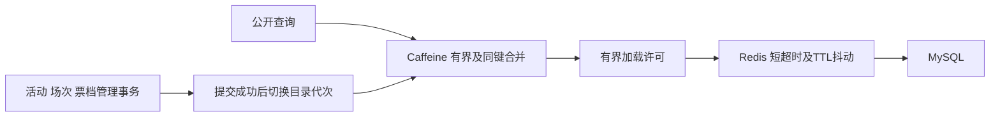
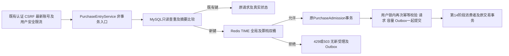
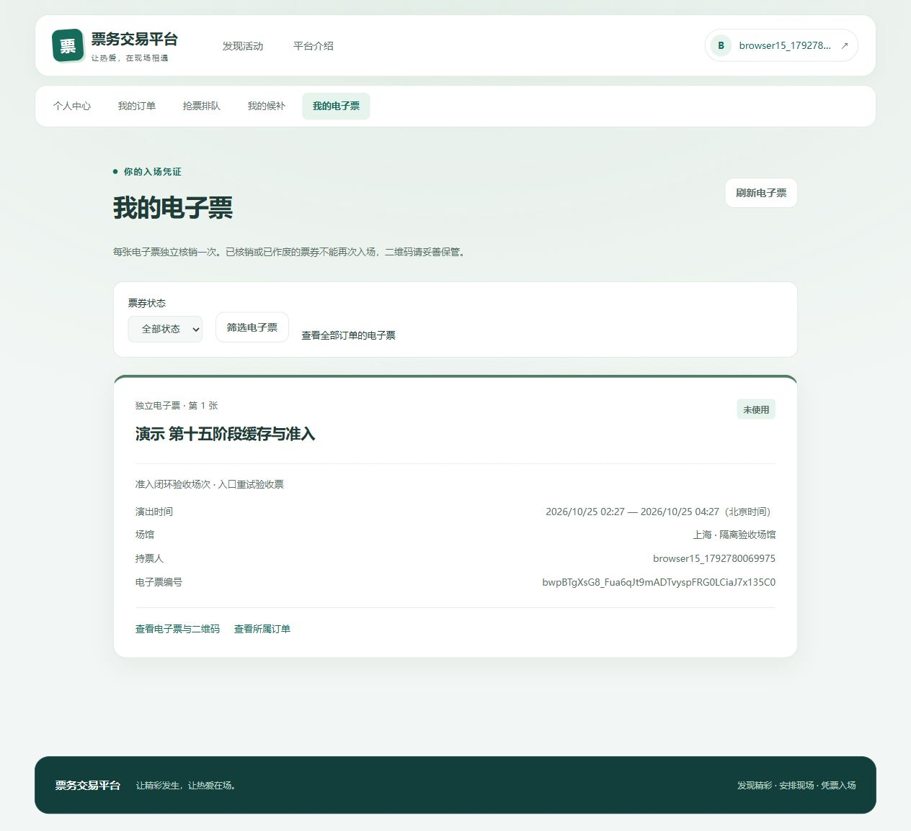

# 第十五阶段目录缓存与热门票档准入

状态：已完成开发及隔离验收（2026年10月24日）。起点为`d25c6784a30e03111b3ca66a948dd01c8ce5a264`，开始时工作区干净。继续一个Maven模块、一个Spring Boot应用及一个进程，无新公开端点、无新基础设施、无数据库结构变更，V1～V8保留。

## 实际审查与边界

公开活动列表原来每次执行count及分页，详情直接查活动，场次先查活动再查场次。活动和场次record适合缓存。票档接口包含动态库存、销售窗口和serverTime，继续全量实时查库，本阶段不缓存其完整响应，也不为拆静态字段再增加一次无法减少原SQL的装饰查询。

开发库只读检查仍为V7，候补、退款、管理审计和V8普通订单预检均未报告异常。没有运行开发库迁移/repair或修改数据。全部新建数据、压测、清理和故障使用当时的独立验收环境（现已退役）及匹配随机guard；其原卷已在前一任务按用户要求删除，本阶段复用原有镜像重新初始化隔离环境。

## 公开缓存

`activity/CatalogCache`负责Caffeine和Redis，`CatalogCacheProperties`负责绑定校验。`ActivityService`只缓存公开详情和有界列表，`SessionService`只缓存公开场次；库存管理仅调用提交后失效，不引入反向依赖。内部事务、管理查询、requireActivity及交易锁定均回源。

键为`ticketing:catalog:v1:{namespace}:{generation}:{DETAIL|SESSIONS|LIST}:{identity}`。列表identity包括类别、trim后的城市、页号和大小。只缓存无关键词、默认前3页、12/20条，以及空城市或北京/上海/广州/深圳/杭州/成都；其他组合直接查库。公开status参数原来就不改变PUBLISHED筛选，因此不影响键的结果维度。

默认L1上限2000项、15秒，L2为120秒并增加0～11秒抖动，404和合法空结果5秒。L1期限不会超过同一L2值的截止时间。缓存序列化为带类型的JSON数据，返回时重新构造record/列表，调用方修改集合不会污染缓存。404保留安全业务码，其他错误不会作为空结果缓存。

每次进程启动及每次管理事务提交后产生不可复用的UUID代次。旧DB读取只会把结果写入它开始时的旧代，后续请求查新代；回滚不换代。提交回调只在本地换代，不进行Redis网络IO，所以Redis失效失败不会被伪装为业务回滚。旧代键依靠TTL退出，既不使用KEYS，也不扫描删除缓存。该方案明确针对单实例；重启后不会复用上一进程的L2数据。

同键通过Caffeine原子get合并加载；不同键最多8个加载任务，等候最多100ms，超出返回503 `CATALOG_BUSY`。不创建后台重建线程池。Redis沿用现有500ms连接/命令超时，失败后1秒内暂缓重复尝试并受控查库；L1仍可读取，恢复后重填。请求指标只用detail/sessions/list及固定结果标签，另有加载并发、条目数、Redis读写耗时及失效计数。

管理操作走正常服务提交后立即对新查询换代；直接在数据库外部修改数据不属于应用失效协议，公开展示最多滞留L2约131秒。真实购票和核销始终重新校验MySQL，不受展示陈旧影响。进程内并发提交时，与提交重叠的旧读可以返回旧快照，但不能污染新代。

## 新购票速率准入

`PurchaseEntryService`禁止外部事务。只读查重按可信用户、CREATE_ORDER操作域和原键进行，不改变状态/截止/容量；同参返回原请求，异参409。新键才执行`admission/ticket-admission-v1.lua`，然后调用原受理事务。用户锁内的最终幂等与容量逻辑保留，竞争时多消耗一次速率预算允许，但只产生一个受理记录。

Lua使用Redis TIME的毫秒时间，令牌采用毫令牌整数精度，同时读取全局/票档桶，先检查两桶再一起扣减。时钟回退不倒退已记录时间。拒绝不创建新键、不扣任何桶、不延长寿命；空闲桶以补满所需时间加1秒过期。票档ID仅在数字及long范围校验后用于键，不放用户、会话或幂等键。

票档拒绝429 `PURCHASE_TICKET_BUSY`，全局拒绝429 `PURCHASE_GLOBAL_BUSY`，Redis故障/类型错误/返回异常503 `PURCHASE_ADMISSION_UNAVAILABLE`，均no-store并含Retry-After。MySQL满额继续503 `PURCHASE_QUEUE_FULL`。原用户安全限流独立，可能在查重之前429；Redis完全停机时它也可能先503 `RATE_LIMIT_UNAVAILABLE`，因此不承诺这种情况下HTTP幂等重放可达。

前端保留原幂等键和排队恢复，针对已知入口拒绝显示未到达受理的本次拒绝及稍后确认提示，不生成假requestId。查询和支付等接口不执行新Lua。指标只记录allowed/limited-global/limited-ticket/unavailable及Lua耗时。

## 验证计划及执行记录

- 实施前`mvn -f backend/pom.xml clean verify`：84项普通测试通过，失败/错误/跳过均0。
- 首轮新增真实集成：13项中12项通过，1项并发夹具失败；两个随机键落在同一同步加载锁，导致测试屏障等候，改用确定性不同键后复验。首轮日志保留，失败schema已完整导出压缩备份并核对解压后SHA-256，不自动修复或掩盖失败。
- 第二轮新增真实集成：缓存6项、准入9项共15项全通过，涵盖L1/L2、负缓存、写后失效/回滚、旧回填、加载边界、实时票档、双桶并发/TTL/部分扣减、HTTP429/503/CSRF/禁用账号、已完成重放、并发同键及MySQL满额。
- `python -B scripts/verification/verify_backend.py --label stage15final`执行`mvn -f backend/pom.xml clean verify -Pmysql-it`，84项普通测试及203项真实集成共287项全部通过，失败/错误/跳过均0。成功后清理本轮10个隔离schema，首次失败现场以压缩备份及原始日志保留。
- 最终同一JAR十四轮A/B全部通过，包含Redis调用计时和加载并发监测；初次十四轮单独保留，不混合统计。全部数据库一致性审计通过，原始目录不可覆盖。
- [浏览器记录](architecture/results/stage15-browser.json)共20项检查通过，使用本轮生产前端与固定隔离后端；HTTP无Mock，真实注册/Session/CSRF、排队、刷新、模拟支付及电子票，以及429/503及身份边界。受控预算或故障夹具的方式在记录中明确。

[完整证据汇总](architecture/results/stage15-validation.json)保留JAR SHA-256、测试计数及八份迁移摘要；原开发库只读审核保持V7，没有应用V8或新DDL。完整日志、凭据及临时输入在已忽略的.local，公开报告仅含脱敏聚合数据。

缓存及Lua算法分别参考[Caffeine原子加载](https://github.com/ben-manes/caffeine/wiki/Population)和[Redis原子脚本](https://redis.io/docs/latest/develop/programmability/)，没有复制教学项目的库存预扣协议。

第16阶段仅建议承接库存事务和限购模型。库存分桶、多实例、Redis库存预扣、Outbox吞吐重构与真实支付/退款均未实现。

## 交付与环境收尾

主要新增实现为`CatalogCache/CatalogCacheProperties`与`PurchaseEntryService/TicketAdmissionLimiter/AdmissionLimitProperties`及Lua脚本。活动、场次、库存管理接入提交后失效；`OrderController`接入非事务入口，原`PurchaseAdmission`保留最终用户锁、幂等、容量及Outbox事务。异常响应增加可选Retry-After；前端API和购票面板区分入口拒绝并继续保留原申请。所有新生产类登记模块归属，未关闭架构守卫。

[浏览器验收](architecture/results/stage15-browser.json)和[数据库事实](architecture/results/stage15-browser-database.json)分别记录页面检查与16项数据库不变量。403由普通账号访问管理API及管理页面验证；CSRF拒绝由真实HTTP集成覆盖，浏览器跨标签重登录会主动重取令牌，没有伪造CSRF失败。429、503使用固定隔离Redis的独立新准入键作为短时夹具，HTTP和响应处理均无Mock。

[清理记录](architecture/results/stage15-cleanup.json)确认本轮两个专用压测卷已删除，Docker逻辑卷总量从542.7MB降为244.2MB，未删除开发数据卷或兼容镜像；临时后端、预览和为只读审计启动的开发MySQL均已停止。失败schema的9.6KB压缩备份与原始失败日志保存在被忽略的`.local`中。未压缩宿主WSL/VHD，因此这些逻辑回收量不等同于D盘立即增加的空间。

开发库目前仍为V7。正式升级前按现有部署流程重新执行候补关系、退款、管理审计和普通订单受理的只读预检；任何异常均停止，不自动repair或修改既有迁移。第十五阶段本身无新DDL，不能将隔离测试已迁移到V8等同于开发库已经部署。
