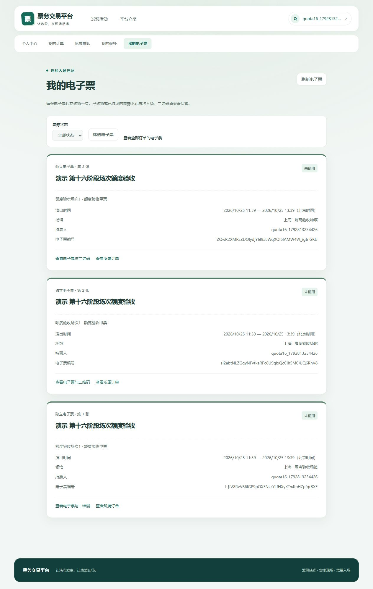

# 第十六阶段用户场次额度与交易事务

状态：已完成开发及隔离验收（2026年10月24日）。起点为`43976d035ea65df921c46744783f64bd4a8c8f3c`，开始时main工作区干净。只有一个Maven模块、一个应用实例和原有中间件。原V1～V8不修改，本阶段新增V9。普通购票保持可靠异步受理。

## 实际审查与设计取舍

原`TradeResourceLocker`对所有交易锁账号UPDATE，不同场次也互斥；`OrderReservation`在库存锁内通过订单明细SUM算限额。普通受理与交易是独立事务，受理侧另有账号UPDATE锁保证同键请求、容量和Outbox原子提交。核销与权限撤销也依赖同一账号行协调，不能删掉账号锁。

本阶段将交易账号锁降为SHARE，与禁用、降权和撤权的UPDATE互斥；同一用户不同场次可以并行进入交易。实际占额的互斥范围缩为`user_session_quota(user_id,session_id)`。受理侧UPDATE锁及恢复/失败落账协议保留，不能把交易并行等同于HTTP受理无串行。

额度表由`UserSessionQuotaMapper/Service`维护，不添加空实体。唯一主键及`INSERT ... ON DUPLICATE KEY UPDATE`安全建立并锁行；条件UPDATE增加或释放，禁止INSERT IGNORE、内存锁及向零裁剪。没有新增外键：父账号、场次在写入前已被显式锁定，当前业务只停用/取消父记录，不硬删除或迁移归属；避免外键隐式锁反向获取父资源。对账同时检查孤儿额度，外部人工SQL不得绕过部署与审计协议。

普通受理请求、WAITING候补都不占额度；真正预留订单才占。MySQL继续同时决定库存、额度、金额和订单事实，Redis不参与这些账本。金额按整数分精确乘算，支付截止仍从创建订单时的数据库时间开始。

## 生命周期与事务边界

| 路径 | 额度变化 | 原子边界 |
| --- | ---: | --- |
| 普通消费者创建PENDING | +数量 | 额度、库存、订单、请求SUCCEEDED及容量释放同事务 |
| 候补分配PENDING | +数量 | 额度、库存、订单及ALLOCATED同事务 |
| 消息重放、同键回放、重复分配 | 0 | 先检查已有订单和状态，不重复占额 |
| PENDING→PAID | 0 | 保留占额，支付流水及先候补后出票同步提交 |
| PENDING→CANCELLED/EXPIRED | -数量 | 状态条件更新成功后，额度、库存、同步联动与Outbox一起提交 |
| PAID→REFUNDED | -数量 | 退款真正成功才释放；支付事实保留，退款流水及票券作废同事务 |
| 重复取消、过期、退款 | 0 | 返回既有结果或明确拒绝，不二次释放 |
| 退款缺票、已核销、支付异常转人工 | 0 | 原订单、额度、库存不变，记录人工待办 |
| 场次取消逐单善后 | 按对应关闭/退款规则 | 禁用买家仍处理，每笔事务独立，可退避和重启恢复 |
| 未建单的请求FAILED/EXPIRED | 0 | 只释放受理容量，不能释放不存在的订单占额 |
| WAITING、未分配候补取消/过期 | 0 | 只读预检；分配时再锁额度复核 |

额度释放不足属于存储一致性错误，抛出技术异常并回滚，不伪装成限购不足或成功。真实死锁、数据库断连及租约CAS失效同样回滚，继续由原消息重试/租约恢复协议处理；没有新增无界重试或提交后补写额度。

`OrderMapper.occupied()`仅保留为历史对账SQL，不再被生产热路径调用。本人`/orders/limits`读取独立额度，接口字段与中文语义不变。降低运行限额不会删除历史占额，只有继续新增会被条件拒绝。

## 统一锁顺序

| 入口 | 实际锁序 |
| --- | --- |
| HTTP可靠受理及失败/恢复落账 | 账号UPDATE→请求→容量/Outbox，不触碰库存及额度 |
| 普通建单 | 账号SHARE→活动SHARE→场次SHARE→用户场次额度UPDATE→票档UPDATE→订单→请求/容量 |
| 候补分配 | 非锁定发现候选→账号SHARE→父级SHARE→额度UPDATE→票档UPDATE→复查队首→订单→候补 |
| 候补入队/未分配取消 | 账号SHARE→父级SHARE→票档UPDATE→候补，额度只读、不占额 |
| 支付 | 账号SHARE→父级SHARE→票档UPDATE→订单→候补→电子票，不获取额度锁 |
| 取消/超时 | 账号SHARE→父级SHARE→额度UPDATE→票档UPDATE→订单→同步末端 |
| 退款及逐单善后 | 涉及账号按ID升序SHARE→父级SHARE→额度UPDATE→票档UPDATE→订单→候补→电子票 |
| 核销 | 工作人员账号SHARE并复查角色→父级SHARE→票档UPDATE→订单→票券，不锁持票人额度 |
| 历史补票 | 买家账号SHARE→父级SHARE→票档UPDATE→订单→票券，不改变额度 |
| 权限变更 | 操作人与目标账号按ID升序UPDATE，随后修改权限；与核销SHARE协调 |
| 管理活动/场次/票档 | 操作人UPDATE；活动变更取活动UPDATE，场次/票档取活动SHARE再场次UPDATE |

初读只发现不可变归属，取得父资源后重读票档并核对关系。候补分配在SKU之前取额度锁，入队的额度预检不加行锁，因而不存在“票档→额度写锁”的循环。退款管理员与买家不修改账号，使用升序共享锁即可稳定角色；管理角色/授权的排他协议保留。

`OrderStateService.cancel`作为独立Bean开启READ_COMMITTED，`OrderService.cancel`禁止外围事务，等命令提交后才查询公开投影。交易状态读取改用订单和明细两表快照，去掉临界区内活动、用户、支付、退款等不必要JOIN。支付及退款所需流水与票券校验仍在事务内，不推迟原子性协作。

## V9与历史库切换

V9按所有PENDING/PAID明细分组回填，不把取消、超时、退款及未分配候补计入。迁移前及回填后均核对异常：缺/重复明细、孤儿归属、票档场次不一致、非正数量、非法状态、整型溢出及超过部署限额。异常通过新表CHECK使Flyway失败，原业务记录不改写；MySQL已提交的DDL及失败历史保留，不自动repair或删表。回填后逐组双向比较，空库允许没有额度行。

`quotaLimit`迁移占位符来自原`ORDER_SESSION_LIMIT`，SQL不硬编码4。已有业务数据而未应用V9时，启动预检默认`STOP_QUOTA_SWITCH`，在任何V9 DDL前停止。配置`ORDER_QUOTA_MIGRATION_APPROVED=false`不参与运行限额的计算，仅作为历史库切换门槛。

受控部署必须依次执行：停止全部业务写入及后台工作→备份并验证可恢复→按实际部署限额运行`scripts/audit-user-session-quota.sql`及既有候补/退款/审计/受理预检→审计无异常时单次设置`ORDER_QUOTA_MIGRATION_APPROVED=true`并迁移→使用`scripts/performance/audit-quota.sql`在一致性快照内核对全部组及额外额度→撤销开关并放写。任何STOP或DDL失败只报告并停止，禁止自动恢复工具修改旧数据。

只读审计需要在同一连接先`SET @ticketing_quota_limit=<实际ORDER_SESSION_LIMIT>`；未提供参数也会报告STOP。开发库[只读记录](architecture/results/stage16-development-readonly.json)仍为V7，未应用V8/V9。本阶段不替用户升级开发库。固定隔离性能脚本仅对匹配guard的ticketing_perf完成停写、备份、审计及单次切换，备份存入忽略的.local。

## 观测与基准口径

新增低基数指标：`ticketing.trade.quota`记录额度SQL占用/拒绝/释放/不一致尝试；占用和释放计数可能随后回滚，不能当作已提交额度账本。`ticketing.trade.transaction.duration`区分提交成功、确定业务失败及技术失败；失败包含回滚和必要的独立终态处理。`ticketing.trade.lock.duration`记录账号、额度、票档锁定查询的调用耗时，含数据库往返，不能当作纯锁等待。MySQL行锁等待、死锁、锁超时另读数据库指标。所有标签都不含用户、场次、票档、订单或幂等键。

完整系统沿用10秒预热、20秒稳定、150秒graceful及原收尾审计：100VU充足、100VU稀缺、25VU/64场次混合及25VU共享一个账号跨64场次。新准入统一关闭、缓存开启，原安全限流开启且统一使用既有regression阈值，连接池10及JVM512MB～1GB保持一致。共享账号专项仅改变账号分布和目标轮转，基线与优化完全相同；受理侧账号UPDATE限制仍存在。

`TradeKernelBenchmark`不提供生产端点。仅显式Failsafe指定，在固定13307及guard内先持久受理96笔请求并认领，再以1/4/8/16个有界线程调用生产worker.complete。计量包括交易提交，排除HTTP、claim及Outbox传输；逐笔保留耗时，核对96笔真实成功、库存、额度和容量。场景为96用户单票档、12用户各8场次、96用户同场次4票档。它是有限批次实验，不冒充稳定HTTP TPS；冷启动、JIT及本机I/O影响需与原始样本一起解释。

三组内核分别归档原版本、额度+FOR UPDATE、额度+条件UPDATE。条件UPDATE尝试通过父级共享锁稳定配置，把库存排他锁推迟到条件写入，不使用库存version作为销售版本。实测热点部分档位锁等待下降，但低并发及多票档并无一致吞吐收益，因此已回退该实验代码，生产保留FOR UPDATE，不新增V10、销售版本或永久配置分支。

## 执行记录

- 原版本普通回归84项通过；原版本内核12组及完整系统4轮已保留新标签基线。
- 首轮新增真实验证16项全部通过；额度FOR UPDATE与条件UPDATE各12组内核审计通过。
- 首轮完整回归84普通+221真实集成共305项，304项通过、1项夹具错误、无跳过。错误为测试对Mapper抽象方法调用callRealMethod；已改用真实MyBatis代理，原日志及隔离schema保留。
- 修复后36项专项全部通过，涵盖真实MySQL死锁回滚、管理配置与消费者并发、未批准历史切换及额度对账。最终普通84项+真实集成222项共306项，失败/错误/跳过均0；后续未再改生产代码。
- `npm ci`及`npm run build`通过，包含严格TypeScript检查。
- 最终同JAR四轮闭环及18项数据不变量通过；另保留热点3轮复核（含1轮采样诊断），Redis/缓存故障10项、应用/MQ/数据库故障8项及浏览器25项通过。7项性能隔离检查通过。全部证据汇总见[机器验证记录](architecture/results/stage16-validation.json)。

复现普通及真实集成使用`python -B scripts/performance/verify_backend.py --label <新标签>`。运行内核需先设置`TRADE_BENCH_RESULT`为未存在的绝对JSON路径，再加`--tests TradeKernelBenchmark`；数据库及guard由验证工具限定。闭环使用`python -B scripts/performance/trade_suite.py --jar <指定JAR> --label <新标签>`，不覆盖任何已有结果。故障脚本继续使用catalog_faults.py和async_faults.py，所有操作仅固定隔离环境。

## 边界与后续

本阶段没有消除受理侧账号排他锁、全局持久容量行及Outbox逐条Confirm。交易内核收益不能直接外推端到端容量。第十七阶段只保留基于实际测量决定是否库存分桶的入口；本阶段不实现库存分桶、Redis额度、多实例、异步Confirm或真实支付退款。

本阶段完成全部本地验收后，按交易额度与迁移、验证工具与实测证据、部署与验收文档三个功能点分别提交并依次推送main。

## 实际性能对照

完整系统同场景单变量对照，HTTP及终态按完成时间截取20秒稳定窗口。端到端时间包含Outbox与排队。

| 场景 | 基线订单TPS | 额度版本订单TPS | 基线终态P95 ms | 额度版本终态P95 ms |
| --- | ---: | ---: | ---: | ---: |
| hot-ample | 10.10 | 7.45 | 10505.95 | 18286.20 |
| hot-scarce | 7.05 | 7.60 | 20131.00 | 17450.60 |
| mixed | 11.25 | 11.00 | 3167.80 | 3740.95 |
| same-user-cross-session | 9.90 | 9.50 | 3028.80 | 3198.55 |

[基线四轮](performance/results/stage16-system-baseline/comparison.json)与[最终四轮](performance/results/stage16-system-final/comparison.json)记录HTTP RPS、受理TPS、终态P50/P95/P99/最大值、数据库锁等待及最终各通道投递延迟和积压；每轮目录还包含全过程Hikari/JVM/MQ采样及数据审计。不能拿部分SENT样本代替积压，也不将整轮SELECT/锁等待直接除以稳定秒数。

首轮热点出现明显回退，因此没有直接归因为交易改造或结束验收。先备份隔离V9现状，再从校验过的自有V8备份恢复固定ticketing_perf夹具，以相同工具复跑旧包、新包；开发实例和所有失败探针库均未参与，见[复核环境记录](architecture/results/stage16-regression-recheck-environment.json)。

| 热点复核 | 订单TPS | 终态P95 ms | 说明 |
| --- | ---: | ---: | --- |
| stage16-hot-recheck-baseline | 7.45 | 18555.60 | 旧包，无额外快照 |
| stage16-hot-recheck-quota | 7.15 | 19218.50 | 新包，含两次jcmd及只读SQL采样，仅作诊断 |
| stage16-hot-recheck-quota-clean | 7.30 | 18735.25 | 新包，无额外快照 |

旧包复核同样降至7.45TPS，证明不能将最初两轮全部差异归因于额度模型。等采样条件的复核为7.45对7.30TPS，P95约18.56对18.74秒，没有证明端到端提速。快照看到受理容量行锁等待，连接池等待同时阻塞状态查询、消费者和Outbox认领；第二个时刻也看到票档锁等待，未见额度行等待。[快照摘要](architecture/results/stage16-recheck-trace-summary.json)仅代表两个时刻，各只读查询不是同一原子快照，不能推断唯一瓶颈。原始SQL和线程在.local。已有全局容量、受理账号锁与逐条Confirm仍是后续限制，本阶段没有越界改造它们，也没有把波动包装成稳定收益。

| 内核场景 | 并发 | 基线TPS | 额度FOR UPDATE TPS | 条件UPDATE实验TPS | 基线P95 ms | 额度FOR UPDATE P95 ms |
| --- | ---: | ---: | ---: | ---: | ---: | ---: |
| hot | 1 | 22.20 | 21.95 | 17.57 | 99.48 | 106.44 |
| hot | 4 | 34.83 | 28.47 | 38.99 | 232.99 | 245.42 |
| hot | 8 | 35.12 | 38.24 | 41.17 | 442.40 | 389.52 |
| hot | 16 | 38.54 | 41.00 | 44.76 | 892.21 | 621.71 |
| same-user-cross-session | 1 | 34.02 | 32.32 | 31.42 | 38.92 | 67.82 |
| same-user-cross-session | 4 | 51.60 | 67.19 | 67.81 | 170.31 | 114.31 |
| same-user-cross-session | 8 | 67.79 | 80.39 | 83.32 | 226.05 | 145.02 |
| same-user-cross-session | 16 | 67.00 | 76.30 | 73.37 | 436.75 | 319.80 |
| multi-ticket | 1 | 38.40 | 39.39 | 29.86 | 36.66 | 32.03 |
| multi-ticket | 4 | 84.32 | 77.01 | 77.69 | 74.70 | 74.96 |
| multi-ticket | 8 | 76.93 | 80.04 | 75.50 | 162.92 | 119.86 |
| multi-ticket | 16 | 80.05 | 77.64 | 75.34 | 289.44 | 389.93 |

[内核基线](performance/results/stage16-kernel-baseline.json)、[额度FOR UPDATE](performance/results/stage16-kernel-quota-for-update.json)、[条件UPDATE实验](performance/results/stage16-kernel-quota-conditional.json)保存全部单次时长和锁等待，未筛选有利档位。[内核JAR记录](performance/results/stage16-kernel-artifacts.json)证明两种票档协议只有两个生产类不同，基准源相同；最终包所有生产类与选定FOR UPDATE内核JAR逐字节相同。全部8个历史迁移与起点提交字节相同，见[摘要](architecture/results/stage16-historical-migrations.json)。

所有内核批次均成功96笔且无隐式技术重试；正常性能负载与刻意注入的死锁回滚测试分别统计。基线四轮未逐轮采集新增的InnoDB死锁计数；[累计补充快照](performance/results/stage16-baseline-lock-metrics-after.json)显示当时从服务启动累计死锁/锁超时仍为0，不能伪造为逐轮原始采样。最终四轮已逐轮采集这些指标。内核有限批次没有独立预热剔除，首组包含JIT/冷启动效应；少量百分比差异不视作稳定优化。

## 浏览器与环境收尾

[浏览器步骤](architecture/results/stage16-browser.json)记录真实Session、CSRF、可靠受理、刷新、跨票档限额、跨场次独立额度、模拟支付、取消、电子票及运营模拟退款；HTTP无Mock。数据库事实另存独立记录，未展示完整入场凭证。

最终归档时发现旧压测审计尚未覆盖整单退款，会把保留的支付流水及作废票券误报为异常；已补齐支付与退款快照、退款票券完整性和COMPLETED候补历史规则。新增[10项真实MySQL审计正反例](performance/results/stage16-final-refund-audit-probes.json)，验证合法退款通过，金额、缺流水、缺票、票券状态及候补关联异常仍被检出。反例仅在同连接事务中修改并回滚，前后完整18项审计和表计数一致。生产代码与受测JAR未改变，旧性能原始结果未覆盖。复现使用`python -B scripts/performance/refund_audit_probes.py --label <新标签>`，须先在固定隔离库通过模拟退款生成完整退款夹具；脚本停止专用应用后运行，不自动重启。

[清理记录](architecture/results/stage16-cleanup.json)保存失败现场压缩备份校验与专用卷删除事实。只有ticketing-perf的临时资源被回收，开发数据卷和镜像保留。Docker逻辑空间回收不等于D盘立即增加，未执行宿主虚拟磁盘压缩。

收尾备份包含34个隔离schema及21条预期或首轮失败迁移记录，保存在忽略的`.local/stage16/final-isolated-schemas.sql.gz`。已验证gzip完整解压、全部schema段落及摘要，未进行恢复演练；没有repair或修改失败历史。仅删除`ticketing-perf_perf_mysql`和`ticketing-perf_perf_rabbit`，三个开发数据卷保留。
