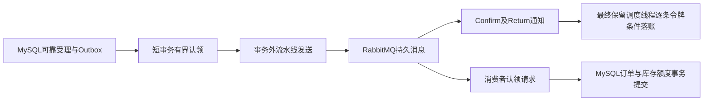

# 第十六阶段后关键链路审查与整改

状态：整改及本地验收完成。起点`ff1c1650de30b317ebfe17bdb5cf9c86b648b9be`，开始时main工作区干净（2026年10月24日）。本次授权来源为用户确认执行的`ticketing_latest_audit_and_fix_prompt.md`，不是第十六阶段性能结论的追认。本文按调查顺序保留实验，**最终选择为窗口16流水线发布、逐条确认条件落账；批量SENT实验已回退**。最终选择及限制以文末为准。

## 初始代码审查结果

下表为修复前代码定位；性能归因和未证实风险须经过隔离实验后更新，不能由静态阅读推断负载能力。

| 编号 | 分类 | 最小复现条件与定位 | 处理与验证 |
| --- | --- | --- | --- |
| A1 | 已证实性能设计缺陷 | `messaging/OutboxPublisher.java:43`每条认领、发送后在`:90`阻塞等待Confirm，下一条尚未发送；队列持续受理时累加确认往返 | 保留旧JAR与同场景基线，比较有界在途窗口；ACK与Return、认领令牌及租约不变 |
| A2 | 未证实风险 | `admission/PurchaseRequestMapper.java:30`单行持久预算，成功及失败释放同一行；此前两个时刻见过锁等待，不足以证明所有负载的瓶颈 | 区分账号、预算、票档与连接池等待；先测量，必要时才增量迁移，要求一万个独立隔离账号 |
| A3 | 已证实设计缺陷 | `admission/PurchaseEntryService.java:18`查重后只有速率准入；`PurchaseAdmission.java:41`直接写受理，非存在或明确停售的新票档也写请求、预算与Outbox | 非事务入口用实时轻量读预检，旧键回放优先；消费者最终权威校验保留 |
| A4 | 预期业务行为 | `PurchaseAdmission.java:31`仍锁账号UPDATE；交易SHARE只改变交易侧，不代表HTTP受理全并行 | 保留幂等与预算原子性，如无证据不重写账号协议 |
| A5 | 已证实诊断缺陷 | `messaging/OutboxPublisher.java:72`购票命令失败也称库存事件，日志输出事件标识且缺少分通道确认指标 | 按低基数消息通道及结果计量，不把业务标识作标签，不记录载荷和凭据 |
| A6 | 已证实体验缺陷 | `auth/RequestRateLimitFilter.java:95`在业务入口查重前返回429或安全故障503；客户端若丢失首次响应，重放也暂时受限 | 不绕过安全过滤器，提供当前用户按幂等键只读查找与有限恢复，测试越权和真实429 |
| A7 | 预期业务不确定性 | `trade/OrderService.java:32`取消已提交后再组装详情，后续读失败可能使响应失败而订单已取消 | 保持短事务，验证同键语义下重复取消及状态查询恢复，完善客户端提示 |
| A8 | 未证实风险 | 额度、候补、模拟退款、核销、权限撤销及缓存的并发路径；306项通过只证明既有覆盖 | 逐项复核与新故障回归，不无依据改写已正确实现 |
| A9 | 预期部署门禁 | 开发库最近只读记录为V7，V8/V9未部署；最新代码不直接连接旧库运行 | 全部实验固定ticketing-perf与随机guard；V1～V9字节冻结，开发库不迁移、不清理、不repair |
| A10 | 已证实工具Bug | `scripts/performance/trade_suite.py`在全新隔离库中审计尚未创建的ticket_order，报1146，基线未能启动 | 已增加业务表存在性检查，全新库正常由Flyway初始化；随后隔离基线实际运行通过 |

## 执行与证据约束

先复现A1及记录完整链路，再改发布器；随后测量A2、处理A3/A6/A7并完成全量回归。发布窗口对照必须使用同一JAR、相同数据、相同限流及缓存配置，记录真实订单TPS、终态P95/P99、受理TPS、数据库与连接池等待以及所有Outbox通道积压，不能用拒绝响应包装吞吐。

历史迁移不修改；只有证明必要才新增版本。独立环境的凭据、故障原始堆栈和可恢复备份只存忽略的`.local`。结果文件使用新标签，不覆盖第八至十六阶段的原始证据。完整本地验收结束后按功能点分批提交并逐次推送main。

## 已执行的调查与取舍

发布器专项87项普通测试、41项真实集成首先通过，之后冻结独立JAR对窗口1/16/32/64做顺序及反向两轮热点对照。两轮16档订单TPS为11.65/12.25，对照1档为6.95/7.80；64档为11.85/7.05，未重复出稳定收益。因此选择16，而不是继续扩大窗口。完整原始结果保留在`docs/performance/results/postaudit-pub-r*-w*`。它们是发布器专项JAR的对照，最终含入口整改的JAR还要独立复测，不混为同一个受测产物。

当前实现使用局部有界完成队列，Rabbit回调不访问数据库，也不为每条消息分配阻塞线程。短事务批量认领在两个通道之间交替，先持行锁再更新令牌，事务外发送。每条消息独立核验ACK/Return及超时；窗口内健康消息继续落账，故障后不认领下一窗口。关闭时仅保留持久租约，迟到回调不会发起数据库写入，旧令牌CAS不能覆盖新认领者。Spring文档对[CorrelationData Future及Return先于Future完成的保证](https://docs.spring.io/spring-amqp/reference/amqp/template.html)提供协议依据，真实Rabbit mandatory Return与重复投递用例另行验证。

探索轮期间增加过监测项，最终正式对照冻结`perf.py`、`scenarios.js`、`chain_metrics.py`、`trade_suite.py`与全部受测JAR，每轮前后检查SHA-256。探索数据不作为唯一变量控制严格成立的证据，正式结果单独保存在`postaudit-final-*`，以最终协议清单为准。

一万个独立随机账号的服务层容量专项已通过：64线程、10000持久受理、有限批次约76.19次/秒；采样确实看到`purchase_capacity`行等待，最大连接池等待54。这个实验跳过HTTP/认证及消费者，正式订单为零；只能证明容量行是服务层热点，不能把它当作成交容量或证明分片能改善约12单/秒的当前完整链路。暂不增加容量分片及V10：没有对账/超额/重复释放缺陷，也没有分片完整链路收益证据，避免引入持久归属与配置下调切换风险。实际HTTP一万账号验证另行执行；结果见[容量专项](performance/results/postaudit-capacity-10000.json)。

## 整改期间的失败样本

最初单元专项9项有2项失败：配置record曾保留测试用旧构造器重载，使Spring绑定失败；另一个中断夹具没有先完成Future，未进入新的确认完成边界。已去掉多余构造器，并修正夹具的真实触发顺序；9项复验全部通过，后续87项普通回归也全部通过。

新增预检最初使用NEVER传播，外层非事务同步范围让MyBatis保留预检连接；后续受理事务再借连接时，100并发耗尽10个连接，两个原有并发用例超时。失败日志及`ticketing_postentry_835527bc00ef_it`现场保留。改成REQUIRES_NEW的短只读事务，结束即释放连接，然后才运行Redis额外准入及受理写事务；修复后的43项专项和首轮316项全量回归均通过。这是整改实现引入并被回归捕获的问题，不能算作基线原有缺陷。

补充真实行锁超时与池耗尽后，首次318项回归有一个夹具错误及一个后续断言失败：夹具按配置上限额外填满连接，撞到全套缓存上下文的MySQL连接上限，受理夹具未完成恢复而影响下一项容量断言。现场`ticketing_postauditfinal_74c1d8acd326_it`和报告保留；夹具改为只耗尽当前已建连接，finally恢复池配置。15项额度及故障专项复验全通过，正在重跑最终全量；未因此扩大生产连接池或MySQL连接上限。

最终318项回归已通过（87普通、231真实集成，失败/错误/跳过均0），包含新增的真实行锁超时、真实连接池耗尽及相同认领恢复；见[测试XML与产物摘要](architecture/results/postaudit-backend-validation.json)。前端`npm ci`及`npm run build`通过，包含严格TypeScript检查。开发库[重新只读检查](architecture/results/postaudit-development-readonly.json)仍V7，原运行状态已恢复。

一万个真实Session/CSRF账号的HTTP专项已通过，非虚构用户标识或同账号循环：10000个不同账号各提交一次，64并发、消费者及发布器暂停，10000个QUEUED、预算10000、正式订单0。10秒预热后按完成时刻截取20秒，受理79.75次/秒、P95约1000毫秒、P99约1110.9毫秒；整批为有限样本，不视作持续成交能力。满额真实503与容量由10000下调至200后的拒绝均验证，旧键能恢复同一申请而不续期；原安全限流保持开启。结果包含所有未投递Outbox积压，见[HTTP一万账号报告](performance/results/postaudit-http10000/report.json)。

## 确认落账的二次定位

第一版流水线在最终固定协议下，16档两轮热点为10.55/11.15单每秒，P95约15.36/14.69秒；1档为8.70/6.95单每秒，P95约12.40/19.28秒。吞吐提高，但不能声称长尾已经稳定改善。该阶段全部结果保留在`postaudit-final-*`，这里的“final”是当时标签，不表示之后没有整改。

SQL摘要进一步显示一轮685次单条`SENT`更新累计9344.89毫秒，均值13.642毫秒。发送流水线之后，调度线程仍逐条等待MySQL确认落账，成为剩余串行开销。因此增加有界批量条件落账：只合并已经收到且核验ACK、无Return的完成通知，按通道合并为一条UPDATE；每个分支都要求`id + PROCESSING + retry_count`匹配。部分记录被新令牌认领时，只更新仍匹配者，返回真实更新条数；重复确认不再次改变状态。数据库落账结果不确定时，保留租约并停止本轮继续落账，避免连续冲击故障数据库。

上述批量落账为实验实现，随后对照没有复现整链路收益，最终已撤回该方法与新增SQL。保留实验产物、320项测试记录及全部原始结果，不将实验通过数量冒充最终逐条版本的测试数量。

新批量确认专项88项普通及44项真实集成通过，新增混合新旧令牌与落账故障用例。最终产物与此前流水线产物单独封存，重新执行全量回归、HTTP一万账号及同协议对照，结果使用`postaudit-batch-*`标签。

Confirm落账与消费可以并发，消费者可能先提交订单。数据库“确认落账到订单写入”的时差可为负，不截断也不作为两个顺序阶段相加。记录受理→Outbox写入、Outbox→确认落账的全部SENT分布及未投递积压，发送→确认Timer、受理→认领Timer（两个时刻均来自MySQL）与消费者交易Timer分别记录；HTTP终态耗时另按完成时间截取。旧包没有新增Timer，不补造历史值。

## 最终实现与性能取舍

最终生产源码与已封存的`final.jar`逐项SHA-256一致，产物摘要`4d86020249e9e837248e4ff68c80215160818ddd33cadd19971e162da5a62610`。`final-batch.jar`摘要`75d410981a56894c3f97aca9e946629b278f7337ef62bf9d00e7133de2d00f8a`仅用于批量SENT实验；不是最终交付选择。所有正式与探索结果索引见[机器可读汇总](performance/results/postaudit-summary.json)，各轮自己的协议清单、产物摘要和原始快照保留。

### 同产物流水线窗口对照

下表均为最终选择产物，同数据、100个独立账号、100 VU、10秒预热及按完成时间截取的20秒稳定窗口。速率单位为次/秒，时间单位为秒；累计行锁时间覆盖整轮，不与稳定窗口速率直接相除。两个消息通道收尾积压均为0，5xx/传输错误均为0，一致性审计全部通过。

| 轮次与窗口 | 受理TPS | 正式订单TPS | 终态P95 | 终态P99 | 累计行锁等待ms | 连接池等待峰值 |
| --- | ---: | ---: | ---: | ---: | ---: | ---: |
| 第一轮1 | 8.80 | 8.70 | 12.401 | 12.500 | 22819 | 14 |
| 第一轮16 | 10.60 | 10.55 | 15.361 | 16.592 | 47227 | 40 |
| 第二轮1 | 7.05 | 6.95 | 19.278 | 19.853 | 20602 | 25 |
| 第二轮16 | 11.35 | 11.15 | 14.692 | 16.304 | 47721 | 33 |

16窗口两轮订单TPS分别高约21.3%和60.4%，但第一轮P95/P99变差，连接池及行锁竞争增加。由此保留有界流水线和较小的16默认窗口，**不宣称长尾稳定改善**。32/64窗口的波动更大，不据其单轮高值扩大默认。原基线热点订单TPS10.30、P95 10.512秒；整包改动没有稳定胜过该基线，因此也不宣称本次总体端到端提速。

### 批量SENT实验的回退依据

同一冻结脚本协议下，逐条与批量落账都使用窗口16。其余生产类相同，JAR类差异仅OutboxPublisher、OutboxService、OutboxMapper及发布器内部record。

| 轮次 | 逐条订单TPS | 批量订单TPS | 逐条P95/P99秒 | 批量P95/P99秒 |
| --- | ---: | ---: | --- | --- |
| 第一轮 | 11.45 | 11.10 | 14.134 / 14.850 | 14.942 / 15.787 |
| 第二轮反向 | 10.85 | 10.35 | 15.303 / 16.093 | 14.868 / 15.922 |

批量落账两轮吞吐均未提高，尾部一升一降。SQL累计耗时提供调查线索，却不能证明批量改写改善完整链路。因此回退额外批量SENT SQL及完成通知合并，保留短事务有界批量**认领**、事务外流水线**发送**、逐条令牌条件**确认落账**。回退后生产源码摘要与先前已测试产物完全一致，重新跑最终回归。保留实验数据`postaudit-finalbatch-*`，其中`before`指逐条流水线版本，不是原始串行基线。

### 分段延迟、积压与其余场景

以下为最终选择产物第一轮窗口16的整轮数据库快照；分布口径区别于上表HTTP稳定窗口，不能彼此替换。确认落账与消费并发，分段不能相加推算总时长。

| 时段或通道 | 样本数 | P95毫秒 | P99毫秒 | 收尾未投递数 |
| --- | ---: | ---: | ---: | ---: |
| 受理到Outbox写入 | 328 | 201.765 | 305.560 | 不适用 |
| 购票Outbox写入到确认落账 | 328 | 10602.998 | 13101.536 | 0 |
| 库存候补Outbox写入到确认落账 | 328 | 1592.321 | 2435.846 | 0 |
| 确认落账到订单写入有符号时差 | 328 | 4277.231 | 4487.246 | 不适用 |
| 受理到订单写入 | 328 | 12278.256 | 12928.863 | 不适用 |

快照保留全部状态及未确认年龄分布，不只抽样SENT。发送到ACK、受理到消费者认领及消费者事务Timer见每轮monitoring与metric-quantiles；旧包未提供的Timer不补造。第二轮购票通道P95/P99为9208.633/12007.850毫秒，库存候补通道为1667.267/1900.061毫秒。购票消息存在29/31条重复尝试，幂等效果与预算、库存、额度审计均通过；不将其当成额外成交。

最终选择产物的其他负载：库存紧张订单11.65 TPS、P95/P99 14.194/14.889秒；混合多场次16.00 TPS、1.890/1.954秒；同一用户跨场次11.40 TPS、1.901/2.509秒。最后一组受理15.80 TPS，不能当作15.80订单TPS；受理账号UPDATE仍保留。均是当前本机单实例、有限负载的结果，不外推持续或生产容量。

一万账号受理专项暂停消费者，订单为0，只验证持久受理、容量下调拒绝及原键恢复。原始最终批量版本首次HTTP专项有4次传输错误，失败轮未改成通过；同键恢复、Windows TCP/IP 4227定位及连接复用后复验分别保存在`postaudit-http10000-transport-*`和`postaudit-batch-http10000-r2`。压测客户端改用64条共享传输连接，各账号Cookie/CSRF仍独立。登录准备失败时现在清理匿名令牌并单独计数，避免失败后401级联；4项登录状态单元检查通过。这些是压测工具修复，未放宽服务端限流或连接配置。

## 业务正确性审查结论

| 审查对象 | 本次结论及验证边界 |
| --- | --- |
| 交易额度与库存 | 保留账号SHARE→活动→场次→额度UPDATE→票档→订单→候补→票券顺序；真实并发及双向SUM审计覆盖，释放不足回滚。未复现超卖、负额度或重复释放缺陷 |
| 受理容量 | 服务层及真实一万独立Session专项测到单行热点；没有证据证明分片改善当前完整链路，未新增V10、分片或容量归属字段 |
| 无效新申请 | 既存键优先回放，新键以实时主键点查拒绝不存在/停售/下架/窗口外票档；短只读事务归还连接后才做Redis与写受理。预检不占库存，消费者权威校验保留 |
| 重放与安全 | 新GET按可信当前用户及CREATE_ORDER键查找，no-store；授权前数据库复查沿用SecurityConfig共用匹配器。真实429不阻止只读恢复，也不绕过POST过滤器；越权不存在返回404 |
| 候补、出票及退款 | 同事务生命周期及原FIFO保持；暂停、重复投递、支付/取消/过期、退款与核销竞争复用原回归。未改写COMPLETED候补或既有支付/核销历史 |
| 取消响应不确定性 | 保留提交后独立详情读取；新增故障回归确认取消已经提交且重复取消安全。前端查询取消状态后明确告知，仍未知时保留安全重试提示 |
| 缓存、权限及凭证 | 正负缓存、提交后失效、Redis故障回源、会话停用与撤权竞争沿用真实回归；不更改凭证签名、摘要、存储或权限语义 |

未发现的缺陷不等于不存在；账号受理串行、容量行热点及不稳定长尾是仍需在目标负载下评估的限制。没有本次部署开发库、真实资金渠道或大规模生产容量验证。

## 文件与SQL变更清单

生产类共10个：`messaging`中的OutboxPublisher、OutboxService、OutboxMapper、OutboxProperties；`admission`中的PurchaseAdmission、PurchaseEntryService、PurchaseProcessing、PurchaseRequestsController；`inventory`中的TicketInventory、TicketSkuMapper。没有新增生产类或启动服务。

SQL修改仅为OutboxMapper有界批量SKIP LOCKED候选读取及认领UPDATE、TicketSkuMapper实时销售预检SELECT；逐条SENT/失败CAS继续按id、状态及递增attempt校验。生产无新增表、索引或迁移。V1～V9逐字节未变，详见[历史迁移校验](architecture/results/postaudit-historical-migrations.json)。

前端修改`api/orders.ts`、`components/PurchasePanel.vue`、`views/OrdersView.vue`，实现本人按键恢复及取消状态恢复。中断前最后一处提示编辑把变量放错catch作用域，续接时已纠正并重新通过严格TypeScript及生产构建。

测试修改ConfigurationBindingTest、RateLimitIT、UserSessionQuotaIT、AsyncPurchaseIT、OutboxPublisherTest、WaitlistManagementIT；新增OutboxPipelineIT及显式运行的AdmissionCapacityBenchmark。后者不计入普通或mysql-it默认回归数量，不默认制造一万账号。

工具修改`perf.py`、`scenarios.js`、`trade_suite.py`、`catalog_faults.py`及`application-performance.yml`；新增`chain_metrics.py`、`metric_quantiles.py`、`admission_10000.py`、`publisher_crash.py`和`test_login.mjs`。更新`.env.example`、`application.yml`、AGENTS及docs中的架构、API、本地运行、开发计划和本报告；本次原始结果及脱敏汇总独立归档。未提交.env、Cookie、凭据、日志、JAR、构建目录或根README。

未改生产边界：交易锁序/订单状态服务/额度SQL、模拟支付与退款、核销与出票、候补生命周期、Session/CSRF/安全限流、缓存实现、受理预算模型、数据库迁移及Docker固定拓扑。没有引入微服务、多实例、真实支付退款或Redis库存。

## 最终交付验证

回退无收益的批量SENT后再次完整执行隔离`mvn clean verify -Pmysql-it`，普通87项、真实集成231项，共318项，失败/错误/跳过均为0。包含真实缺交换机NACK与另一通道健康消息并存、行锁超时、池耗尽、取消提交后读取失败等新增场景。重新构建JAR的所有应用条目与最终选择产物逐字节相同；[最终测试及源码摘要](architecture/results/postaudit-delivery-validation.json)独立记录，不覆盖此前318/320项实验报告。前端严格TypeScript与构建通过；压测隔离单元检查7项及登录状态检查4项通过。

真实Redis停机、L1过期、20并发回源、恢复重新填充等[11项检查](architecture/results/catalog-faults-postaudit-delivery.json)通过，追加验证真实Redis故障时POST仍503关闭、本人GET原键仍200找回且no-store。异步[8项故障检查](architecture/results/async-faults-postaudit-delivery.json)通过，包含应用处理中中止、代理持续停机后过期释放、数据库真实停机响应ReadTimeout后同键恢复只建一单；不把超时当作已受理或成交。

发布器在真实认领后暂停RabbitMQ并终止Java进程的[3项检查](architecture/results/publisher-crash-postaudit-delivery.json)通过：原PROCESSING租约留存，重启后以递增令牌恢复，三笔受理各生成一个订单且预算归零。另用最终产物完成[25账号候补闭环](performance/results/postaudit-delivery-waitlist/waitlist-25/environment.json)：25项候补全部分配并完成模拟支付、k6退出0、数据库审计通过。FIFO只指同票档候补内部，不扩张成普通购票优先权。

浏览器[14项联调与最终数据库事实](architecture/results/postaudit-delivery-browser.json)通过：首次受理202响应及取消200响应均在后端完成后由隔离代理延迟7秒，触发前端5秒超时；页面分别自动找回同一订单、查询确认已取消。停售409明确提示未受理，恢复开售后原键可首次受理；真实安全429后GET404不新增申请，刷新保留原参数，等待窗口结束后原键成功。随后完成模拟支付、唯一出票、管理员整单模拟退款和买家重新登录回看。最终三笔申请全部SUCCEEDED、两单CANCELLED/一单REFUNDED，成功支付事实与支付/退款流水各保留一份，唯一电子票VOID，两票档locked/sold均0、可售均20，场次额度0；完整一致性审计通过。

联调截图：[首次响应恢复](images/postaudit-create-recovered.png)、[取消超时恢复](images/postaudit-cancel-recovered.png)、[停售拒绝保留参数](images/postaudit-unavailable-retained.png)、[真实429](images/postaudit-rate-limit-retained.png)、[退款保留支付事实](images/postaudit-refunded.png)、[额度及库存释放](images/postaudit-quota-released.png)。均为随机非实名隔离账号，不包含密码、Cookie或完整电子票凭证。

在该有效退款夹具上执行[10项退款审计反例](performance/results/postaudit-delivery-refund-audit-probes.json)通过，所有人为异常仅在同连接事务中回滚，前后数据库快照一致。没有改写真实历史或提交异常数据。

## 环境保全与部署边界

本轮结束后停止单个专用应用、浏览器代理与ticketing-perf三个容器，保留所有Docker卷及原失败schema。专用MySQL全部44个非系统schema均已导出到忽略的.local，校验mysqldump完成标记、SHA-256与gzip解压逐字节一致；[脱敏备份清单](architecture/results/postaudit-delivery-backups.json)不含SQL或秘密。本次没有执行备份恢复演练，不将解压校验称为已验证恢复。

原开发库仍V7，其[只读审计](architecture/results/postaudit-development-readonly.json)通过并恢复原停止状态；V8/V9未部署，未新增V10，历史迁移未改。后续部署必须停写/停消费者、备份及可恢复性验证、依次执行候补/退款/审计/受理/额度只读预检、人工单次批准、逐版本迁移与同快照后验对账后再放写；V9批准开关完成后撤销。异常只报告并停止，不repair、不清库。代码交付不等于开发库已升级。
