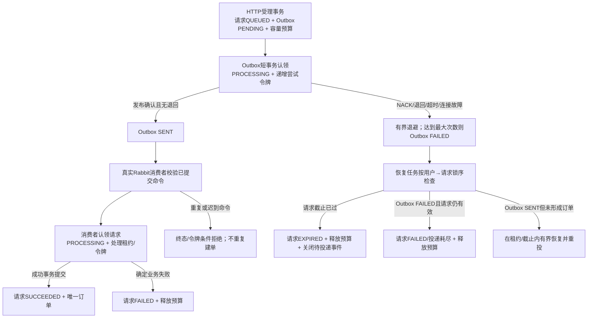
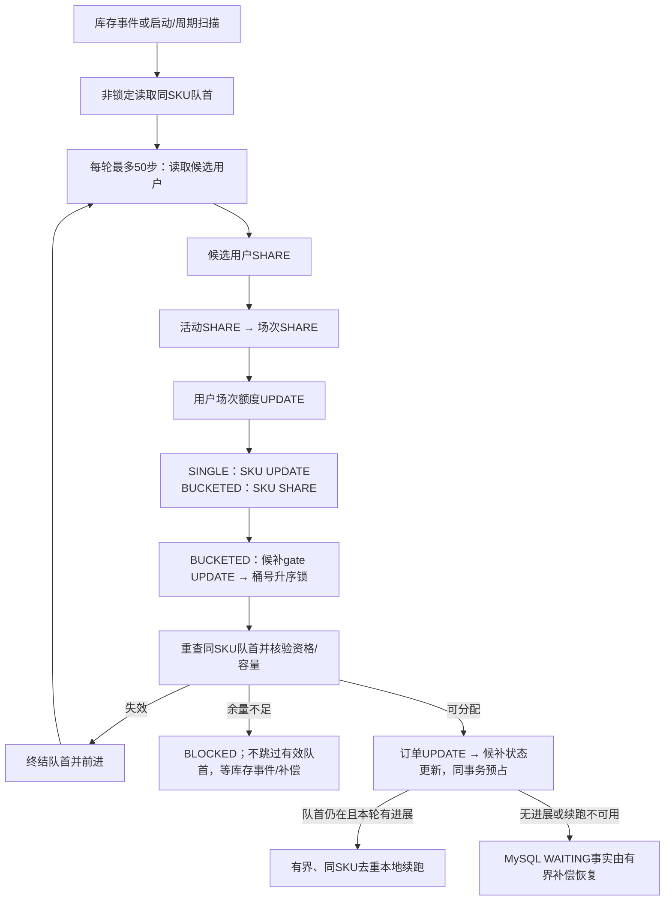

# 第十八阶段消息可靠性与候补恢复验收

状态：阶段18开发及隔离验收已完成。起点为`main`提交`b134b250133b03ea49cf6e2d7feeb99696c7c6c6`；开始审查时HEAD与`origin/main`一致、工作区干净。固定性能环境为历史独立验收环境（现已退役），MySQL/RabbitMQ/Redis使用既有容器及随机验收schema。开发库没有连接，仍按仓库记录为V7。V1～V10没有修改；本阶段不需要数据库迁移。

## 1. 审查基线与问题证据

审查实际覆盖消息与购票调用链（`OutboxPublisher`、`OutboxService`、`OutboxMapper`、`OutboxProperties`、`OutboxPublishJob`、`PurchaseCommands`、`PurchaseRabbitConfig`、`PurchaseConsumerProperties`、`PurchaseAdmission`、`PurchaseProcessing`、`PurchaseRequestMapper`、`PurchaseRecoveryJob`、`PurchaseOrderConsumer`、`PurchaseOrderWorker`）；库存、交易、限额与售后（`TicketInventory`、`TicketSkuMapper`、`StockBucketMapper`、`TradeResourceLocker`、`OrderReservation`、`OrderStateService`、`OrderRefundService`、`OrderExpiryJob`、`SessionAftercareJob`、`AftercareMapper`、`UserSessionQuotaService`）；候补链路（`WaitlistService`、`WaitlistMapper`、`WaitlistDispatcher`、`WaitlistCompensation`、`WaitlistOrderLifecycle`、`InventoryConsumer`、`WaitlistRabbitConfig`）。还只读核对V8～V10及库存、额度、Outbox审计SQL，检查`application.yml`、Compose、MySQL/Rabbit/Redis集成测试、性能脚本及`docs/28`、`docs/29`；前端检查包括`PurchasePanel`、`PurchaseRequestsView`、`WaitlistPanel`、`WaitlistView`、订单卡片、电子票、管理员订单与核销组件、认证请求和购票找回工具。没有把静态审查或通过测试解释成正式环境SLA证明。

| 发现 | 源码路径 | 判断与触发条件 |
| --- | --- | --- |
| 购票Outbox耗尽后，尚未到期的受理请求没有终态 | `admission/PurchaseProcessing`、`messaging/OutboxMapper`、`PurchaseRecoveryJob` | 已确认缺陷。恢复逻辑只会把`SENT`消息重新置为`PENDING`；当发布器把购票命令记为`FAILED`时，请求仍可处于`QUEUED/PROCESSING`并占用容量，后续恢复扫描不会重投也不会关单。真实RabbitMQ缺交换机NACK复现后，Outbox为`FAILED`、请求仍为`QUEUED`。 |
| 候补超过每轮50步后，已有可分配余量需等下一次补偿 | `waitlist/WaitlistDispatcher`、`WaitlistCompensation` | 已确认调度缺口。一个库存事件只触发一轮最多50步分配；余下队首仍可分配时没有继续调度意图，原补偿任务默认间隔60秒。真实MySQL/RabbitMQ测试构造100条候补，单事件处理50条后其余50条仍`WAITING`，直到显式运行补偿扫描。 |
| `MANUAL_REQUIRED`是否会被自动扫描略过 | `trade/AftercareMapper`、`SessionAftercareJob`、`AdminOrderService` | 不是静默丢失。达到配置最大次数后状态不再自动重试；订单详情继续呈现售后状态及原因。默认最大5次、失败退避从30秒起并封顶一小时、后台每10秒有界扫描；管理查询保持既有权限及审计路径。 |
| 库存分桶及交易锁顺序 | `inventory/TicketInventory`、`trade/TradeResourceLocker` | 沿用第17阶段协议。`SINGLE`仍为默认；没有更改桶归属、候补gate、库存SQL或V10。候补仅在成功分配时写额度，`WAITING`不占额度。 |

原始初次复现和修复后运行日志保留在`.local/stage18/`。初次购票复现的测试夹具曾因只给临时发布器设置最大尝试数、未同步Spring Outbox服务配置而未触发`FAILED`；该次失败schema按保护规则保留。第二次复现将真实Outbox服务的最大尝试数设为2，确认缺交换机NACK两次后形成`FAILED`，并保留了修正后的真实复现记录。

### 购票命令投递耗尽

恢复任务持有既有用户UPDATE锁及购票请求UPDATE锁后，查询对应唯一购票Outbox命令状态。若Outbox已为`FAILED`、请求仍在有效期且请求行满足`QUEUED`或租约到期`PROCESSING`条件，则以条件更新将请求转为`FAILED/PURCHASE_COMMAND_DELIVERY_EXHAUSTED`，清除租约、推进处理令牌，并在同一事务释放容量预算。若数据库时钟已越过请求截止，则仍优先按原流程转`EXPIRED`并关闭命令。

此路径不会制造订单或改变库存、场次额度、支付与电子票。迟到消息因请求已终态而不能认领；重复恢复由状态条件和用户锁防止重复释放。前端无需接收内部堆栈，查询会得到明确中文提示：购票消息多次投递失败、本次未创建订单、请重新选择购票。

### 候补续跑

`WaitlistDispatcher`仍每轮最多处理50步。若达到上限且队首仍存在，且本轮至少有候补成功分配或失效队首被终结，则投递一次按SKU去重的本地续跑任务。续跑队列单线程、容量默认64且限制在1至256；重复SKU在队列中合并，队列满或任务异常会计低基数指标并交由MySQL事实补偿。

若头部因票数不足返回`BLOCKED`，不立即续跑，防止库存未变化时热循环。若连续多步只有候选变化`RETRY`、没有状态前进，也停止本地连跑；`WAITING`数据仍保留，后台补偿接手。候补补偿现在在应用启动约1秒后先扫描，后续默认每60秒有界扫描，游标失败前进、到尾回绕；本地队列丢失不会丢失候补事实。

### 购票请求恢复

Outbox发布仍使用确认流水线、窗口16、递增认领令牌与至少一次投递；失败次数有限。数据库恢复以MySQL状态为权威，过期或投递耗尽只有一次条件终态更新与预算释放，不依赖易失进程游标。

### 候补调度与交易锁序

调用顺序继续为候选用户账号SHARE→活动SHARE→场次SHARE→该用户场次额度UPDATE→票档锁；`BUCKETED`在SKU SHARE后先持候补gate，再按桶号升序锁库存。锁定订单后才更新候补；每个候补分配仍是一笔独立READ_COMMITTED事务。队首票数不足不跳过。普通购票与候补FIFO不构成跨队列优先级。

## 4. 恢复任务与人工处理边界

| 工作 | 权威事实与扫描 | 终态/退避 | 人工介入 |
| --- | --- | --- | --- |
| 购票请求/租约/命令失败 | MySQL `purchase_request`、对应Outbox；默认每秒有界恢复扫描 | 成功、确定失败、截止过期或Outbox耗尽失败；令牌防旧消费者提交 | 请求仅在未形成订单时以明确失败结束；买家可重新选择并以新幂等键受理 |
| Outbox投递 | `outbox_event`状态、租约和递增尝试；发布器默认每秒扫描 | 确认后`SENT`；重试有界退避，达到默认10次后`FAILED`；租约过期可恢复 | `FAILED`对购票请求会形成可解释终态；库存事件保持数据库补偿可恢复 |
| 待支付订单过期 | MySQL截止时间、订单状态、库存与额度；默认每30秒有界扫描 | 单订单事务将`PENDING`转`EXPIRED`并只释放一次；失败前进，扫描游标回绕 | 不因账号停用而跳过释放 |
| 候补FIFO | MySQL `WAITING`队首、库存及用户状态；启动后约1秒、之后默认每60秒有界补偿 | `ALLOCATED`、资格失效`EXPIRED`；有效但余量不足时保持队首`WAITING` | 库存补入、取消/过期释放事件或周期补偿恢复；不越过队首 |
| 取消场次善后 | `activity_session=CANCELLED`、订单与`order_aftercare`；默认每10秒有界扫描 | 关闭PENDING或模拟退款PAID；失败退避，默认5次后`MANUAL_REQUIRED` | `MANUAL_REQUIRED`不重试但可在管理员订单详情查询。真实支付退款不在此流程内 |

本阶段没有对人工售后增加无鉴权重放接口，也没有改变审计、管理员权限、订单退款或电子票核销语义。

## 5. 验收命令与故障复现

以下运行仅使用隔离脚本创建的随机验收schema及当时的独立验收环境（现已退役）服务；失败运行日志及schema按脚本规则保留，成功运行只清理本轮随机schema。

| 验证 | 命令/输入 | 实际结果 |
| --- | --- | --- |
| Outbox失败最小复现 | `AsyncPurchaseIT`；真实RabbitMQ投往不存在交换机，最大投递尝试设为2 | 首次请求保持有效、Outbox已`FAILED`时复现旧缺陷；修复后恢复扫描只终结请求并释放预算，库存/额度/订单均不变；晚到真实Rabbit消息ACK但不建单，重复恢复不再改变事实。 |
| 候补50步缺口复现 | `WaitlistManagementIT`；100个真实候补用户、单票档、MySQL及RabbitMQ | 修复前单事件只分配50，余50需补偿扫描；修复后100个可分配候补在同一事件后续跑完成。 |
| 候补千级续跑 | `WaitlistManagementIT`；1000条MySQL候补，1条库存消息，续跑期间10条重复消息 | 全量回归用时30,478毫秒，1000笔PENDING预留订单建立，剩余WAITING为0，SKU锁定库存1000，未重复分配。单次本机运行只用于描述该闭环，不作为生产容量承诺。 |
| 部分库存与队首 | `WaitlistManagementIT`；100候补、首轮可分配50，增加库存后再投递真实事件 | 保持同SKU FIFO；初始50笔预留、50条仍等待，容量提升后其余候补才分配。有效队首不足时不跳过，待后续库存/补偿。 |
| 进程状态丢失恢复 | `WaitlistManagementIT`；先留下50条MySQL `WAITING`，再用新游标/新续跑调度器扫描 | 新调度器只依赖数据库未终结事实恢复，剩余50条在1,825毫秒内完成分配。 |
| 第一次修复针对性回归 | `verify_backend.py --label s18waitfix1 --tests WaitlistManagementIT,StockBucketIT` | 42项集成测试通过，覆盖候补与SINGLE/BUCKETED库存行为。 |
| 最新代码定向回归 | `python -B scripts/verification/verify_backend.py --label s18lasttarget --tests AsyncPurchaseIT,WaitlistManagementIT` | 46项集成测试通过（购票17、候补29）；用于重新编译并执行最终测试源码。 |
| 全量后端回归 | `python -B scripts/verification/verify_backend.py --label s18final1` | Maven `clean verify`成功：87项普通测试+255项MySQL/Rabbit/Redis集成测试，失败、错误、跳过均为0；校验10个迁移并已到V10。完整日志为`.local/stage18/final-backend-run-1.log`。 |
| 前端锁定依赖和构建 | `cd frontend; npm ci; npm run build` | `npm ci`审计0漏洞，严格`vue-tsc`与Vite构建通过；没有前端功能变更。 |

完整回归中的故障日志包含预期的缺交换机NACK及迁移失败注入；最终测试摘要仍为零失败、零错误。第一次购票复现因测试夹具未同步真实Outbox服务的最大重试数而没有进入`FAILED`，该失败日志及schema均保留；第二次使用真实服务配置完成缺交换机复现。定向复跑与全量回归使用独立随机schema，开发库未连接。

## 7. 交付边界与遗留风险

本阶段没有真实支付、真实退款、开发库升级、新迁移、前端身份凭据或新建服务进程/中间件；续跑机制是现有单体内的有界守护线程。前端源文件未修改，`npm ci`及严格TypeScript/Vite构建通过；本阶段未做浏览器驱动的全流程回放，业务状态通过真实HTTP Session/CSRF、MySQL及RabbitMQ集成和隔离负载验证。性能数据只代表本机单实例与固定中间件的有限负载，不能外推高并发容量或生产SLA。Outbox与MySQL依然是独立故障域，MySQL是库存、受理状态和候补事实权威；本地续跑队列溢出或进程重启时，恢复依赖默认60秒周期补偿，存在配置周期内等待。`SINGLE`继续是默认库存策略；`BUCKETED`兼容路径与第17阶段保持一致。
