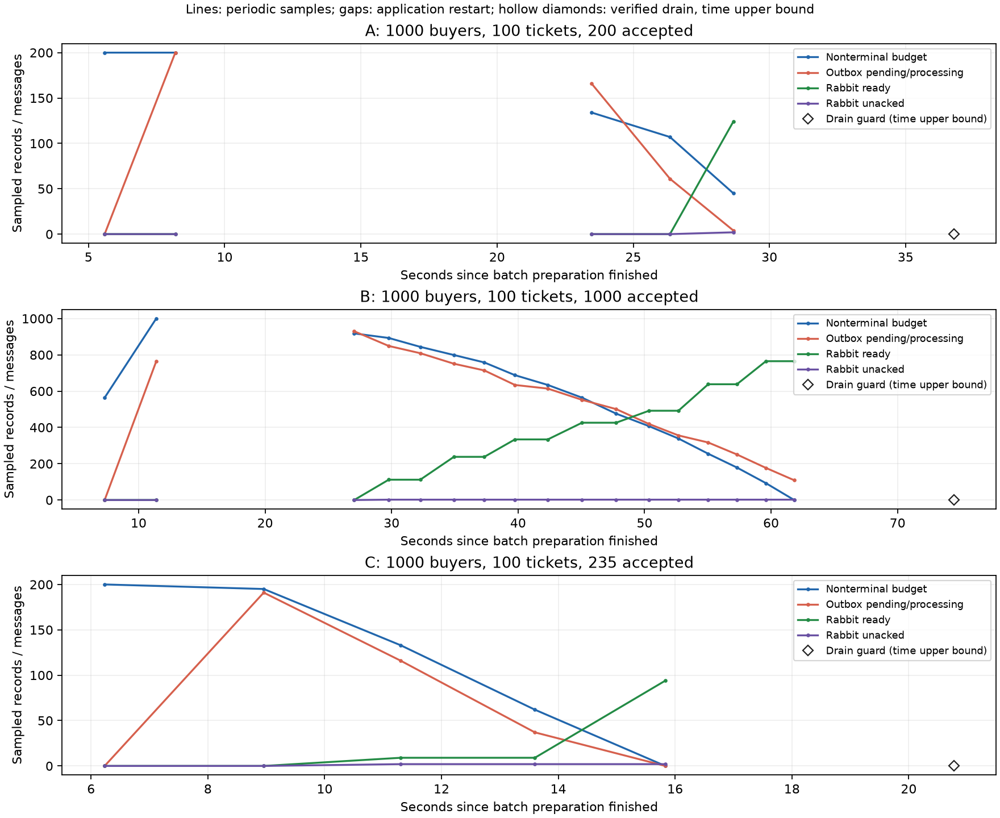

# 专项实验03 百张库存与千名独立买家

2026年10月25日在本机实际执行。A、B、C三组均通过：每组1000名不同的有效USER，每人向同一个SKU首次申请1张，最终各有100个SUCCEEDED绑定100个不同用户的唯一PENDING订单，锁定库存100张。超卖、重复订单、额度偏差、未知错误、传输错误、过期申请、投递耗尽及未终态申请均为0。202表示可靠受理，不表示订单已经生成。

## 版本、机器与隔离

开始时执行`git fetch origin`，本地和远端`main`均为`1ff6a4b79a700c1b02a46a18a32c77415174cbaf`，工作区干净。没有修改生产Java、正式默认配置、通用`perf.prepare()`上限或V1至V10迁移。本轮新增专项夹具、审计、保护测试、汇总绘图和实测记录；`perf.environment_snapshot()`新增可选独立输出路径，避免改写历史机器快照；PyMySQL启用`rsa`依赖，以支持本机MySQL首次caching_sha2_password认证。

三组使用同一个冻结JAR，SHA-256为`be5f19d130b751ff92706e920208662b353af20f75ad56a97c14bc17005ce288`，私有位置为`.local/performance/ex03-baseline.jar`。各组`report.json`保存Git基线、JAR摘要和实验脚本/SQL摘要；新工具的最终交付版本以本报告所属提交为准。

Windows11 build26100，AMD Ryzen5 5600H，12逻辑处理器，内存15.86GiB；Docker Desktop Engine28.5.2，12CPU、约7.68GiB；Zulu JDK21.0.13、Maven3.9.11、Python3.13.0、requests2.33.1、PyMySQL1.1.1。单JVM为`-Xms512m -Xmx1024m -XX:+UseG1GC`。本轮由Python requests发压，没有使用k6。MySQL8.4.13保持`innodb_flush_log_at_trx_commit=1`、`sync_binlog=1`和binlog；Redis7、RabbitMQ4.1.8，镜像摘要见每组`environment.json`。

只使用固定`ticketing-perf`：MySQL13307/`ticketing_perf`、Redis16379、Rabbit15673/管理25673、唯一后端18080。写入、重置和重启前核验随机数据库guard及应用PID/监听端口归属；互斥文件阻止同一专项重复启动。每组开始前要求上一组非终态、预算、未完成Outbox及Rabbit消息全部为0，才允许既有`perf.prepare()`清理专用夹具。已有标签拒绝覆盖，失败记录保留。不读取根`.env`作为实验配置，不连接开发库3307/`ticketing`。开发Compose的三个空闲服务保留运行，本轮没有停止或重置它们。

## 夹具与有效配置

先运行`perf.prepare('hot-ample',1)`，保留1000条PUBLISHED活动和一个有效场次/票档；通过管理员真实HTTP PUT及当前版本号将唯一SKU总量由1000000改为100。没有用SQL修改库存。公开接口再次确认`100/0/0/100`及SELLING，数据库确认SINGLE。此时尚无订单、候补或额度占用。

专用库复制测试注册用户的BCrypt哈希，删除尚无订单的临时USER种子，生成恰好1000个不同的ACTIVE/USER账号。全部通过真实密码登录建立独立Cookie/Session，登录后重新获取CSRF。公开元数据仅保留账号数量和排序用户ID集合的SHA-256，不公开用户名、密码、Cookie、CSRF或逐用户身份映射。每用户唯一幂等键，quantity固定1。

登录8线程，买家共享TCP连接池上限64，提交64线程；统一门闩释放首批工作者，由64线程处理1000份申请。监测/管理员另用少量连接。**不是1000条HTTP连接同一瞬间发送，也不是1000个线程。** 登录准备耗时A/B/C分别为11.710/11.882/11.997秒，登录失败均0，不计入抢票提交窗口。

| 配置 | A 默认容量保护 | B 库存诊断 | C 在线负载 |
| --- | --- | --- | --- |
| PURCHASE_CAPACITY | 200 | 1000，仅专用进程 | 200 |
| PURCHASE_QUEUE_SECONDS | 120 | 900，仅专用进程 | 120 |
| 提交期间发布器/购票消费者 | 暂停，随后重启恢复 | 暂停，随后重启恢复 | 始终在线 |
| 恢复/补偿、过期扫描 | 开启 | 开启 | 开启 |
| 库存/Outbox窗口/消费者/prefetch/Hikari | SINGLE/16/2/1/10 | 同左 | 同左 |
| 支付窗口 | 显式15分钟 | 显式15分钟 | 显式15分钟 |

三个场景均保持真实安全过滤器，使用既有`regression`模式：登录IP、登录账号IP、注册IP、下单用户、候补用户和CSRF会话IP的计数上限均为10000，时间窗口沿用配置；DIRECT来源识别、独立随机限流密钥、真实Session与CSRF保持启用。额外Lua票档准入关闭。该配置排除同一发压来源污染，**不是生产安全阈值基准**。既有性能配置原为1分钟支付窗口，本轮显式改为15分钟；过期扫描仍沿用性能配置1秒。三个冻结快照均远早于第一笔订单支付截止，没有关闭扫描、支付、取消或手改终态。

## 原始分类与正确性

| 指标 | A | B | C |
| --- | ---: | ---: | ---: |
| 首次新键申请 | 1000 | 1000 | 1000 |
| HTTP202受理 | 200 | 1000 | 235 |
| HTTP503 PURCHASE_QUEUE_FULL | 800 | 0 | 765 |
| 入口售罄等预检拒绝 | 0 | 0 | 0 |
| HTTP429/其他拒绝/未知5xx/认证或网络失败 | 0 | 0 | 0 |
| SUCCEEDED及唯一PENDING订单 | 100 | 100 | 100 |
| 已受理后FAILED TICKET_UNAVAILABLE | 100 | 900 | 135 |
| EXPIRED/投递耗尽/仍非终态 | 0 | 0 | 0 |
| 最终库存 total/locked/sold/available | 100/100/0/0 | 100/100/0/0 | 100/100/0/0 |
| 成功用户及精确场次额度占用 | 100人，各1 | 100人，各1 | 100人，各1 |
| 最终受理预算 | 0 | 0 | 0 |
| 最终Outbox SENT | 200 | 1000 | 235 |
| 最终Outbox未完成/FAILED、Rabbit ready/unacked/dead | 0 | 0 | 0 |
| 34项SQL审计违规总数 | 0 | 0 | 0 |
| HTTP与数据库逐申请核对差异 | 0 | 0 | 0 |
| 两条分类等式差异 | 0/0 | 0/0 | 0/0 |

A暂停期间只有200个QUEUED、预算200、200条已提交待发布命令；正式订单0、额度0、库存仍100张可用，暂停阶段订单TPS为0。B暂停期间是1000个QUEUED、预算1000、1000条待发布命令，订单和额度仍0。二者均只恢复原有真实Outbox→Rabbit→消费者，没有手动修改订单、库存、预算或事件状态。

C在消费者在线时累计受理235个，大于200是因为容量随终态释放。本轮入口预检拒绝实际为0，不能将其余765个容量拒绝改称售罄；135个已受理失败的真实业务码为`TICKET_UNAVAILABLE`，也不改写为其他库存码。

分类逐项核对为A：`1000=200+800`、`200=100+100`；B：`1000=1000`、`1000=100+900`；C：`1000=235+765`、`235=100+135`。每组附加一次同键同参重放及一次同键异参409，原requestId和持久事实不变；这2次附加请求不计入1000次主申请。

## 时间与吞吐口径

以下为有限批次实测。HTTP提交窗口只覆盖1000次首次申请；成功终态延迟从各用户首次提交开始到本人接口首次观察到终态。8线程有界轮询在提交批次完成后开始；A/B重启会使Session失效，因此包含重启和重新认证。**终态延迟是客户端可见上界，不能当作精确SQL执行或提交耗时。** `chain`另存数据库accepted_at→updated_at写入时刻分布，写入也不等于事务提交时刻。

| 指标 | A | B | C |
| --- | ---: | ---: | ---: |
| 首次HTTP提交窗口，秒 | 7.858 | 11.243 | 8.622 |
| HTTP批次平均RPS | 127.26 | 88.94 | 115.98 |
| 202受理批次平均RPS | 25.45 | 88.94 | 27.25 |
| 全部HTTP P50/P95/P99，毫秒 | 469.26/831.46/1037.50 | 646.27/1170.85/1434.40 | 513.85/882.52/1070.19 |
| 202受理P50/P95/P99，毫秒 | 686.92/1038.21/1215.76 | 646.27/1170.85/1434.40 | 665.79/908.22/1071.58 |
| 容量503拒绝P95，毫秒 | 719.51 | 无样本 | 840.59 |
| 成功终态观察P50/P95/P99，毫秒 | 23136.14/26862.54/26869.09 | 26625.60/43511.12/43952.26 | 9732.44/10889.85/10930.00 |
| 全部已受理终态观察P95，毫秒 | 28177.33 | 50347.45 | 12643.78 |
| DB受理→终态写入P95，毫秒 | 27183.59 | 49553.22 | 11721.97 |
| 首笔至末笔成功订单写入跨度，秒 | 6.988 | 6.046 | 9.427 |
| 重启恢复及最终排空校验，秒 | 28.402 | 62.713 | 不重启 |
| HTTP轮询完成后的排空/归属检查，秒 | 包含在上一项 | 包含在上一项 | 4.459 |
| 主批次起点至排空及收尾核对，秒 | 36.768 | 74.444 | 20.770 |
| 含排空及收尾的成功订单批次平均，笔/秒 | 2.72 | 1.34 | 4.81 |

最后两行包含监测关闭、排空守卫、幂等收尾和SQL读取，提供保守的完整交付批次口径，不代表纯消费者服务率；第一笔至末笔订单跨度不包含首笔前的等待，也没有拿100除以该跨度冒充持续TPS。没有预热后稳定窗口、持续生产吞吐或1000在途连接能力的结论。第19阶段13.74TPS来自另一台机器、30分钟闭环且包含取消的持续负载，本轮目标、硬件、窗口、支付窗口和分母不同，不能直接计算优化倍数。

## 积压、数据库和JVM



曲线来自每至少2秒一次的串行采样，读多个系统有采样时间差；Rabbit管理统计也有更新滞后，不是每毫秒的瞬时真值。A/B重启间断开连线；空心菱形表示成功排空守卫已核对预算、非终态、Outbox及所有专用Rabbit队列为0，其横坐标使用完成收尾时刻，属于时间上界，**不是插值得到的消息清零时刻**。采样峰值不等于未采样期间的真实峰值；B暂停快照明确有1000条待发命令，即使周期采样只捕获930条。

| 全轮采样或累计增量 | A | B | C |
| --- | ---: | ---: | ---: |
| 非终态预算采样峰值 | 200 | 1000 | 200 |
| Outbox待发/处理中采样峰值 | 200 | 930，暂停快照1000 | 191 |
| Outbox最老年龄采样峰值，秒 | 26.206 | 51.138 | 11.634 |
| Rabbit ready/unacked采样峰值 | 124/2 | 765/2 | 94/2 |
| MySQL行锁等待次数增量 | 269 | 1082 | 428 |
| MySQL行锁等待累计增量，毫秒 | 13735 | 62590 | 14657 |
| 新增死锁/锁超时 | 0/0 | 0/0 | 0/0 |
| Slow_queries增量 | 167 | 750 | 160 |
| Hikari active/pending采样峰值 | 10/54 | 10/55 | 10/55 |
| Hikari连接获取超时计数峰值 | 0 | 0 | 0 |
| Hikari获取连接最大观察值，毫秒 | 649.99 | 1051.68 | 648.98 |
| 归一化进程CPU采样峰值 | 0.716 | 0.583 | 0.434 |
| 堆占用采样峰值，MiB | 311.76 | 317.83 | 316.15 |
| GC暂停最大观察值，毫秒 | 18 | 22 | 16 |
| 线程采样峰值 | 92 | 92 | 123 |
| retry_count大于1的Outbox事件数 | 171 | 909 | 162 |

锁等待是整个批次累计时间，不能除以订单数推断某一把锁的独占持有时长。`diagnostics.json`保存归一化SQL digest、执行计划和慢查询汇总，digest自专用MySQL启动以来累计，含准备及先前轮次，不能冒充该组独立稳态SQL样本。没有导出带参数的慢日志。

保持默认10秒购票恢复间隔；仍QUEUED的请求可能在原SENT命令尚未消费时被恢复重投，符合现有至少一次协议。上述Outbox重试事件数不等于Rabbit的redeliver次数，更不等于创建了多笔订单。原始MQ统计和投递计数保留于`monitoring.json`，最终全部排空。这里只记录重投开销和Hikari等待，没有凭这些观测改生产协议或宣称唯一性能根因。重启前后JVM计数重置，汇总为采样最大值，没有将不同进程的计数错误相减。

## SQL与身份核对

每个初始、提交完成、暂停（如适用）和最终快照，在同一个REPEATABLE READ只读一致性事务内运行原25项审计及新增9项有限供给审计，参数从本轮夹具绑定`@limited_sku`，没有写死SKU ID或只抽样前100笔订单。主要断言见`limited_stock_audit.sql`：

```sql
SELECT COALESCE(SUM(i.quantity),0) AS active_units
FROM ticket_order o JOIN ticket_order_item i ON i.order_id=o.id
WHERE i.sku_id=@limited_sku AND o.status IN ('PENDING','PAID');

SELECT (SELECT pending_count FROM purchase_capacity WHERE id=1)
 -(SELECT COUNT(*) FROM purchase_request WHERE status IN ('QUEUED','PROCESSING'))
 AS capacity_difference;
```

三组最终active_units均100、capacity_difference均0。原额度双向审计核对每一用户/场次的占额与PENDING/PAID数量；新增审计核对每买家至多一申请、一订单、成功关联、失败无订单、SKU/场次/单价12800分/数量1/金额12800分快照、ACTIVE/USER身份、SINGLE供给边界，以及没有支付、电子票或候补。原审计还检查截止时间、幂等哈希及操作域、Outbox关联、支付/退款和库存视图。

最终冻结时刻（UTC）A为07:59:40.106197，B为08:02:30.612512，C为08:04:10.310143，均处于15分钟支付窗口内。1000份主申请的内存身份映射、requestId、唯一键和本人接口终态与数据库逐条核对，差异均0；只有100名成功用户各占1张额度，失败用户无库存或额度泄漏。身份映射及凭据只留于被忽略的`.local/performance/<label>/`，不推送。

## 实际验证与保留问题

普通`mvn -f backend/pom.xml clean verify`已实际通过90项，失败/错误/跳过均0。随后实际执行`python -u -B scripts/performance/verify_backend.py --label ex03final`，本轮90项普通+256项真实MySQL/Redis/Rabbit集成，共346项全部通过，失败/错误/跳过均0，耗时7分53秒。成功后仅清理本轮符合守卫条件的13个隔离schema，预期DDL失败现场按既有工具规则保留。普通测试的重复执行不叠加成436项覆盖。

脚本保护测试15项（既有7项、新增8项）、既有登录函数测试4项和4份相关Python源码语法检查通过。公开JSON字段及本轮真实私有敏感值扫描未发现泄漏。最终计数由JUnit XML结构化读取，逐套件证据及摘要见[validation.json](performance/results/ex03-summary-20261025-d72c/validation.json)，不是引用历史346项。本轮没有修改前端，未运行前端构建、浏览器或额外长期负载。

首轮20人在线冒烟`ex03-smoke-c-e6b10d28`的20笔均真实SUCCEEDED、预算归0，但收尾脚本只允许重放HTTP202，误拒正常终态HTTP200，因此该轮报告为FAIL且原样保留。修正脚本为允许200/202并加回归测试，第二轮`ex03-smoke-c-46e67f7f`20/20通过；随后`ex03-smoke-a-c77805ea`50人暂停/恢复50/50通过。没有产品Java修复，不把首轮失败改写为成功，也没有覆盖旧标签。

本轮仅执行64提交线程的1000人A/B/C，未进行32/128档、1000同时在途连接或长期持续负载。三组数据各独立准备；没有发现需要改变交易协议的可复现产品正确性问题。后续可单独诊断高积压时恢复重投及连接池排队，但本轮不调大生产默认值。

## 复现与证据

准备Java21、Maven、Python和本机Docker，安装`python -m pip install -r scripts/performance/requirements.txt`。本机便携工具位于被忽略的`.local/tools`，可在PowerShell用`. ./.local/use-tools.ps1`为当前进程设置PATH；没有修改系统Java11或全局环境。先构建并冻结JAR，再运行以下命令；每次都使用新随机标签，必须顺序运行，不能在另一个测试仍使用专用环境时重置夹具。

```powershell
mvn -f backend/pom.xml clean verify
python -B scripts/performance/perf.py init
python -B scripts/performance/test_safety.py
python -B scripts/performance/test_limited_stock.py
node scripts/performance/test_login.mjs

$tag = [guid]::NewGuid().ToString('N').Substring(0,8)
$jar = ".local/performance/ex03-$tag.jar"
if (Test-Path $jar) { throw '冻结文件已存在' }
Copy-Item backend/target/ticketing-backend-0.1.0-SNAPSHOT.jar $jar
python -u -B scripts/performance/limited_stock_1000.py --jar $jar --scenario C --buyers 20 --workers 8 --label "ex03-smoke-c-$tag"
if ($LASTEXITCODE) { throw '冒烟未通过，停止' }
python -u -B scripts/performance/limited_stock_1000.py --jar $jar --scenario A --buyers 1000 --workers 64 --label "ex03-a-$tag"
if ($LASTEXITCODE) { throw 'A未通过，停止' }
python -u -B scripts/performance/limited_stock_1000.py --jar $jar --scenario B --buyers 1000 --workers 64 --label "ex03-b-$tag"
if ($LASTEXITCODE) { throw 'B未通过，停止' }
python -u -B scripts/performance/limited_stock_1000.py --jar $jar --scenario C --buyers 1000 --workers 64 --label "ex03-c-$tag"
if ($LASTEXITCODE) { throw 'C未通过，停止' }
python -B scripts/performance/perf.py stop
python -u -B scripts/performance/verify_backend.py --label "ex03it$tag"
```

冻结JAR是在初次普通测试成功后复制的；后续`clean verify`会重建target，不覆盖私有冻结副本。若需重新复制，使用新的私有文件名并核对SHA。绘图是可选离线步骤，另安装`matplotlib==3.11.2`，执行`python -B scripts/performance/limited_stock_report.py --labels <A标签> <B标签> <C标签> --output <新的汇总目录>`。绘图只读取脱敏结果，不连接服务。

| 证据 | 路径 |
| --- | --- |
| A主实验及200人暂停快照 | [ex03-a-3fa9a423](performance/results/ex03-a-3fa9a423/report.json) |
| B主实验及1000人暂停快照 | [ex03-b-c7084df8](performance/results/ex03-b-c7084df8/report.json) |
| C在线主实验 | [ex03-c-fa0be20a](performance/results/ex03-c-fa0be20a/report.json) |
| 汇总、监测峰值和曲线 | [summary.json](performance/results/ex03-summary-20261025-d72c/summary.json) |
| 本轮完整测试计数和源码摘要 | [validation.json](performance/results/ex03-summary-20261025-d72c/validation.json) |
| 首轮失败及重跑冒烟 | `performance/results/ex03-smoke-c-e6b10d28/`、`ex03-smoke-c-46e67f7f/`、`ex03-smoke-a-c77805ea/` |

每组均有`fixture-metadata.json`、`environment.json`、脱敏`http-completions.json`、`monitoring.json`、`after-submission-audit.json`、`final-audit.json`及`diagnostics.json`，A/B另有`paused-audit.json`。私有构建、失败堆栈、集成日志、账号和JAR在`.local`，不提交。原始JFR、根`.env`、README、构建产物和依赖目录均不推送。

结束时唯一专用压测应用已停止，专用及开发中间件均健康并保留数据卷。没有对原开发库执行实验SQL、迁移或初始化，也没有发布到生产。
