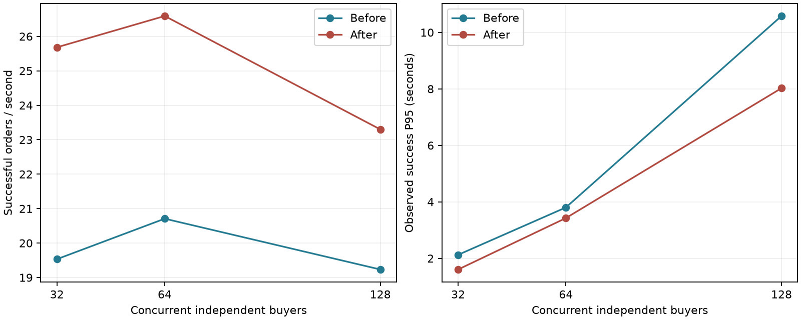

# 热点下单吞吐与响应时间排查

2026年10月25日本机实测。保留两项最小调整：新申请的首次补偿时间遵守既有恢复间隔；启用MySQL Connector/J的`useLocalSessionState`，减少驱动重复读取连接状态的往返。在相同64并发闭环中，两轮指标的中位数由20.71升至26.59笔成功订单/秒，提升28.41%；成功终态观察P95由3.803降至3.427秒，下降9.90%。这是本机有限稳定窗口的重复对照，不是生产容量保证。

## 同口径前后结果

| 并发独立买家 | 成功订单TPS前/后 | 提升 | 成功终态P95前/后，秒 | 降低 | HTTP202受理P95前/后，毫秒 | 各侧轮数 |
| --- | ---: | ---: | ---: | ---: | ---: | ---: |
| 32 | 19.53 / 25.68 | 31.48% | 2.125 / 1.606 | 24.44% | 59.31 / 54.52 | 1 |
| 64 | 20.71 / 26.59 | 28.41% | 3.803 / 3.427 | 9.90% | 68.31 / 64.67 | 2 |
| 128 | 19.23 / 23.30 | 21.14% | 10.581 / 8.026 | 24.15% | 116.78 / 97.64 | 1 |

64并发旧版本两轮为20.35、21.07笔/秒；候选为26.55、26.63笔/秒。先执行旧版本32→64→128，再做参数探索；随后再次执行旧版本64和最终包128→64→32。64列使用每轮指标的中位数；P95的中位数不是将两轮请求合并后重算的P95，也不提供统计置信区间。32和128是单轮边界诊断，不能与64的重复稳定性等同。



原始分位数、请求数、MySQL累计增量和全部探索轮均保留在[summary.json](performance/results/tune-summary-20261025-40a7/summary.json)。没有把快速拒绝或HTTP202数量当作成功订单数，也不把这轮结果与另机第19阶段13.74TPS或专项03的1000人有限突发批次直接计算优化倍数。

## 版本、环境与负载

开始时工作区干净，执行`git fetch origin`，`main`为`9c3a877314642ef2fadab525bce8108be5778450`。旧冻结包来自专项03基线；`1ff6a4b`至该HEAD没有后端源码变化。基线包、恢复时间探索包、最终包的SHA-256依次为：

```text
be5f19d130b751ff92706e920208662b353af20f75ad56a97c14bc17005ce288
f455abb6e1020979639c2d3e3aacaabe4e1eb2b152aa6ea8e7e7b7f179eff48f
391eb73efef6b3bf4b30ed1325ce7c204c16e295e6453c4952b85efca05cef23
```

选中候选的首轮使用探索包和外置驱动缓存配置，反序复测使用最终包及相同显式参数。逐ZIP条目比较确认两候选的生产class字节完全一致，只有`BOOT-INF/classes/application.yml`不同，最终包把相同驱动选项纳入默认配置。证据见[artifact-comparison.json](performance/results/tune-summary-20261025-40a7/artifact-comparison.json)。各轮保留实际JAR及执行工具SHA；探索期间只增加了工具参数和收尾保护，没有改k6请求流程及固定窗口定义。

Ryzen5 5600H、12逻辑处理器、15.86GiB内存、Windows11 build26100；Docker28.5.2、12CPU/约7.68GiB；MySQL8.4.13、Redis7、RabbitMQ4.1.8；Zulu JDK21.0.13、Maven3.9.11、Python3.13、k6 v2.3.0。单JVM512MiB初始/1GiB上限、G1。每轮独立`machine.json`记录实际版本及镜像，未更新已有Docker镜像。构建、回归与性能窗口顺序执行。

仅使用`ticketing-perf`和随机数据库guard：MySQL13307/`ticketing_perf`、Redis16379、Rabbit15673/管理25673、应用18080。正常开发Compose及3307/`ticketing`不参与实验；没有迁移或重置开发库，没有修改V1至V10，也没有调整MySQL刷盘与binlog持久化。

每档重新调用既有`perf.prepare('hot-ample', vus)`：1000条活动、一个有效场次和一个SINGLE票档、初始库存1000000；独立买家数等于VU数，另有管理及准备账号。真实BCrypt注册、密码登录、Session和CSRF，登录在k6 setup预先完成。安全过滤器开启，沿用既有regression限流阈值10000，额外Lua准入关闭；这是排除单来源限流污染的回归配置，不是生产安全阈值。

每个买家依次首次下单、每五轮一次同键重放、250ms间隔轮询本人申请、成功后取消订单释放库存，随后下一轮。不是1000人各买一次，也不是仅消费者建单微基准。每轮预热15秒，稳定窗口60秒；HTTP、受理和成功订单按各自完成时刻进入窗口，终态延迟从提交开始到本人接口首次观察成功，包含轮询误差。JFR另记录同JVM单调时钟的提交和消息阶段，数据库汇总时刻不冒充事务提交时刻。

前后均为容量200、排队120秒、消费者2/prefetch1、Hikari10、Outbox窗口16/批量100、扫描间隔1000ms、补偿间隔10秒。支付窗口显式15分钟，过期扫描保持启用。每买家最多一个尚未结束的购票循环，VU最高128，因此本轮没有容量503，不能据此宣称千人突发不再排队。

## 排查依据与保留调整

1. 8用户冒烟的JFR显示，受理提交到Outbox认领P95约935ms，而消费者认领到订单提交P95约121ms，说明默认1秒扫描确实贡献延迟；但必须以完整链路对照决定是否调低。
2. 新申请原来不显式写`next_recovery_at`，沿用V8的当前时间默认值，首个恢复扫描就可重发正常排队中的SENT命令。64并发基线首轮有794个Outbox事件发生再次投递；修正首次时间后，默认设置下的选中候选各轮重试事件均为0。该计数不是重复订单数，也不等于Rabbit redelivery。
3. `PurchaseRequestMapper.insert`现在按数据库时间写首次恢复时间为`now + recoverySeconds`；HTTP受理侧传入既有配置10秒。后续租约、恢复、截止、故障退避、递增令牌、确认及幂等协议不变。截止早于首次恢复时仍由原deadline分支及时过期，不等到恢复时间才释放预算。
4. 在只修正恢复时间的64并发轮中，驱动仍执行29768次`SELECT @@SESSION.transaction_read_only`和8605次`SELECT @@SESSION.transaction_isolation`，SQL digest记录其调用量；统计包含准备后整轮预热/稳态/收尾，不是稳定窗口单独SQL样本。生产代码未用原始SQL私自切换这些会话属性，因此启用驱动支持的`useLocalSessionState=true`，由JDBC维护已知状态，省去重复状态查询。没有关闭MySQL只读约束或把交易隔离级别降级。

只修正恢复时间的首轮约22.45TPS；再启用驱动缓存约26.55TPS。此分步结果用于解释排查路径，最终收益使用前后重复对照，不把逐步百分比累加。

新增`JdbcSessionStateIT`直接检查应用默认选项，并在一个真实MySQL连接上反复切换READ_COMMITTED只读与读写事务，查询服务器实际隔离/只读状态，要求只读UPDATE失败、复用后读写UPDATE成功且状态复原。既有`AsyncPurchaseIT`增加首次间隔断言，并检查间隔内SENT不重投、到期后能正常重投且仍共用一个Outbox事实。

## 未采用的调整

以下均为64并发同样15秒预热/60秒稳定窗口的单轮诊断，库存与账号独立重建，未把较差结果删掉。不能把单轮微小差异当作统计显著性。

| 探索设置 | 成功订单TPS | 成功终态P95，秒 | 结论 |
| --- | ---: | ---: | --- |
| 旧包，仅扫描1000→100ms | 14.75 | 4.796 | 退化，未采用 |
| 首次恢复修正，消费者2/池10 | 22.45 | 3.431 | 保留代码修正，继续分解开销 |
| 同上，消费者4/池10 | 20.82 | 3.577 | 未证明收益，保留2消费者 |
| 同上，消费者4/池16 | 21.55 | 3.684 | 未超过保守候选，保留池10 |
| 恢复修正及驱动缓存，扫描1000ms | 26.55 | 3.418 | 进入重复对照 |
| 恢复修正及驱动缓存，扫描100ms | 18.33 | 3.836 | 退化，扫描仍1000ms |

默认1秒扫描有等待，但减少这一段并未自动提高整条链路吞吐；更频繁发布改变了数据库访问及消息竞争，数据不足以指定唯一退化根因。消费者和连接池增加也未获收益，因此没有继续把消费者加到8、没有扩大排队预算或改库存锁来提高分数。

热点SKU的`FOR UPDATE`仍是主要累计等待SQL之一。128并发的选中候选，连接等待采样峰值仍达116，终态P95仍约8秒。该采样为整轮峰值，不能推断每用户都等待同样时长，也不能直接当作某把锁持有时间。当前改动减少了额外开销，没有消除热点串行或证明长期持续容量。

## 正确性与验证

本轮共16个有效性能轮次，包括8用户冒烟、原始阶梯、参数探索、重复基线及最终反序阶梯，共23230笔真实成功订单。全部成功完成；未知错误、网络错误、容量拒绝、业务失败、队列过期、新增MySQL死锁/锁超时和连接获取超时均为0。每轮按原25项只读一致性快照审计库存、订单、幂等、额度、候补、支付和电子票，违规均0；全部申请真实SUCCEEDED，订单按客户端取消，预算、非终态、Outbox未完成和实际应用四个Rabbit队列最终由排空守卫核对归0。

首次尝试的8用户冒烟在发压前被旧的全队列排空检查阻止：上一轮集成测试保留了99条专用测试死信及1条专用测试待发消息。没有清理它们或伪造通过。新入口只检查已确认应用使用的四个固定队列，其他集成测试队列名称/数量记录在每轮`excludedIntegrationQueues`，保留故障样本。新增4项守卫测试覆盖实际死信仍阻止重置、缺队列阻止重置、数据库积压/预算阻止重置及测试死信保留。

脚本保护测试19项、登录函数测试4项、4份相关Python源码语法检查通过。实际执行`python -u -B scripts/performance/verify_backend.py --label tuneverify`，90项普通测试加257项真实MySQL/Redis/Rabbit集成测试，共347项，失败/错误/跳过均0；Maven全轮耗时6分43秒。新增连接状态复用测试及17项异步购票测试均通过。原始JUnit按XML结构解析并记录各套件摘要及SHA，见[validation.json](performance/results/tune-summary-20261025-40a7/validation.json)。重复构建的90项不叠加为更多覆盖。

成功后仅清理本轮13个符合guard和命名规则的新建隔离schema，预期DDL失败样本按既有规则保留。公开JSON敏感字段与可取得的私有密钥/密码匹配扫描未发现泄漏；轮次数、订单数和全轮终态检查见[evidence-check.json](performance/results/tune-summary-20261025-40a7/evidence-check.json)。结束时专用压测应用已停止，开发和专用中间件均保留数据卷。

没有修改前端，本轮未执行前端构建、浏览器验证、1000同时在途连接、长时间soak，或重新执行专项03完整A/B/C。原百票千人证据保留；本轮新增真实集成回归另覆盖稀缺库存竞争和故障恢复。

## 复现

本机可用`. ./.local/use-tools.ps1`启用便携Java21/Maven/Python；k6由既有`install-k6.ps1`下载官方包并校验SHA。凭据及JAR只保存在被忽略的`.local`，不要把原始JFR、Cookie、密码或根`.env`放入报告。

开始前用当前HEAD完成构建并以新私有文件名冻结候选JAR。若复现旧代码，需要从报告基线版本在独立临时目录构建旧包；直接对候选包关闭驱动选项不会撤销首次恢复代码修正，不能冒充原始基线。启动只允许固定隔离环境已初始化且四个实际应用队列已声明；已有结果标签、互斥锁、应用PID/18080归属或随机guard不符都会停止。

```powershell
$tag = [guid]::NewGuid().ToString('N').Substring(0,8)
# 两个JAR均须已构建并冻结，路径替换为本次新文件。
$oldJar = '.local/performance/ex03-baseline.jar'
$newJar = '.local/performance/tune-final.jar'

python -u -B scripts/performance/throughput_tuning.py --jar $oldJar --label "before-$tag" --vus 32 64 128
if ($LASTEXITCODE) { throw '基线失败，停止并保留现场' }
python -u -B scripts/performance/throughput_tuning.py --jar $newJar --label "after-$tag" --vus 128 64 32 --local-session-state
if ($LASTEXITCODE) { throw '候选失败，停止并保留现场' }
# 使用新标签重复64并发，轮换执行顺序；不要并行运行构建、测试或另一个压测。
python -u -B scripts/performance/verify_backend.py --label "tuneit$tag"
```

本轮汇总的实际离线命令：

```powershell
python -B scripts/performance/throughput_report.py --baseline tune-base-r1-c8d2 tune-base-r2-f291 --candidate tune-local-r1-d7b0 tune-final-r2-g302 --diagnostic tune-poll100-r1-f39a tune-recovery-r1-a4e7 tune-c4-p10-r1-b5f8 tune-c4-p16-r1-c6a9 tune-local-p100-r1-e8c1 --output <新的汇总标签>
```

`--local-session-state`只控制专用外置配置。入口缺省显式关闭该选项，以便对旧包复现原始配置；选中候选必须带此参数。生产配置和其他压测入口的默认值均为true。工具没有静默把旧包套上优化配置。

每轮子目录包含`k6-summary.json`、`environment.json`、`monitoring.json`、`database.json`、`chain.json`、`delivery-stages.json`和应用Timer分位估计；私有日志为`.local/tune-*.log`，原始JFR在`.local/stage19/recordings/tune-*.jfr`。正式配置通过`application.yml`生效，既有外部显式覆盖仍以实际部署配置为准；未自动重启正常业务应用，也未部署到生产。
